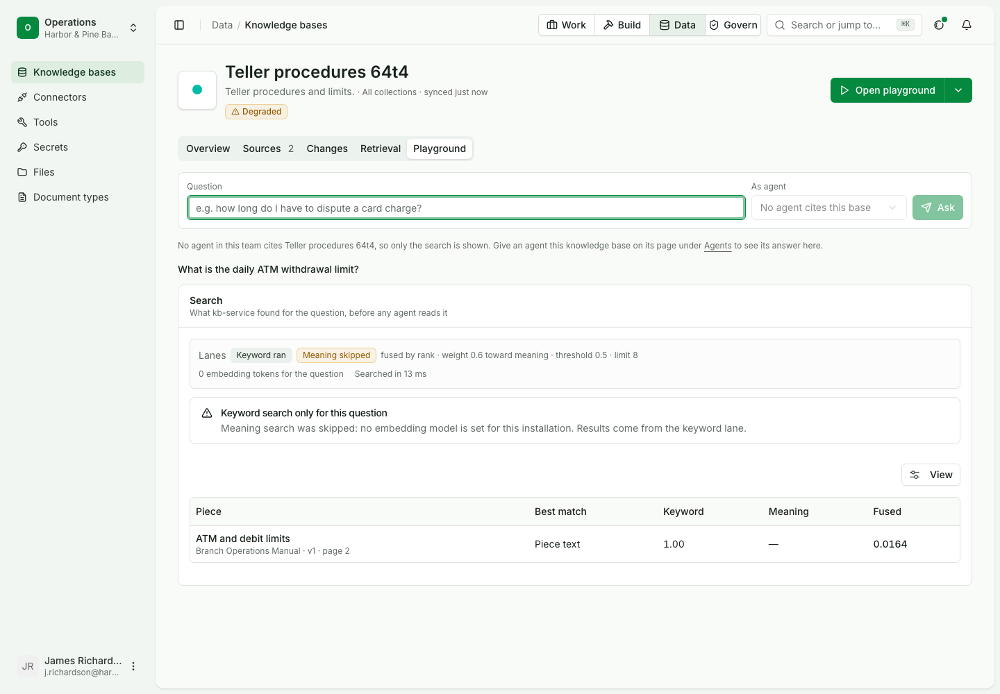

# Answer questions from your documents

Status: current. The steps below run end to end in the console, the CLI and both SDKs.

Branch staff ask the same questions every day: what is the ATM limit, who opens a night deposit bag, which form a
payoff needs. The answers are in manuals nobody can search quickly. This guide puts a manual into a knowledge base and
gets cited answers from it, in about ten minutes, with no engineer involved.

## Before you start

| You need | Why |
|---|---|
| The Builder role in your team | Builders make knowledge bases |
| A document with a text layer: Markdown, Word, a text PDF | A scanned PDF with no text cannot be read |

## In the console

<!-- site: steps -->
1. **Make the base.** Open **Knowledge**, press **New knowledge base**, give it a name such as Branch procedures, pick
   **Precise**, and press **Create**. You land on the base's page.
2. **Add the manual.** Press **Add source**, pick **Files**, upload the manual and press **Create and sync**. The
   **Documents** tab shows it as **Indexed**. A file with no text layer shows its reason, such as "no text layer".
3. **Write a page.** For a rule that lives in nobody's document, press **Add page** on the **Documents** tab and type
   it. It is indexed at once.
4. **Ask it.** On the **Playground** tab, ask "What is the daily ATM withdrawal limit?". The answer is a passage of the
   manual with its section, version and page.
5. **Give it to an agent.** On an agent's page, add the base under **Knowledge** and publish. In chat, the agent answers
   from it and cites the section each answer came from.



## From the CLI or SDK

```bash tab="CLI"
KB=$(opsai kb create "Branch procedures" --owner branch.ops@example.com --json | jq -r .id)
opsai kb add-file "$KB" ./branch-operations-manual.md
opsai kb add-text "$KB" --title "Night deposit" --text "A night deposit bag is opened by two tellers before 9 am."
opsai kb search "$KB" "What is the daily ATM withdrawal limit?"
opsai chat say --kb "$KB" -m "Who opens a night deposit bag?"
```

```python tab="Python"
from ops_ai import OpsAI

ops = OpsAI(profile="builder")
kb = ops.knowledge.add_base("Branch procedures", owner="branch.ops@example.com")
ops.knowledge.add_page(kb["id"], "Night deposit", "A night deposit bag is opened by two tellers before 9 am.")
found = ops.knowledge.search({"kbIds": [kb["id"]], "question": "Who opens a night deposit bag?"})
print(found["passages"][0]["text"])
```

```ts tab="TypeScript"
import { OpsAI } from '@chanl-ai/ops-ai';

const ops = new OpsAI({ profile: 'builder' });
const kb = await ops.knowledge.addBase('Branch procedures', { owner: 'branch.ops@example.com' });
await ops.knowledge.addPage(kb.id, 'Night deposit', 'A night deposit bag is opened by two tellers before 9 am.');
const found = await ops.knowledge.search({ kbIds: [kb.id], question: 'Who opens a night deposit bag?' });
console.log(found.passages[0].text);
```

Expected: the first passage quotes the page: "A night deposit bag is opened by two tellers before 9 am."

## Where documents can come from

| Source | Keeps itself current | Page |
|---|---|---|
| Files you upload | No; upload a new version | This guide |
| Pages you write | Saving the same title makes a new version | This guide |
| SharePoint and OneDrive | Yes, on a schedule; only changes are fetched | [SharePoint and OneDrive](../integrations/sharepoint.md) |
| Confluence | Yes, on a schedule | [Confluence](../integrations/confluence.md) |
| Salesforce Knowledge | Yes, daily | [Salesforce](../integrations/salesforce.md) |
| A website | Yes, from its sitemaps and links | [Website](../integrations/website.md) |

## How answers stay grounded

- An agent searches only the bases it was given. An agent not given a base cannot search it.
- Every answer carries its citation: the document, the section and the version it quotes.
- A question nothing answers gets the base's own no-answer message, which you set on its **Settings** tab.

## Limits

- A scanned PDF with no text layer is refused with its reason; run it through OCR first.
- Retiring a base an agent still cites asks you to type its name, and names the agent first.

## Next

<!-- site: cards -->
- [Connect an app and use it in an agent](connect-an-app.md): add Salesforce articles as a source.
- [Start the day from chat](chat-and-human-tasks.md): where staff ask the agent.
