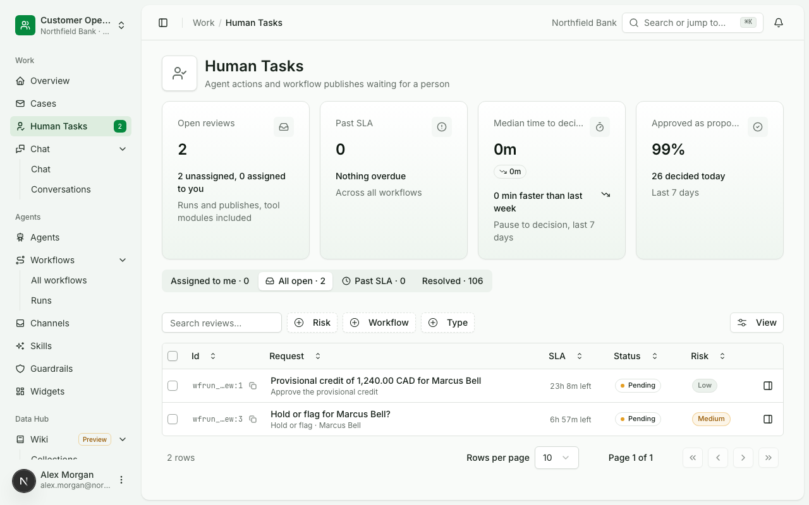

# Hold a write for approval

Status: current. Run end to end through the API, the SDK and the chat.

An agent may read an account's balance at once, but freezing the account or escalating a case should wait for a person
who can see exactly what will change. This guide makes an App's writes wait, shows what the person in the chat and a
reviewer each see, and how the write runs once, only after a yes.

## Steps

<!-- site: steps -->
1. **Turn asking on.** A team admin opens **Governance › Policies**, **Approvals**, and turns on **Ask before an agent
   changes anything in an app**.
2. **Pick who answers.** **Ask the person**: the person in the chat confirms, and only they can. **Ask a reviewer**:
   someone else with the role you choose approves, and nobody approves their own request.
3. **Narrow it if you need to.** Below the team switch, add an App and give it its own answer, such as Salesforce:
   ask a reviewer. On a single Tool's page, **Access and approval** sets that Tool's answer. The most specific one wins.
4. **Ask the agent to change something.** In chat: "Freeze account 4471." Reads still run at once.
5. **See the card.** With Ask the person, the chat shows **Allow** and **Deny**, naming the tool and each field it
   changes. With Ask a reviewer, the write becomes a Human Task in the reviewer's queue.
6. **Decide.** Allow, or a reviewer's Approve, runs the write exactly once. Deny runs nothing. **Allow for this chat**
   stops the asking for the rest of that chat.

Expected: nothing reaches the app while the card waits. After the yes, the app holds exactly one change, and the call
log shows the write with who approved it.



## Decide from code

A reviewer can decide from a script or another system. The approver's key must belong to someone with the approve
permission.

```python tab="Python"
from ops_ai import OpsAI

reviewer = OpsAI(api_key="ok_...", base_url="https://ops.example.com", team="team_customer_ops")
for task in reviewer.tasks.list(view="open"):
    print(task["id"], task.get("question"))
reviewer.tasks.decide("wfrun_...", "approved", reason="Freeze confirmed with the branch.")
```

```bash tab="CLI"
opsai tasks list --view open
opsai tasks approve wfrun_... --reason "Freeze confirmed with the branch."
```

## The settings

| Setting | What it does | Default |
|---|---|---|
| Ask before an agent changes anything in an app | Team-wide: writes wait for the answer below | Off: writes run at once |
| Who answers | Ask the person, or ask a reviewer of a chosen role | Ask the person |
| Per App | Use the team setting, don't ask, ask the person, or ask a reviewer | Use the team setting |
| Per Tool (**Access and approval**) | The same choices for one Tool | Follows the App, then the team |
| Requester may decide | The person who asked may also approve | Off |
| Test accounts never ask | A write on an App's sandbox account runs without asking | On |
| Test runs ask first | A test run from a Tool's page asks before writing to a live account | On |

Who may approve at all is the approve permission on a role, held by the built-in Admin and Reviewer roles.

## Rules that always hold

- A read never waits.
- Every write over MCP waits for a person, whatever the settings say, since nobody is in the chat to confirm.
- In a workflow there is no person in a chat, so Ask the person becomes Ask a reviewer.
- If the approval settings cannot be read, a write that needs approval is refused and never runs.

## Next

<!-- site: cards -->
- [Card disputes](card-disputes.md): a workflow whose credit waits for an approver.
- [Start the day from chat](chat-and-human-tasks.md): deciding Human Tasks from chat.
- [Security and governance](../security-and-governance.md): approvals as a control.
