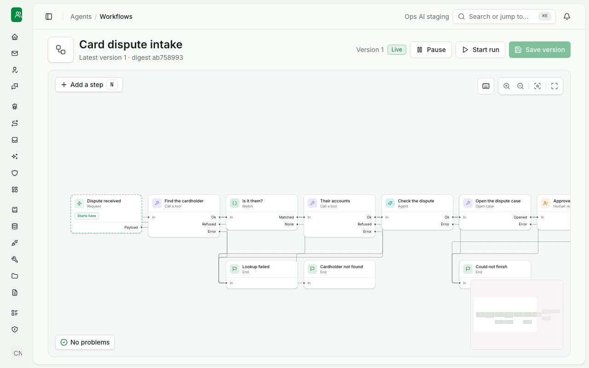
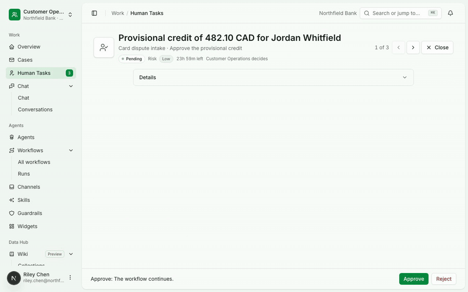

# Card disputes

Status: current. The workflow runs in the demo team, and the code below is the SDK calls its tests run end to end.

**Run a card dispute from intake to a provisional credit, with an agent that checks the handbook and a person who
approves the money.**

## A dispute is mostly lookup, and one decision that moves money

A card team works through hundreds of disputes a week, and most of the work repeats: find the cardholder, list their
accounts, read the handbook's rules for this kind of dispute. The judgement is small but it matters: is the dispute in
time, which rule applies, how much provisional credit is allowed. The credit moves money, so a person has to approve it,
and the bank has to show later who approved what and what they saw.

This guide runs one dispute with the Card dispute intake workflow in the demo team. Fixed steps do the lookups, an
agent reads the handbook, and a person approves the credit.

## The plan

<!-- site: steps -->
1. **The dispute comes in** through a form or the API: who the cardholder is, the merchant, the amount and what went
   wrong. The Card dispute intake workflow starts.
2. **Fixed steps find the cardholder** and their accounts in the core banking system, through the tool gateway. A
   cardholder the workflow cannot find ends the run as Cardholder not found, rather than a guess.
3. **An agent checks the dispute against the handbook** and answers in a fixed shape: the reason category, whether provisional
   credit is due, whether a team lead must approve it, and a short summary. The next step checks that shape before
   anything moves.
4. **The case opens** and holds the record of the run.
5. **A person approves the credit** in **Human Tasks**, seeing the dispute, the agent's assessment, the accounts and the
   case. Approving adds a note to the case, "Provisional credit approved by" the approver, and the run ends at Credited.



## Try it

Run one dispute in the console, then approve its credit. With the team's Two-person rule on, a teammate must
approve; working alone, run it as a team Admin, who may approve their own run.

| Step | Where | Expected |
|---|---|---|
| Start a dispute | **Workflows**, Card dispute intake, **Run**, with the cardholder Jordan Whitfield (last four 5555), merchant Northline Electronics, amount 482.10, posted 2026-10-11, card type debit and the reason "Ordered a monitor on 11 October; the parcel never arrived." | The run starts and moves through the lookup and the agent's check |
| Watch the run | The run's page | Each step with its input and output; it stops at the approval |
| Approve | **Human Tasks**, the provisional credit task | The dispute, the assessment and the accounts; **Approve** with a reason |
| Read the record | The case | The run ends at Credited; the case holds the credit and the decision |



## Run it from code

The same dispute from a script. Start a dispute, wait until it reaches the approval, and decide it. An API key under **Settings › Team › API keys** can start a run and
wait on it, but a key never decides a task: the approver signs in as themselves.

```python tab="Python"
from ops_ai import OpsAI

ops = OpsAI(api_key="ok_...", base_url="https://ops.example.com", team="team_customer_ops")
started = ops.runs.start(
    "card_dispute_intake",
    input={
        "cardholder": "Jordan Whitfield",
        "ssnLast4": "5555",
        "merchant": "Northline Electronics",
        "amount": "482.10",
        "postedOn": "2026-10-11",
        "cardType": "debit",
        "reason": "Ordered a monitor on 11 October; the parcel never arrived.",
    },
)
run = ops.runs.wait(started["runId"])  # returns at the approval, with the task's id
approver = OpsAI(profile="approver")  # the approver signs in as themselves; a key never decides
approver.tasks.decide(run["taskId"], "approved", reason="Inside the 90-day debit limit.")
print(ops.runs.wait(started["runId"])["outcome"])  # credited
```

```ts tab="TypeScript"
import { OpsAI } from '@chanl-ai/ops-ai';

const ops = new OpsAI({ apiKey: 'ok_...', baseUrl: 'https://ops.example.com', team: 'team_customer_ops' });
const started = await ops.runs.start('card_dispute_intake', {
  input: {
    cardholder: 'Jordan Whitfield', ssnLast4: '5555', merchant: 'Northline Electronics',
    amount: '482.10', postedOn: '2026-10-11', cardType: 'debit',
    reason: 'Ordered a monitor on 11 October; the parcel never arrived.',
  },
});
const run = await ops.runs.wait(started.runId);
const approver = new OpsAI({ profile: 'approver' });  // the approver signs in as themselves; a key never decides
await approver.tasks.decide(run.taskId!, 'approved', { reason: 'Inside the 90-day debit limit.' });
console.log((await ops.runs.wait(started.runId)).outcome);   // credited
```

Expected: the first wait returns at the approval with a task id; after the decision, the run's outcome is `credited`.

## How each run can end

Every run ends in one of five outcomes, shown on the run's page; four are on the path below.

<!-- site: decision source caption="How a card dispute run ends: lookup, cardholder, then the approver" -->
- **Can the lookup reach the core banking system?**
  - **No**: Lookup failed.
  - **Yes**: The cardholder search runs next.
    - **Does it find a cardholder matching the details?**
      - **No**: Cardholder not found. The run stops; nothing is guessed.
      - **Yes**: The agent checks the handbook, then a person decides the credit.
        - **Does the approver approve the provisional credit?**
          - **Approves**: Credited. The case holds the credit note and the decision.
          - **Declines**: Declined. No credit is sent.

A step that fails after the lookup ends the run as Could not finish; the run's page shows which step and why.

## What success looks like

The run stops at the approval with the dispute, the assessment and the accounts on the task. After the
approver decides, the run ends at Credited, and the case holds the credit, the decision and who made it. A dispute with
no matching cardholder ends as Cardholder not found, not as a credit to the wrong person.

## What skipping it costs

Without the approval step, a provisional credit rests on a lookup and a summary alone. The bank cannot later show
who approved it or what they saw.

## Limits

- While the team's **Two-person rule** is on (**Settings › Approvals**), the approver cannot be the person who started the run. An Admin of the team still decides their own request.
- The workflow, its agent and its tools are records your team owns. Change them in the console or through the same API;
  the demo team's copy is a starting point, not a bank's policy.

## Next

<!-- site: cards -->
- [Hold a write for approval](approve-a-write.md): the approval settings behind the credit step.
- [Agents and workflows in the console](../../console/agents-and-workflows.md): build your own workflow.
- [Start the day from chat](chat-and-human-tasks.md): where the approver finds the task.
