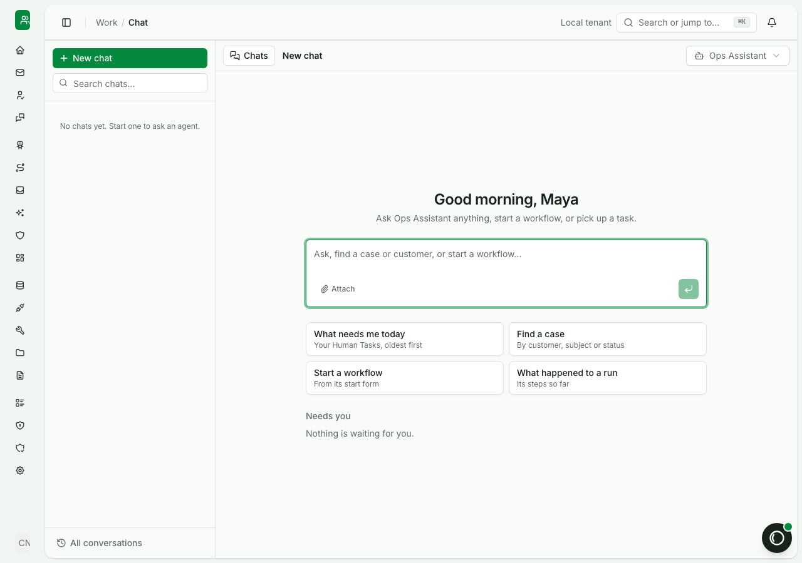
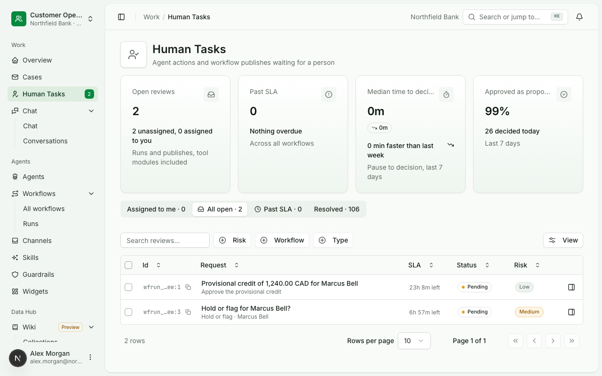

# Start the day from chat

Status: current. In the console today; the SDK calls below were run against a local stack.

After sign-in, a person lands on the chat home. They can ask an agent a question, find a case, start a workflow, or
pick up the Human Tasks waiting on them, from one place.

## The problem

An operations person's morning is spread across tools: a queue of approvals in one place, case notes in another, the
handbook in a third, and a colleague to ask what happened to yesterday's run. Each answer costs a search, and the
approvals that block a customer wait the longest.

## How Ops AI runs it

<!-- site: steps -->
1. **The chat home opens first.** Four starting points sit under the message box: what needs me today, find a case,
   start a workflow, and what happened to a run. Below them, Needs you lists what is waiting on this person.
2. **Ask in plain words.** "What needs me today" lists the person's Human Tasks, oldest first, as cards with Approve
   and Reject. The assistant reads only what the person may see, as that person.
3. **Decide in the chat or in Human Tasks.** A decision in the chat goes through the same review route as the Human
   Tasks page, with the same rules: a payment asks for a fresh sign-in, and a second approver where the policy says so.
4. **Ask an agent about the work.** A team's agents answer from the knowledge bases they are granted and cite the
   section each answer came from.





## Do it from code

List the Human Tasks waiting in a team and decide one. The API calls them reviews; the SDK calls them tasks.

```python tab="Python"
from ops_ai import OpsAI

ops = OpsAI(api_key="ok_...", base_url="https://ops.example.com", team="team_customer_ops")
for task in ops.tasks.list(view="open"):
    print(task["id"], task["status"], task.get("question"))
ops.tasks.decide("wfrun_...", "approved", reason="Checked against the handbook.")
```

```ts tab="TypeScript"
import { OpsAI } from '@chanl-ai/ops-ai';

const ops = new OpsAI({ apiKey: 'ok_...', baseUrl: 'https://ops.example.com', team: 'team_customer_ops' });
for await (const task of ops.tasks.list({ view: 'open' })) console.log(task.id, task.status, task.question);
await ops.tasks.decide('wfrun_...', 'approved', { reason: 'Checked against the handbook.' });
```

The chat itself runs in the console and in the chat embed; the API's chat routes are for the console and are not yet
part of the SDK.
