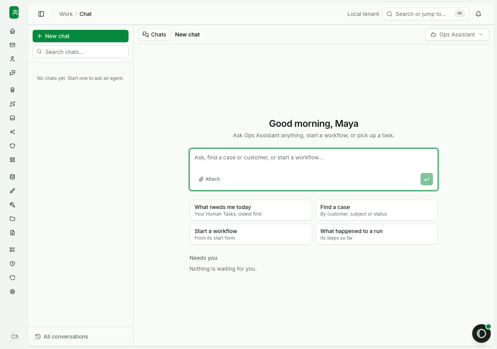

# Start the day from chat

Status: current. In the console today; the SDK calls below were run against a running install.

An operations person's morning is spread across tools: approvals in one queue, case notes in another, the handbook in
a third, and a colleague to ask what happened to yesterday's run. The approvals that block a customer wait the longest.
This guide starts the day from the chat home instead, where one question lists what needs you and each answer is one
click from done.

## Steps

<!-- site: steps -->
1. **Sign in.** The chat home opens first. Under the message box sit four starting points: **What needs me today**,
   **Find a case**, **Start a workflow** and **What happened to a run**. **Needs you** below them lists what is waiting
   on you.
2. **Ask what needs you.** Press **What needs me today** or type it. The assistant lists your Human Tasks, oldest first,
   as cards with **Approve** and **Reject**.
3. **Decide in the chat.** A decision here goes through the same review as the **Human Tasks** page, with the same
   rules: a payment asks you to sign in again, and a second approver is needed where the policy says so.
4. **Ask about the work.** "What does the handbook say about debit disputes after 60 days?" A team's agents answer
   from the knowledge bases they are given, and cite the section each answer came from.
5. **Follow up on a run.** Press **What happened to a run** and name it. The assistant reads the run and says where it
   is.



Expected: every task waiting on you is listed once, decided tasks leave the list, and **Human Tasks** shows the same
decisions.

## What the assistant can see

The assistant acts as you. It reads only what you may see in your team, and it can do only what you may do.

| You ask | It uses | Needs |
|---|---|---|
| What needs me today | Your Human Tasks | Nothing extra |
| Find a case | The team's cases | Permission to read cases |
| Start a workflow | The team's published workflows | Permission to run them |
| A question about policy | The knowledge bases the agent is given | The agent has the base |
| Something in an App, such as Salesforce | The App's tools, signed in as you or the team | The App is on, and you connected if it asks |

## Do it from code

List the Human Tasks waiting in a team and decide one. The API calls them reviews; the SDK and CLI call them tasks.

```python tab="Python"
from ops_ai import OpsAI

ops = OpsAI(api_key="ok_...", base_url="https://ops.example.com", team="team_customer_ops")
for task in ops.tasks.list(view="open"):
    print(task["id"], task["status"], task.get("question"))
ops.tasks.decide("wfrun_...", "approved", reason="Checked against the handbook.")
```

```ts tab="TypeScript"
import { OpsAI } from '@chanl-ai/ops-ai';

const ops = new OpsAI({ apiKey: 'ok_...', baseUrl: 'https://ops.example.com', team: 'team_customer_ops' });
for await (const task of ops.tasks.list({ view: 'open' })) console.log(task.id, task.status, task.question);
await ops.tasks.decide('wfrun_...', 'approved', { reason: 'Checked against the handbook.' });
```

```bash tab="CLI"
opsai chat say -m "What needs me today?"
opsai tasks list --view open
```

## Limits

- Chat runs in the console, in the chat embed and through `opsai chat`. Chat is not yet part of the Python and
  TypeScript SDKs.
- The assistant decides only tasks you may decide. A task that needs a second approver stays open until one approves.

## Next

<!-- site: cards -->
- [Hold a write for approval](approve-a-write.md): what makes a task wait for you.
- [Answer questions from your documents](answer-from-documents.md): give the agent a handbook to cite.
- [Chat](../ops-assistant.md): everything the chat can do.
