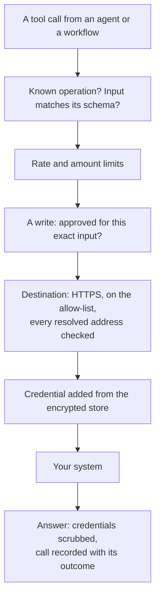

# Egress and connections

Status: current. Checked against the release's tool gateway, egress and connection code.

An agent that can call the bank's systems could also, in principle, be steered into calling somewhere else. Ops AI
keeps that from happening by sending every call to an outside system through one tool gateway, which holds the
credentials, checks the destination and records the call. Agents and workflows hold no credentials and open no
connections of their own.

## Try it

A Security admin allows one host, then a builder connects an app that uses it.

```bash
opsai egress allow-host api.core-banking.example.com
opsai egress list
```

The host is now reachable over HTTPS by the team's tools. By default a tool that names a host not on the list waits
until a Security admin allows it; under the "Only listed addresses" choice it is refused, and the refusal names the
host.

## How it works



*A refusal lists every condition that failed. The agent sees it as a tool error and can explain it to the person.*

- Only HTTPS is called. Every address a host resolves to is checked inside the connection, so a DNS answer cannot
  redirect a call. Redirects are not followed and cookies are not kept.
- Private address ranges are reached only when a Security admin lists them. Loopback, link-local and cloud metadata
  addresses are never reached.
- Your internal certificate authority is trusted for outbound calls when you provide its certificate.
- A connection signs in one of these ways: API key, basic or bearer, OAuth client credentials, OAuth authorization code
  with PKCE, either OAuth kind with a signed client assertion instead of a secret, a signed service-account JWT, or a
  client certificate (mutual TLS). Tokens are stored encrypted and refreshed one at a time.
- A person can connect an app with their own account; tools they run, and agents acting for them, then use that
  account.
- A code tool runs in a sandbox with a memory cap, a time limit, no network, no files and no secrets. It reaches other
  systems only by calling a tool back through the gateway.

## Options

| Setting | What it does | Default | Who changes it |
|---|---|---|---|
| New app addresses | What happens when an app or tool names an address not yet allowed: ask Security, builders allow it in their name, any public address, or only listed addresses | Ask Security: a new address waits until a Security admin allows it | A Security admin, in Governance › Policies |
| Allow-list | The hosts and private ranges tools may reach | Empty | A Security admin, in Settings › Security › Egress, or `opsai egress` |
| Only Security adds secrets | Builders may not add their team's own secrets | Off: builders add and use their team's secrets | A Security admin, in Governance › Policies |
| Credentials | Entered once in the console, sealed with AES-256-GCM, never returned by any API, scrubbed from answers and logs, every use audited, limited to the teams they are shared with | | A Security admin, in Settings › Security › Secrets |

## Limits

- A plugin's own declared hosts are reached for its own calls without being listed.
- The "Any public address" choice lets tools call any public host without a listing; private ranges stay closed unless
  listed.
- Writing a code tool in the console is planned.

## Next

<!-- site: cards -->
- **[Access, approvals and audit](access-approvals-and-audit.md)**: Which writes wait for a person before the gateway sends them.
- **[Model calls](model-calls.md)**: The other kind of call that leaves the install.
- **[Tools and apps](../guide/apps.md)**: Connecting an app and choosing its accounts.
