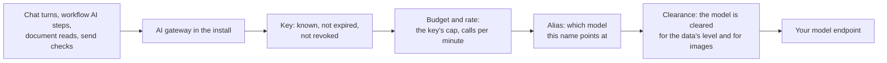

# Model calls

Status: current. Checked against the release's AI gateway and the shipped deployment layouts.

A risk team needs to know which model endpoint sees customer data, under whose key, and what stops a runaway agent
from spending without limit. In Ops AI every model call, from a chat turn, a workflow AI step or a document read,
passes through one AI gateway inside the install. This is true in every shipped layout: Docker Compose, Kubernetes and
hosted.

## Try it

An account admin connects the model endpoint the bank has approved.

<!-- site: steps -->
1. Open Settings › Workspace › Models › Connections and connect a provider: pick it from the list, then give its endpoint and key. The key is
   never shown again, and no team sees it.
2. Open an agent and press Test. The answer comes from that endpoint.
3. The call is recorded with the key, the model, tokens, cost, time taken and outcome. The record holds no prompt or
   answer text.

## How it works

*A call refused at any check is recorded like a call, with the reason.*

- Agents and workflows name an alias, such as `default`, in place of a provider's model id. Moving an alias to another model is a
  new version of the alias; no agent changes.
- Each caller has its own model key: per service purpose, per agent, per workflow or per person. Only a hash of a key
  is stored.
- The provider's key is held by the gateway alone. No other part of Ops AI, and no team, can read it. Outside
  development the gateway refuses provider keys from its environment, so the key lives only where an admin saved it.
- Any endpoint that speaks the OpenAI chat completions API can serve: a public provider, a private deployment, or the
  bank's own gateway.

## Options

| Control | What it does | Default | Who changes it |
|---|---|---|---|
| Provider connections and keys | Where the install's models are called and the key each signs in with | None until an admin adds one | An account admin, in Settings › Workspace › Models |
| Clearance per alias version | The highest data level the model may receive (public, internal, confidential, restricted) and whether it may receive images and files | Set per version | The operator, when binding an alias |
| Budget per key | A spending cap in money; the call that would pass it is refused | Per key | The operator |
| Budget per organisation on a shared key | An organisation's share of a key's budget | Per key | The operator |
| Rate per key | Calls per minute | Per key | The operator |
| Budget per conversation | Caps on model calls and cost per chat; a spent budget pauses the chat until a person continues or ends it | 200 calls and 5.00 in the price table's currency, when the agent sets none; never unlimited | A builder, on the agent |
| Model calls per turn | How many model calls one answer may make | 50 | A builder, on the agent |
| AI steps in workflows | Whether a team's workflows may call a model at all | Off | A Security admin, in Governance › Policies |

## Limits

- Every call is treated as internal data today, so an alias must be cleared for internal to serve. Marking each call
  with the level of the data it carries is planned.
- Model aliases, keys and connections belong to the installation and are shared by every organisation on it.
- Failover between providers, a budget per team, and serving Anthropic's own API are planned.
- The release includes a test model that answers from fixed rules and calls no provider. It is for trying the platform
  and for automated checks, not for production.

## Next

<!-- site: cards -->
- **[Data handling and masking](data-handling-and-masking.md)**: What people see masked while the model sees real values.
- **[Egress and connections](egress-and-connections.md)**: The other calls that leave the install.
- **[Models in depth](../guide/models.md)**: Aliases, keys and the test model.
