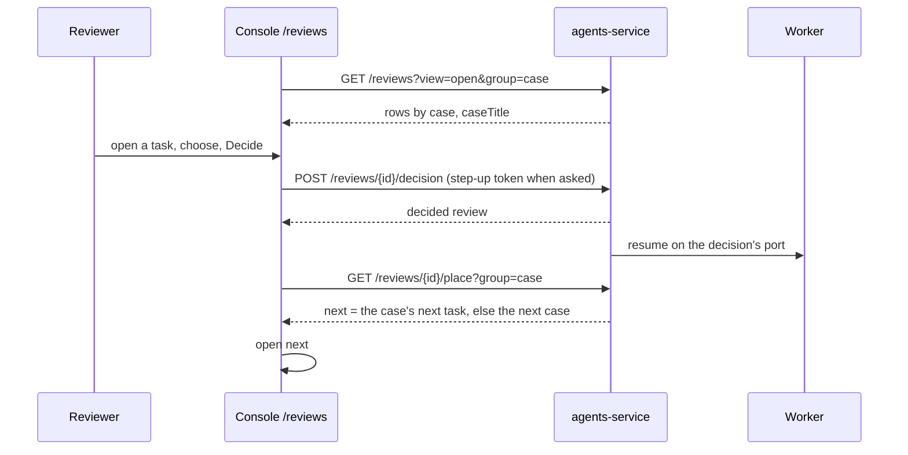

# Agents service design

Status: current for Human Tasks. Written when an earlier change first changed the service's Human Tasks routes; later cards
add their own rows. What the rest of the service does is in [overview.md](overview.md).

## Flow: a Human Task from pause to decision

| # | Step | Where | State |
|---|---|---|---|
| 1 | A workflow step pauses on a review (`ops.flow.humanReview`), or an agent's write waits; the run waits with its deadline (`slaHours`, else the workspace's) counted from `openedAt` | `ops_engine`, `api/engine_reviews.py` | built |
| 2 | Human Tasks lists the team's open reviews grouped by case: each case's tasks together, the case with the soonest deadline first, tasks in a case by deadline, a review on no case its own group, no deadline last; each row named by its case | `api/hitl_facade.py` `by_case`, `list_reviews` | built |
| 3 | The queue's next task after a decision comes from the same order, without building any review | `api/hitl_facade.py` `queue_place`, `engine_reviews.all_places` | built |
| 4 | A person decides through the decision route: their right in the review's team, not their own request, step-up when the call asks, an option's own call; a second decision is refused `already_decided` | `api/routers/reviews.py`, `api/hitl_facade.py` `decide` | built |
| 5 | The run resumes on the decision's port | `api/engine_reviews.py` `decide`, the worker | built |

## Screens

The console's Human Tasks page as approved: [docs/console/approved/human-tasks/](../../console/approved/human-tasks/README.md).
The queue (`components/reviews/task-queue.tsx`), the decision panel (`components/reviews/decision-panel.tsx`) and the
decide forms (`components/reviews/task-decision.tsx`) read the routes below.

## API

| Method and path | Does | Who may | File | State |
|---|---|---|---|---|
| GET `/reviews?view=&group=case&page=&pageSize=` | One page of a view (open, mine, overdue, resolved, all) with view counts, facets and stats; `group=case` orders it by case and adds `caseTitle` from the reader's teams | signed in, the team's reviews | `api/routers/reviews.py` | built; `group` an earlier change |
| GET `/reviews/{id}/place?view=&group=case` | Its position, the total and the reviews either side, in the order the list uses | signed in | `api/routers/reviews.py` | built; `group` an earlier change |
| GET `/reviews/{id}` | One review with `canDecide` | signed in | `api/routers/reviews.py` | built |
| POST `/reviews/{id}/decision` | Decide: a decision or an option, reason, inputs, step-up token; 409 `already_decided` | reviews.decide in the review's team | `api/routers/reviews.py` | built |
| POST `/reviews/assign` | Assign reviews to a person | reviews.decide | `api/routers/reviews.py` | built |

## Data

| Store | Holds | Read by |
|---|---|---|
| Runs (`ops_engine.store.RunStore`) | Each run's waiting step and payload (`openedAt`, `slaHours`, options) and its decisions | `engine_reviews.all_rows`, `all_places` |
| Case events (`store/cases.py`) | Which case each run is on (`kind = run`) | `Cases.cases_of_runs` |
| Cases (`store/cases.py`) | Each case's subject, by team | `Cases.summaries(case_ids, teams)` for `caseTitle` |
| Review assignments (`store/review_assignments.py`) | Who each review is assigned to | `all_reviews` |

## Sequence: decide and move on

