# Documents service design

Status: current. What documents-service reads from a file, its screens, API, data, sequences and the workflows that use it.

The documents service turns a PDF that arrives by email, API, chat or upload into checked fields, each tied to the place on the page it came from. A person corrects what is wrong, and those corrections make the next read of the same kind of document better. It is one subsystem among several: it reads input bytes through the files client, answers what a document says, and does nothing else. Opening a review, storing the result on the file, purging on delete and every other "what next" is a workflow's job. Status: current, 2026-10-19. Built in documents-service on :8760 through `documents_0008`: extraction, document types with templates, checks and key fields, layouts, classification, corrections with their event, purge, and page images. Examples from corrections are built; accuracy and the page image route for the viewer are planned. Services and who calls whom: [service map](../../architecture/service-map.md).

## Flow

![Steps from Layout to Validate are the documents service; it returns fields with a flag on those below the floor and stops. Everything in the right-hand column is a workflow: it stores the fields on the file, sends flagged fields to a person and acts on the result. The bottom row is the learning loop: corrections are kept beside the original read, become examples for the next read, and after five confirmed files with one layout the service offers a template, which a builder confirms as a new version of the document type.](images/design-flow.svg)

## Neighbours

Subsystems compose through workflows, not through each other. The documents service is called by a workflow step, an agent tool or the console; it never calls another service to make something happen. Its only outbound calls are reads of its input and model calls.

| Who | Does what with documents | Through |
|---|---|---|
| Workflow step `ops.documents.extract` | Reads a file; the step's output carries the fields and the flagged ones | run API → documents API, `documents:run` |
| Workflow step `ops.files.set_data` | Writes the extracted fields onto the file's metadata, so files lists them with no join | files API |
| Workflow step `humanReview` | Sends flagged fields to a person; corrections go back to the extraction | Human Tasks, then documents API |
| System workflow on "file deleted" | Purges layout, extractions and samples derived from the file | trigger (`ops_triggers`, planned) → documents API |
| Agent tool `extract_document` | Same call as the step, inside a chat | tools gateway → documents API |
| Console | File page Extract starts a run of the system extract workflow; Document types pages call the documents API directly | run API; documents API |
| documents → files | Reads input bytes only; a file the caller's team cannot see is 404 | `ops_files_client`, `files:view` |
| documents → models | Classify and extract on the model path, charged to the caller's team | models client |

## Screens (low fidelity)

These wireframes fix what each screen shows and which existing component builds it (purple tags are files under `apps/console/src/components`). They are not visual designs: the built page, composed from those components and recorded under `docs/console/approved/`, becomes the spec once it is approved. `DocumentViewer` is the one new shared component; the read check reuses it.

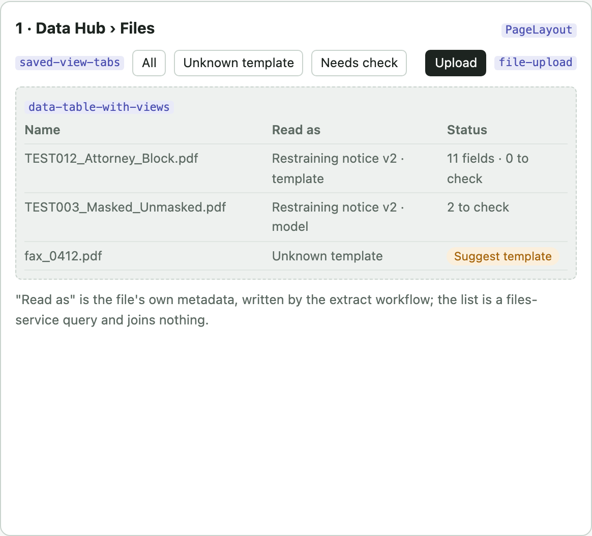

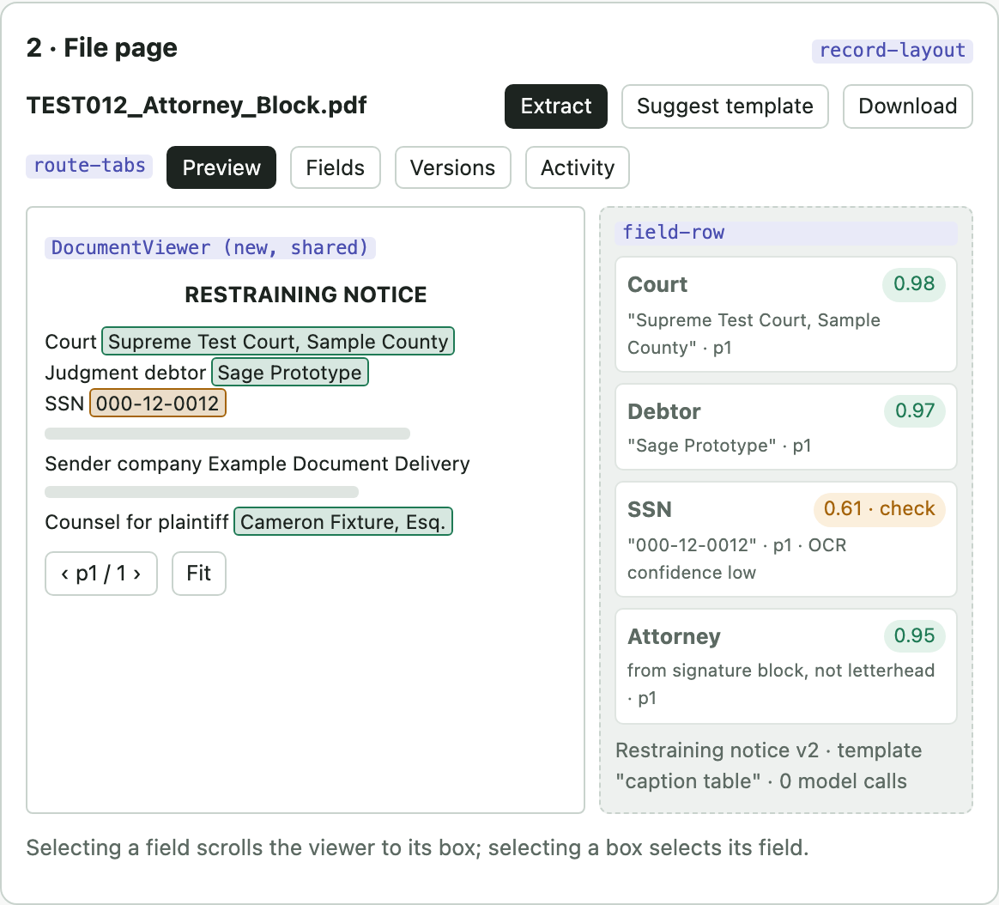

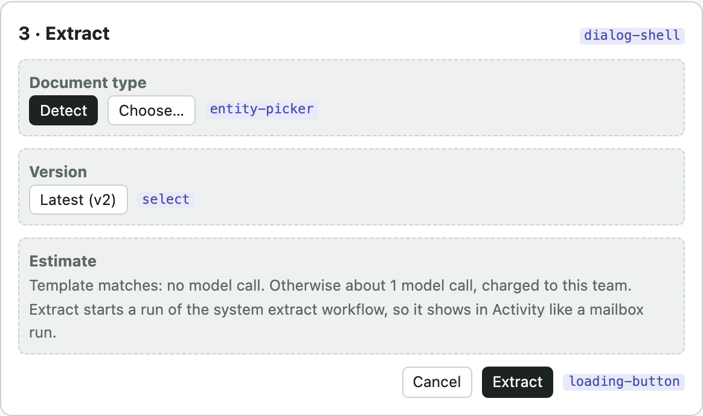

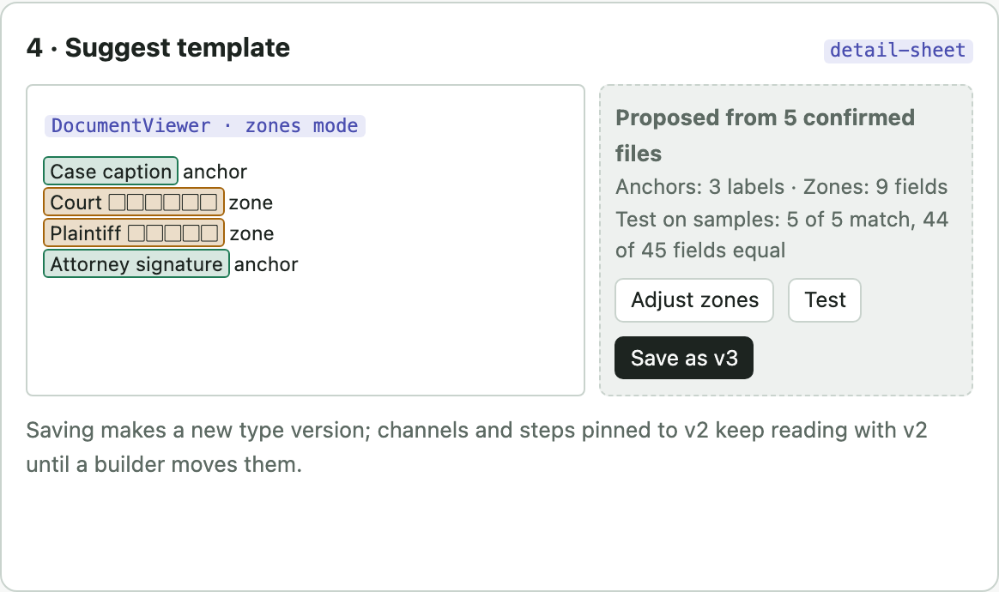

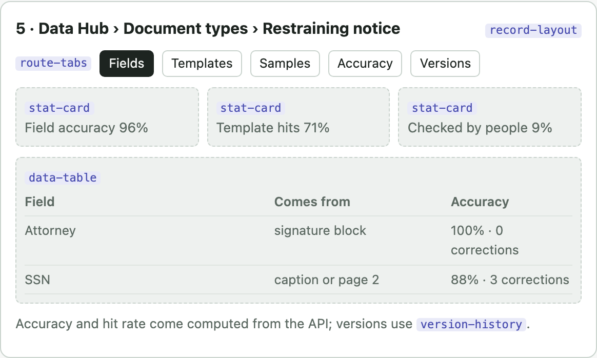

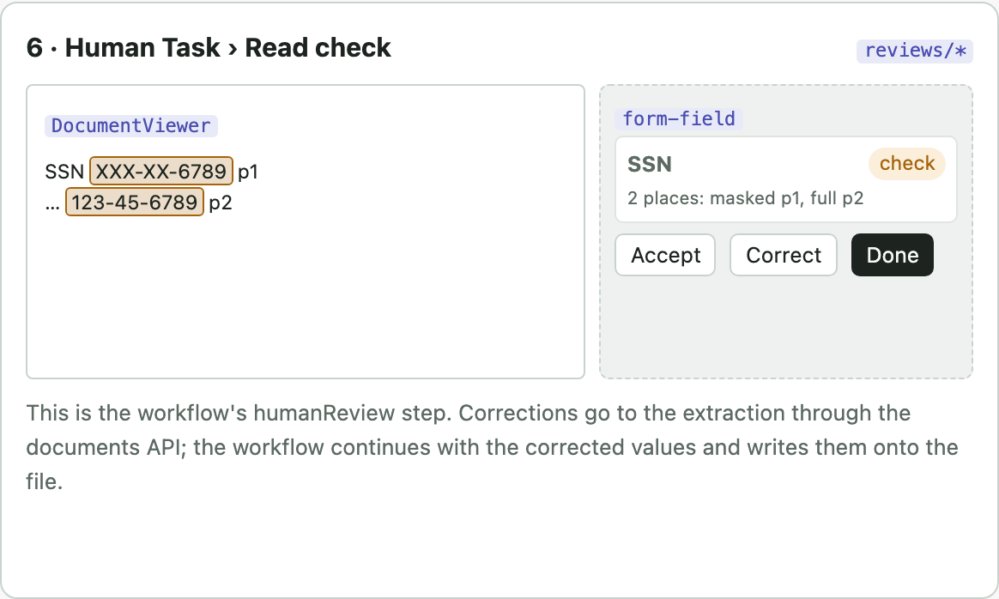

## API

Every route answers in the platform envelope, checks the caller's team, and returns 404 for a file or extraction the caller cannot see. Built routes are in documents-service on :8760 since an earlier change.

| Method and path | Does | Who may | Today | Card |
|---|---|---|---|---|
| `POST /v1/documents/extractions` | Read a file: `{fileId, fields \| documentTypeId, version?, many?, ocr?, reviewBelow?}`. 200 with the answer for a small file, 202 to poll for a larger one; an Idempotency-Key repeat returns the first. Fields below the floor are listed in `needsReview`; opens nothing | `documents.run` | built | an earlier change, an earlier change |
| `GET /v1/documents/extractions/{id}` | Status, fields with value, confidence, quote and page; each found quote carries `boxes` ({page, x, y, w, h}, page fractions, one per line, narrowed to the value) and `blocks`; path and template id follow with templates | `documents.view` | built; boxes an earlier change | an earlier change, an earlier change |
| `PATCH /v1/documents/extractions/{id}/fields/{key}` | Correct one field; the original value and confidence are kept and the field leaves `needsReview`. On the file's newest read it writes `extraction.corrected` to the outbox, due 5 s later; a further correction in that time replaces it (the replaced row is never sent), so a person fixing several fields starts one save of the final read | `documents.edit` | built | an earlier change, an earlier change, an earlier change |
| `POST /v1/documents/layout` | `{fileId}`: the file's layout, computed on the first ask and cached by tenant, file digest and layout engine version: pages, blocks and table cells with ids, boxes as page fractions and reading order, words with confidence | `documents.run` | built | an earlier change |
| `GET /v1/documents/layout/{fileId}?page=N` | The cached layout, or one page of it | `documents.view` | built | an earlier change |
| `GET /v1/documents/layout/{fileId}/pages/{n}.png` | Page image for the viewer | `documents.view` | planned | an earlier change |
| `POST /v1/documents/classifications` | `{fileId, ocr?}`: which of the team's document types the file is, from the model over each type's name and description: `{typeId, name, confidence, reason, needsReview, floor}`, `typeId` null when none fits. An extraction with `detect` classifies first and reads with the kind found; an unknown or unsure kind is answered with no fields and `needsReview: ["documentType"]`. Per-page grouping and templates are planned | `documents.run` | built | an earlier change |
| `PUT /v1/files/{id}/data` (files-service) | What was read from the file: type id and name, version, template or model, fields to check, extraction; files lists, filters (`readAs`, `readPath`) and counts on it (files 0007) | `files:edit` (workflow run identity); people with `files.create` until the setData step writes it | built | an earlier change |
| `POST /v1/files/{id}/read-requests`, `GET …/read-requests/{key}` (files-service) | A person asks for the file to be read with a document type; files-service reports `file.read_requested` and the system extract workflow runs as that person; the request names its run once delivered | `files.create` | built | an earlier change |
| `GET /v1/documents/extractions?fileId=` | A file's extractions by the caller's team, newest first, paged; the file page's Fields tab | `documents.view` | built | an earlier change |
| `GET · POST /v1/document-types`, `GET /v1/document-types/{id}` | List with server flags `canCreate`, `canEdit`; create; read | builder writes, viewer reads | built | an earlier change, an earlier change |
| `POST /v1/document-types/{id}/versions`, `GET …/versions/{v}` | New immutable version: fields (type, rules, `keyField`), review floor, date order, templates, checks across fields (sum, before), and `pageImages`. Templates, checks and `pageImages` left out carry forward from the latest version. Turning `pageImages` on needs `documents.manage` | builder | built | an earlier change |
| `POST · DELETE /v1/document-types/{id}/samples` | Samples with expected values | builder | built | an earlier change, an earlier change |
| `GET …/versions/{v}/test-estimate`, `POST …/versions/{v}/test-runs`, `GET …/test-runs/{id}` | Priced test of a version on its samples (at most 20), field by field; the estimate uses measured token use from an earlier change | builder | built | an earlier change, an earlier change |
| `POST /v1/document-types/{id}/versions` with `templates` | A version's layout templates are part of its body, as its fields are: anchors and zones per template page, checked at save (zones name the version's fields, boxes inside the page). Extraction tries them before the model and answers `path`, `templateId` or `templateMiss` | builder | built | an earlier change |
| `POST /v1/document-types/{id}/templates/suggest`, `GET /v1/document-types/{id}/template-offers` | A draft template from the team's finished reads (zones from field boxes, anchors from the nearest stable labels) and how it reads each of them; offers list groups of 5 or more checked model reads sharing a layout fingerprint that no current template reads, grouped on the fingerprint each model read stores when it finishes (one layout read per offered group). The count is the version's `offerAt`: 5 unless set, at least 2, carried forward (`documents_0009`). Nothing is saved until a builder posts the draft as a new version | builder; offers viewer | built | an earlier change |
| `GET /v1/document-types/{id}/accuracy` | Per-field accuracy split by template and model path; template hit rate as a cost number | viewer | planned | an earlier change |
| `POST /v1/documents/purge` | Remove the extractions and samples the token's team derived from a deleted file; 409 while files-service still serves the file; idempotent. Called by the workflow on `file.deleted` | `documents:delete`, services only (workflow run identity) | built | an earlier change, an earlier change |

## Data

Every table carries `tenant_id` under row-level security, and team-owned rows carry `team`. The extraction and document type tables are built in `documents_0001`, layouts in `documents_0002`, the date order in `documents_0003`, the event outbox in `documents_0004`, templates in the version body in `documents_0005`, checks in `documents_0006`, page images in `documents_0007` each read's layout fingerprint in `documents_0008` and the version's template offer count in `documents_0009`. Examples are planned. The file itself stays in files-service and is referenced by id and digest only.

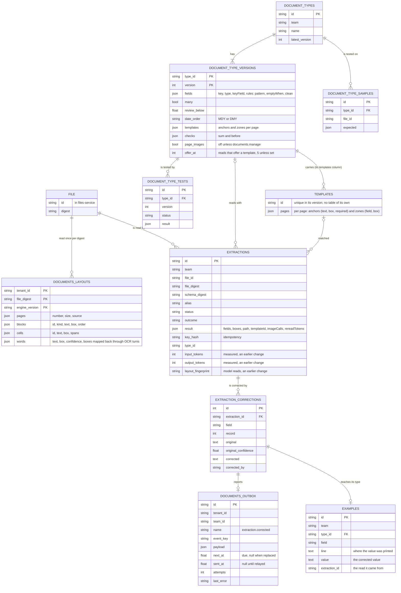

| Table | State | Guarantee |
|---|---|---|
| extractions, extraction_corrections | built documents 0001 | Unique (tenant, key_hash): a repeated request returns the first extraction. A correction never overwrites the original value |
| document_types, versions, samples, tests | built documents 0001 | A version is immutable once created; a template change is a new version |
| documents_layouts | built documents 0002 | One row per tenant, file digest and layout engine version: the same bytes are read once per tenant, and a parser change reads them again |
| templates, checks, page_images (version columns) | built documents 0005 to 0007 | Part of an immutable version, carried forward when a new version leaves them out; a carried template that reads a dropped field is flagged needsRebuild and never matched, and only carry-forward may set that flag |
| documents_outbox | built documents 0004 | Written in the correction's transaction; delivered at least once; delivered and replaced rows are pruned after 7 days |
| extractions.layout_fingerprint | built documents 0008 | Stored when a model read finishes, so template offers never read files again; no table of suggestions is kept, offers are grouped on request |
| document_type_examples | built documents 0010 | One per read and field, from a person's correction whose cited line shows the corrected value; a type's model reads are given the 3 newest per field, 12 at most; a field keeps its newest 10; a purge of a deleted file removes its reads' examples; listed with line and value masked as the team masks personal data, removable |

## Sequences

In every sequence the workflow is the only participant that decides what happens next. Services answer and store; they do not call each other to act.

### Extract from the file page

```mermaid
sequenceDiagram
  actor P as Person
  participant C as Console
  participant W as Workflow run (system extract)
  participant D as documents-service
  participant F as files-service
  participant M as models-service
  P->>C: Extract (Detect)
  C->>W: POST /v1/runs (fileId)
  W->>D: extract step: POST /v1/documents/extractions
  D->>F: read bytes (files:view)
  D->>D: layout (scans turned upright and straightened before OCR), match templates
  alt template matches
    D->>D: read zones, no model call
  else unknown template
    D->>M: extract with layout text (and an OCR'd page's image when pageImages allows)
    M-->>D: values + quotes and pages
  end
  D->>D: checks; one re-read of failed fields (with crops when allowed)
  D->>D: find each quote's words in the layout as boxes
  D-->>W: fields, boxes, needsCheck
  W->>F: set_data step: PUT /v1/files/{id}/data
  W-->>C: run done
  C->>D: GET extraction + layout
  C-->>P: Preview with highlights
```

### Mailbox workflow with a read check

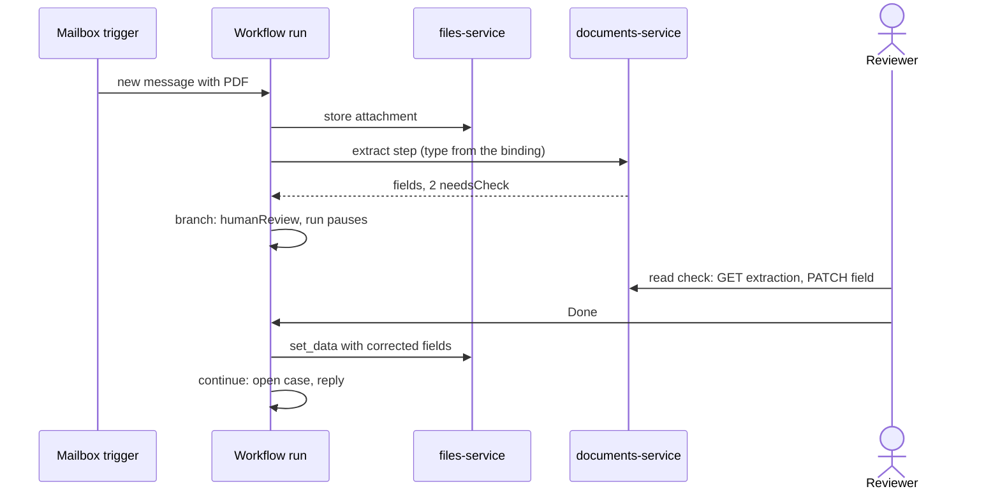

### Template suggested and confirmed

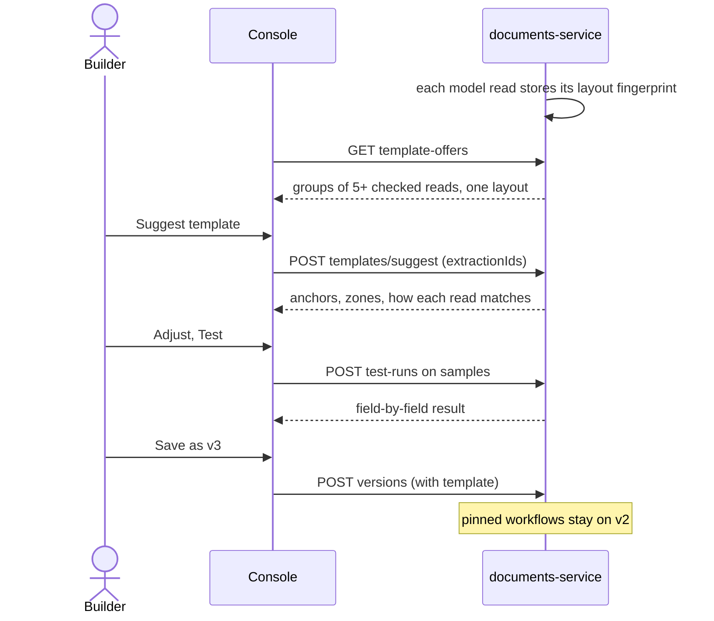

### File deleted, derived data purged

```mermaid
sequenceDiagram
  participant F as files-service
  participant T as Trigger: file deleted
  participant W as System workflow run
  participant D as documents-service
  F->>F: retention ends or hold released, file deleted
  F-->>T: event (files emits, calls nobody)
  T->>W: start run (fileId, digest)
  W->>D: POST /v1/documents/purge
  D->>F: is the file still served? (404 expected; else 409)
  D->>D: delete the team's extractions, corrections, samples
  D-->>W: counts removed
  Note over W,D: the run retries by key; purge is idempotent
```

## Workflows that use it

The documents service only reads. What happens to what it reads is a workflow, built from the node types the engine already has, plus four proposed ones (dashed below). Every step that touches a service calls that service's API; the logic steps run inside the engine and need no API.

### The simplest: a file is read and its data saved

This is the system extract workflow that the file page's Extract button starts, and the smallest demo of the service: a file goes in, its fields come out with their places on the page, a person checks the doubtful ones, and the result is stored on the file.

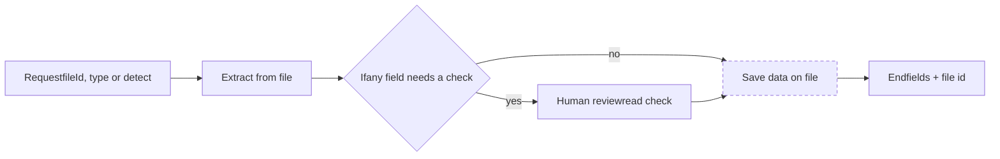

### The full one: an email that may or may not carry the document

The court order mailbox today runs an intake workflow (email, extract, one sub-workflow per debtor) and a court order case workflow (find accounts, match, open a case, place a hold). The version below adds the cases still to cover: no attachment, several attachments, details split between the email text and the attachment, and sending the result to an outside system.

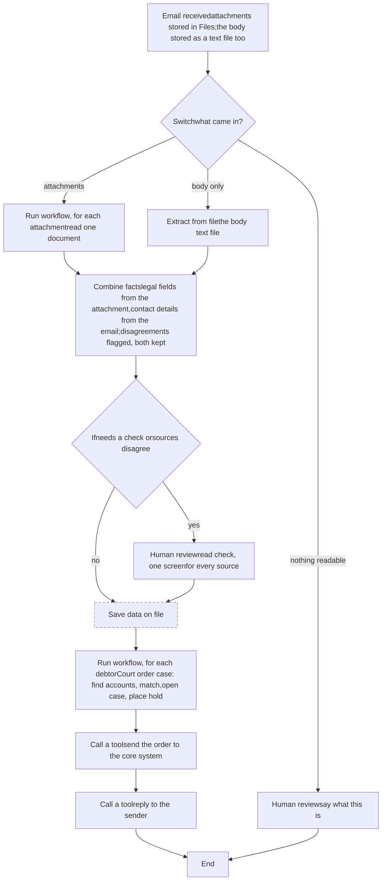

The email trigger stores the body as a text file. It keeps one reading path: the body is read like any attachment, so its fields carry positions and corrections the same way.

### Nodes

| Node | What it does | Behind it | State |
|---|---|---|---|
| Email received | Starts a run per message; attachments stored in Files first; filters on sender, subject, has an attachment | mailbox channel, files API | built; body as a text file built |
| Request | Starts a run from an API call, a button or a service event | run API | built |
| Extract from file | Reads one file with a document type (pinned version) or detects it | documents API | built |
| Set fields | Maps and renames values from earlier steps; no model | engine only | built |
| If | Two ways out (true, false) by rules: equals, greater, contains, exists, empty | engine only | built |
| Switch | Several named ways out, one rule set each, first match wins, an "otherwise" way. The function node: it decides what happens next without a model | engine only | built |
| Combine facts | Merges the same fields from several sources by a precedence per field; keeps each value's source; lists disagreements instead of picking silently | engine only | built |
| Match | Finds candidates that match a record by field rules | engine only | built |
| Run workflow | Runs another workflow, once or once per item of a list ("for each"), and collects the results | run API | built |
| Agent | Asks an agent; with an output schema its answer can feed If or Switch, which is how a model makes a judgement call in a workflow | agents API | built |
| Human review | Pauses for a person; each option is a way out; deadline and timeout way | Human Tasks | built |
| Save data on file | Writes the read fields onto the file, so Files lists and filters by them | files API `PUT /v1/files/{id}/data` | planned (proposed) |
| Open case, Add to case | Opens or adds to a long-lived case | cases API | built |
| Call a tool | Calls a tool operation through the tools gateway | tools API | built |
| End | Finishes with an outcome and output | engine only | built |

Deciding what is next

### Switch now, expressions later

The first function node is Switch: the same rules as If, with as many named ways out as needed and the first match winning. It runs no model and no code, so a reviewer can read every rule. A small expression language for rules that compare or count is a later step. A judgement call ("is this a new order or the release of an earlier one?") is an Agent step with an output schema, followed by Switch on its answer.

Sending data out

### No new node: Call a tool

Sending extracted data to an outside system is a tool operation: import the system's OpenAPI or build the HTTP call in Tools, then add a Call a tool step. The call then goes through the gateway's allow-list, its stored secret, the team's approval rule for writes and the call log. A raw HTTP step would skip all four, so the engine has none.

Several attachments

### For each is already there

Run workflow takes a list and starts one child run per item (up to its limit), so "for each attachment, read it" is a small read-one-document workflow called per attachment. Each child shows in Activity on its own.

## Samples

The samples are synthetic restraining notices as PDFs, each built to test one hard case. Text PDFs are the main fixtures; one or two are also kept as scanned copies. Each case becomes a design rule and one check in the proof use case. Pages made up beyond what the originals show are marked as invented.

| Sample | Tests | Design rule |
|---|---|---|
| TEST003, masked and unmasked | SSN masked on page 1, in full on page 2, for the same defendant | A field may draw on several pages; the extraction cites both places and prefers the full value |
| TEST012, attorney from signature block | Letterhead sender and attorney signature both carry a name and address | A field names where it may come from on the type version; a value cited from the wrong block fails validation |
| Layout variants (invented) | Same fields under other headings and arrangements, plus amount, date served and response deadline | Templates match per layout; an unknown layout takes the model path and becomes a template suggestion |
| Scanned copies | Skew, noise, low resolution | OCR word confidence sets the field's confidence; low confidence goes to the read check |

Positions

### The model never gives coordinates

It answers with values, each with its quote and page; the service finds the quote's words in the layout and returns their boxes, narrowed to the value, so a box is only ever drawn around text that is on the page. Text PDFs give exact positions, scans give OCR word boxes.

Confidence

### From checks, not from the model

Type checks, where-it-may-come-from rules, cross-field rules and OCR confidence set confidence. A field below the type's floor is flagged in the answer; the workflow decides whether a person checks it.

Learning

### Corrections first, templates second

- Confirmed corrections become retrieved examples.
- Repeated corrections on a field propose a better field description.
- After 5 confirmed files with one layout, a template is offered; a builder confirms it as a new version.

Decisions, 2026-10-18

### Settled and open

- Independent service; never stores bytes; never calls another service to act. Workflows compose it.
- Extracted PII is purged when the file is deleted.
- Template offer at 5 files, changeable per type.
- A sender address does not map to a type.
- A template change is a new type version.
- Open: source type and page labels disagree. Recommended: run as the source's type and show a person both.
