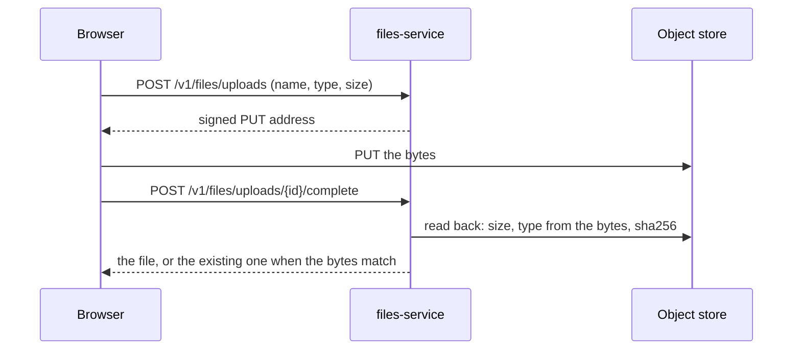

# Files service

Status: current, checked against the code on 2026-11-24. Built: uploads, downloads, dedupe, the scan hook, legal holds, retention for knowledge snapshots and per-tenant storage settings on the local, S3 and Azure Blob backends. Partial: S3 and Azure against real accounts. Not built: multipart uploads and a scanning engine.

The files service holds every file byte in the platform. Other services store and pass a file's id, never its bytes or
where it is kept. A browser sends bytes straight to object storage on a short-lived signed address, and this service
records the file, proves its type from its bytes, refuses a download until a scan clears it, and keeps it for as long as
its retention class or a legal hold requires.

## At a glance

| Item | Detail |
|---|---|
| Owns | File metadata, the blobs behind them, references from other records, legal holds, read requests, the tenant's storage settings and their credentials, and the objects in the configured bucket or container |
| Port | 8750 (`OPS_FILES_PORT`) |
| Code | `services/files-service` (`ops_files`), with the storage adapters in `packages/ops_storage` and the client other services use in `packages/ops_files_client` |
| Database | Own migration chain (`alembic_version_files`, `services/files-service/migrations`). Tables: `files`, `file_blobs`, `file_versions`, `file_references`, `file_legal_holds`, `file_idempotency`, `file_read_requests`, `storage_settings`, `storage_settings_audit`, `storage_credentials`, `file_watches`, `file_watch_events`, `files_outbox` |
| Isolation | Every transaction runs as `ops_files_tenant` (`services/files-service/src/ops_files/store/files.py:175`); a file of another team is reported as missing. Tests: `services/files-service/tests/test_isolation.py`; use case uc-094 |
| Secrets it holds | Storage credentials, sealed with AES-256-GCM under `OPS_SECRETS_KEY` and never returned (`services/files-service/src/ops_files/secrets.py`); a per-process key that signs local download addresses |
| Calls out to | The object store a tenant's storage settings name (local disk, Amazon S3 or S3-compatible with Object Lock, Azure Blob Storage with version-level immutability); agents-service for its events; tools-service (`tools:view`, `tools:run`) for a watched folder's check, with the team's sign-in; platform-service's internal port (`audit:create`) for the audit entries of changes to watched folders. A malware scanner reports back on the scan hook |
| Called by | The console (uploads, the Files pages, watched folders, storage settings); agents-service (chat and mailbox attachments; a watch's events for the Files changed trigger, `files:view`); kb-service (source files and snapshots); documents-service (bytes to read) |
| Events it sends | `file.deleted`, `file.read_requested` and `watch.checked` (once per finished check, keyed by the check) to agents-service, and `audit.recorded` to platform-service's audit log, through `files_outbox` and the `files_relay` process, at least once; delivered rows are pruned after 7 days (`services/files-service/src/ops_files/__main__.py:106-114`) |
| Events it receives | None. A scanner's verdict arrives on `POST /v1/files/scan-results`, naming the version it scanned (`version` or `digest`); a file of several versions without one is 400, and so is a `version` and `digest` that are not one version's, and a verdict on an older version leaves the newest as it was |
| When something is down | A file waits as pending until the scan hook reports, and a download is refused (423) until it is clean. A storage settings save that cannot write, read and delete a probe object is refused naming the purpose, so a wrong target never takes uploads (`services/files-service/src/ops_files/settings.py`) |
| Routes | API reference tab, HTTP API › Files, built from `services/files-service/openapi.json` |
| Console contract | `apps/console/src/lib/types/files.ts`; `ops_files.models` mirrors it in snake_case and accepts the camelCase JSON |

What is read from a file (readings, extractions, document types) belongs to documents-service, which reads bytes
through this service's client as the caller's team. Trust rules for every service are in
[identity and tenancy](../../architecture/identity-and-tenancy.md).



## Run and test it alone

| Task | Command |
|---|---|
| Serve on :8750 in the foreground | `make -C services/files-service run`; on the stack, `make restart SVC=files` |
| Apply its migrations | `make -C services/files-service migrate` |
| Tests on the test database | `make -C services/files-service test` (`T=` names files) |
| Lint, strict types, tests and the OpenAPI gate | `make -C services/files-service verify` |
| Regenerate `openapi.json` | `make -C services/files-service openapi` |
| Upload, complete, scan hook, download, hold and delete end to end | `make usecase-test UC=uc-093`; another team's file is 404 everywhere, `UC=uc-094` |

The S3 and Azure cases run against LocalStack and Azurite when those containers are up, and skip with a reason when
they are not:

```bash
docker run -d --name ops-files-localstack -p 4566:4566 -e SERVICES=s3 -e S3_SKIP_SIGNATURE_VALIDATION=0 localstack/localstack:3.8
docker run -d --name ops-files-azurite -p 10000:10000 mcr.microsoft.com/azure-storage/azurite azurite-blob --blobHost 0.0.0.0 --skipApiVersionCheck --loose
```

The failure modes the tests guard, and which backend runs each, are on the [files tests](tests.md) page.

## What each route enforces

The typed contract is in the API reference tab; this table adds the rule each route holds.

| Route | What it does |
|---|---|
| `POST /v1/files/uploads` | Ticket: a signed PUT (S3, Azure) or, on the local backend and in proxy mode, this service's content route. `Idempotency-Key`: a retry gets the same file id; the key with another request is 409 |
| `PUT /v1/files/uploads/{id}/content` | Proxy upload: the body streamed into storage, refused past the declared size or with another type (409) |
| `POST /v1/files/uploads/{id}/complete` | Size, the type proven from the first 8 KB (puremagic) and checked against the purpose's allowed types, sha256 from the stored bytes, dedupe through `file_blobs`; 409 on a size or digest mismatch and 415 on a refused type, the object deleted either way. The file is recorded as the proven type. Repeated or concurrent completes of one ticket return the same file |
| `GET /v1/files`, `GET /v1/files/{id}` | The team's available files (`uploadedBy=me`, `purpose`, `refType`, `refId`), and one file's detail; the storage location only for admins of the file's team (files 8.1). A watched folder's file carries `source`: its watch's id and name (null once the watch is deleted), its path at the source, when the source changed the version held, when the source stopped listing it, and its access list as read (null when the source never said, `[]` when it lists nobody) with the time it was read; an upload's is null. A list naming no purpose and no record leaves out email texts (`LISTED_WHEN_ASKED`); the purpose facet still counts them |
| `POST /v1/files/{id}/download-url`, `GET /v1/files/{id}/content` | A short-lived link (signed GET, or the proxy route); 423 until scanned clean |
| `DELETE /v1/files/{id}` | 409 while referenced, held, retained, or locked in storage |
| `POST /v1/files/legal-hold` | `{ids, hold, reason}`; an admin of the team only (403), sets the storage-level hold too |
| `POST /v1/files`, `GET /v1/files/{id}[/content]` | Server write (with `Idempotency-Key`) and reads for services, with a service token and `team` |
| `POST`, `DELETE /v1/files/{id}/references...` | Attach (409 unless clean) and detach |
| `POST /v1/files/scan-results` | The scan hook: a scanner's verdict for a file of its token's tenant |
| `GET /v1/files/{id}/content?version=` | An earlier version of a watched folder's file, once that version's own scan is clean; the newest answers 423 until scanned |
| `GET /v1/watches`, `GET /v1/watches/{id}` | The team's watched folders by name on the shared list contract, each with its picked folders by the names the picker showed (`folders`; the create and change bodies send them as `names`), how many of its files are in Files (`filesInFiles`, entries not removed at the source), `lastEvent` (the newest event's number, 0 when none), `inUse` and `usedBy` (the workflows whose Files changed trigger names it, asked of agents-service; false when it cannot be asked), its last check (status, brought in, failed, the first failed files with their size and code, and for a refused or partial check a `code`: `needs_reconnect`, `unreachable`, `not_installed`, `app_off`, `rate_limited`, `fetch_failed`, `continues`, `list_failed`, `lease_lost`) and whether a check is running; every member with files.view, and services holding `files:view` |
| `GET /v1/watches/options` | The watches a picker offers (the Files changed trigger), searched and paged in the query |
| `POST`, `PATCH`, `DELETE /v1/watches[/{id}]` | Add, rename or change the folders of, and delete a watch; watches.manage (Admin and Builder) and an audit entry naming the folders. The plugin, source and folders are checked against the folder sources the team's apps declare (`files: true`), as a knowledge source's are (400 `source_not_offered`, `invalid_source_values`, `connection_missing`, `sign_in_not_team`, `connection_mismatch`), and the watch reads through the team's connection for the app. New folders are listed whole on the next check; a delete keeps the files already brought in |
| `POST /v1/watches/{id}/check` | Check now: 202, and the `files_watch_checks` process checks it within seconds; 409 `already_checking` while one is asked for or running; watches.manage, or agents-service holding `files:check` (a trigger's schedule, which names itself in the optional `by`); an audit entry. |
| `DELETE /v1/watches/{id}` while used | 409 `watch_in_use` with `details.usedBy` while a workflow names the watch; 503 when agents-service cannot be asked |
| `GET /v1/watches/{id}/events?after=&limit=` | What the checks found (new, changed, renamed, removed, failed with reason, size and `code`: `too_large` or `fetch_failed`), oldest first, numbered in commit order |

| Setting | Meaning |
|---|---|
| `OPS_FILES_PORT`, `OPS_FILES_URL` | Port (8750) and the base URL other services use |
| `OPS_FILES_DIR` | Local backend root (`.data/files`) |
| `OPS_FILES_PUBLIC_URL` | The service's public base, path included (e.g. `https://ops.example/api/files`), when a proxy serves it under a path it strips; upload and download URLs are built on it. Unset, the request's own base |
| `OPS_FILES_SCANNING` | `hook` by default (pending until the scan hook), `off` (dev only, set by `make up`: clean at completion, files 5.3.1; files-service refuses it outside dev), `eicar` (inline EICAR engine) |

## Modules

| Module | What it does |
|---|---|
| `ops_files.service` | `FileService`: `create_upload`, `complete_upload`, `get`, `download_url`, `add_reference`, `remove_reference`, `delete`, `record_scan` and `quarantine` (scan-result hook), `set_retention`, `set_legal_hold`. Typed refusals (`FileMissingError`, `SizeMismatchError`, `DigestMismatchError`, `QuarantinedError`, `FileReferencedError`, `FileHeldError`, `FileRetainedError`, `RetentionChangeError`, …) |
| `ops_storage.base` | `ObjectStore` protocol, `PresignedRequest`, `ObjectInfo`, storage errors, the key pattern, retention-change rule |
| `ops_storage.s3` | boto3 adapter: presigned PUT, SSE-KMS by key alias, Object Lock retention and legal hold, delete of every version |
| `ops_storage.azure_blob` | azure-storage-blob adapter: user delegation SAS, encryption scope, version-level immutability policy and legal hold |
| `ops_storage.local` | Filesystem adapter for development and tests, with the same signing, size, overwrite, retention and hold rules |
| `ops_files.repository` | `FileRepository` protocol and `InMemoryFileRepository` |
| `ops_files.scanning` | `Scanner` protocol and `EicarScanner`, a fake that detects the EICAR test string |
| `ops_files.tenant_files` | `TenantFiles`: the hosted service's async use cases, tenant and team scoped |
| `ops_files.app`, `ops_files.__main__` | FastAPI app and entry point on `settings.files_port` |
| `ops_files.store` | Tables and `FilesStore`, portable SQL; `file_blobs` holds the dedupe guarantee |
| `ops_files.sniffing` | `prove`: the type the bytes are (puremagic); the declared type and the name only choose among the types the bytes allow, text is bytes with no signature and no control characters, and binary with no known signature is refused |
| `ops_storage.streaming` | The obstore byte path every adapter uses: create-only streamed writes, streamed and ranged reads |
| `packages/ops_files_client` | `FilesClient` for other services: write, get, stream, read, attach, detach, report a scan |
| `ops_files.models` | Pydantic models for `FileRecord`, `FileDetail`, `UploadRequest`, `UploadTicket`, `CompletedUpload`, `DownloadLink`, `RetentionClass`, `PurposeLimit` |

## Rules the code enforces

| Rule | Where |
|---|---|
| Keys are `{team}/{purpose}/{yyyy}/{mm}/{file_id}`. The name a person gives a file is display metadata and never reaches a key; every store refuses a key outside `KEY_PATTERN` | `service.create_upload`, `storage.base.validate_key` |
| Team comes from the caller's context. A file in another team is reported as missing | `service._owned` |
| `complete_upload` checks the stored size and type against the declaration, computes sha256 from the stored bytes, compares any declared digest, and deletes the object on a mismatch | `service.complete_upload` |
| Dedupe compares the digest the service computed, within one team only. A duplicate's upload is discarded and the existing file returned with `deduplicated: true` | `service.complete_upload`, `repository.find_available_by_digest` |
| Downloads need a clean scan. Infected and unscanned files are refused; a scan that flags a file later marks its references blocked | `service.download_url`, `service._apply_scan` |
| A signed GET lasts at most `max_download_url_seconds` (the console's `signedUrlMinutes`); each store also has its own cap | `service.download_url`, `storage.base.check_expiry` |
| Delete is refused while referenced, held, or inside a keep-until-end or WORM period; storage refuses held and retained deletes too | `service.delete`, each store's `delete` |
| Retention only moves later and only gets stricter, in the service and in every store | `service.set_retention`, `storage.base.check_retention_change` |
| A knowledge snapshot (purpose `knowledge_snapshot`, class `knowledge-snapshot`) has no end date while a source references it; when the last reference goes its 30 days start, a new reference stops them, and the hourly `files_retention` process deletes it once they pass (through `delete`, so a hold or a reference keeps it). It lists the due files across tenants as `ops_files_system` (granted `SELECT` on `files`, files_0014) and deletes each as its own tenant and team. Snapshots are left out of the Files list unless a filter asks for them | `tenant_files.add_reference`, `remove_reference`, `purge_released`; `retention.keep_purging` |
| A watched folder's check holds the watch's lease and renews it with every saved page and every group of fetches; each version and its event commit in one transaction, and a check that lost its lease writes nothing more. Only a check that ends success moves its place on (the watermark and the changes cursor), so a fetch refused for a passing reason or a rate limit is listed again next time; a file whose fetch fails is one failed event per version and is tried on three checks, then left (kept, not fetched) until it changes, so the check settles; only a full listing read whole removes files it did not list. A file refused for its size (`skipped_code` `TOO_LARGE`, or a fetch answering too large) is a failed event with code `too_large` and the reason "Larger than 25 MB" from either limit (the app's listing, or the gateway's 25 MB answer at fetch when the listing called the file smaller); the watch keeps its size and version tag in `refused_sizes`, so a later check says it again, and fetches it, only for a new version (a same-size edit included). One a folder's rule leaves out is none. A refused sign-in, apps out of reach or an app turned off end the check refused with a reason code, and a check that raises does not stop the pass for other watches | `watches.WatchChecks`, `store.watches.write_events` |
| A watched file starts `confidential` (`_SENSITIVITY`); a legal hold and a delete reach every version's stored object, and a scan verdict sets only the version it names | `tenant_files.put_source`, `_object_keys`, `record_scan`, `_scanned` |
| WORM classes set compliance-mode retention in storage; the file becomes `immutable` | `service.complete_upload`, `service.set_retention` |
| `file.deleted` and `file.read_requested` are written to `files_outbox` in the transaction that makes the change, and a relay delivers them to agents-service at least once; delivered rows are pruned after 7 days, rows still being retried are kept | `store.event_relay`, `ops_store.outbox.Relay` |

## Decisions

| Decision | Why |
|---|---|
| S3 uploads use a presigned PUT with signed `Content-Length`, `Content-Type`, `If-None-Match: *` and SSE-KMS headers, not a presigned POST with `content-length-range` | S3 rejects any request whose headers differ from the signed ones, so the exact declared size is enforced at the edge, a different key fails the signature, and a reused URL cannot overwrite (412). A POST policy enforces a range, and its safety depends on a hand-written policy where a missing `key` condition lets the client choose the key. A PUT is also what Azure and the local store take, so the console uploads one way. Verified against LocalStack (403 for other key, other length, other type; 412 for overwrite) |
| Azure SAS tokens are user delegation SAS; account-key SAS is refused unless `allow_account_key_sas` is set (tests only) | A user delegation key comes from Entra ID, expires in at most seven days and can be revoked without rotating the account key that every other client uses |
| Azure upload SAS grants `create` only | Azure refuses a write to an existing blob under that permission, so a reused URL cannot replace scanned content (verified on Azurite: 403 with `create` only, 201 with `write` added) |
| Size is checked again in `complete_upload` on every backend | An Azure SAS cannot bind the request length, and S3-compatible stores differ in what they verify |
| The digest is computed by streaming the stored object | A client-declared digest is a claim; dedupe on a claim would let a caller who knows another file's hash obtain it |
| Dedupe returns the existing file and discards the new upload | Matches the console's `CompletedUpload.deduplicated`. The second upload's name, purpose and retention class are not kept; the caller adds its reference to the returned file |
| A file a document type is tested against has the purpose `document_type_sample`, shown as "Document type sample" | The documents seed uploaded its samples as case attachments, so Files showed 66 sample PDFs as email attachments. Dedupe keeps the first upload's purpose, so re-running the seed cannot relabel them; `files_0010` gives the purpose to case and chat attachments kept only by `test_set` references (documents-service's sample references). When a sample's bytes are uploaded again with another purpose (a mailed attachment), dedupe gives the file that purpose; an attachment uploaded again as a sample stays the attachment |
| A chat attachment (`chat_attachment`) takes pdf, docx, xlsx, pptx, csv, html, txt, md, png and jpg, up to 10 MB (`PURPOSE_LIMITS`) | The console's chat composer uploads through the same ticket flow as Files, and agents-service reads each attachment's text through documents-service on every turn (`ops_agents.api.chat_attachments`), (pictures by OCR), so a type documents-service cannot read would reach the agent as an unreadable file. The conversation records no reference on the file, so a person can delete a file they attached; a later turn tells the agent it is no longer in Files. Proof: `tests/test_chat_attachment_limits.py`, uc-620 steps 6-8 |
| `delete` on S3 removes every version of the key | In a versioned bucket (Object Lock requires versioning) a plain delete adds a delete marker and the bytes remain |
| Retention is never shortened, including S3 governance mode | S3 lets a caller with `s3:BypassGovernanceRetention` shorten governance retention; the service never uses that permission, which keeps the three backends identical |

## Configuration

`FilesConfig` (`ops_files.service`), plus one store config.

| Setting | Meaning |
|---|---|
| `retention_classes`, `default_retention_class` | The console's `RetentionClass` list. A WORM class must have a period |
| `upload_url_seconds` | Upload URL lifetime (default 900) |
| `max_download_url_seconds` | Longest download link (default 300); must not exceed the store's cap |
| `max_upload_bytes`, `limits` | Default size cap and per-purpose `PurposeLimit` (size, checked at the ticket, and allowed extensions, checked at completion against the proven type). The service starts with `PURPOSE_LIMITS` (`ops_files.__main__`) until a tenant saves its own limits in Storage settings |
| `environment`, `region`, `encryption` | Reported on the admin `StorageLocation` |
| `S3Config.bucket`, `kms_key_id`, `max_url_seconds` | Bucket (Object Lock enabled), KMS key id or alias, signing cap (at most seven days) |
| `AzureBlobConfig.container`, `encryption_scope`, `max_url_seconds`, `allow_account_key_sas` | Container (version-level immutability enabled), encryption scope, signing cap, tests-only account-key switch |

## Not built yet

| Gap | State |
|---|---|
| Multipart and resumable uploads, Uppy in the console upload component | not built |
| Deletes on their date for every other retention class, upload expiry, an abort sweep, scan reconciliation | not built: the `files_retention` process deletes released knowledge snapshots only (`services/files-service/src/ops_files/retention.py`) |
| ClamAV, Defender and GuardDuty adapters | not built: the scan hook route is built; the engines are not |
| A tenant-wide platform admin role for legal holds | not built: holds need an admin of the file's team |
| Checksum header on uploads to Object Lock buckets | not built: real S3 requires one per PUT; moto does not, so it is untested |
| New versions of a file | a watched folder's file only: a check writes version 2 and later, and `?version=` reads an earlier one; an upload still holds version 1 only |
| Watched folders | routes, the check, the SDK and CLI, the Watched folders tab and dialog, and the file page's Source section are built and driven end to end by uc-779 (`make usecase-test UC=uc-779`, api and ui; it needs the plugins checkout whose SharePoint source sets `files: true`). A delete is refused while a workflow names the watch; agents-service answers `GET /v1/watch-uses` from the Files changed trigger (increment B, not yet built), and until it does that call fails and Stop watching answers 503 |
| Asynchronous scanning | not built: the scanner runs inline in `complete_upload` when configured; `record_scan` is the hook for an engine that reports later |
| Previews and evidence export from `files.ts` | not built |
| Azure immutability and legal hold against a real account | partial: Azurite does not implement them, so `AzureBlobObjectStore.set_retention`, `set_legal_hold` and the version-by-version delete have not run |
| Azure user delegation SAS against a real account | partial: Azurite has no Entra ID; tests use an account-key SAS |
| Upload and digest read the object twice when a scanner is configured | acceptable at current sizes; one pass can feed both later |

## Licences

Runtime dependencies:

| Package | Licence | Used for |
|---|---|---|
| pydantic, pydantic-core, annotated-types, typing-inspection | MIT | Models |
| typing-extensions | PSF-2.0 | Models |
| boto3, botocore, s3transfer | Apache-2.0 | S3 |
| jmespath, six | MIT | Through botocore |
| python-dateutil | Apache-2.0 or BSD-3-Clause | Through botocore |
| urllib3 | MIT | HTTP for botocore and requests |
| azure-storage-blob, azure-core | MIT | Azure Blob |
| obstore | MIT (engine MIT or Apache-2.0) | Streamed byte path in every storage adapter |
| puremagic | MIT | Type sniffing at completion |
| cryptography | Apache-2.0 or BSD-3-Clause | Through azure-storage-blob |
| cffi | MIT-0 | Through cryptography |
| pycparser | BSD-3-Clause | Through cffi |
| isodate | BSD-3-Clause | Through azure-storage-blob |
| requests | Apache-2.0 | Through azure-core |
| certifi | MPL-2.0 | CA bundle through requests (unmodified, file-level copyleft only) |
| idna | BSD-3-Clause | Through requests |
| charset-normalizer | MIT | Through requests |

Development only: pytest (MIT), ruff (MIT), pyright (MIT), moto (Apache-2.0), boto3-stubs and
mypy-boto3-s3 (MIT), httpx (BSD-3-Clause). Test containers: LocalStack community image (Apache-2.0),
Azurite (MIT).
