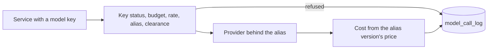

# Models service

Status: current, checked against the code on 2026-11-25. Built: a provider registry (OpenAI, Anthropic, Google Gemini, Azure OpenAI, Amazon Bedrock, any OpenAI-compatible URL), a model catalog with each model's knobs, aliases, keys with budgets, completions and embeddings with a call log. Not built: the admission check before a thread opens; Bedrock and Gemini are **unverified** against real accounts.

The models service is the one way out for model calls. Every service that needs a model calls one OpenAI-compatible
endpoint here with its own model key; the service checks what that key may still spend and which data it is cleared
for, picks the provider behind the alias it asked for, and records each call without its prompt or answer. Workers
hold a model key, never a provider's credential.

## At a glance

| Item | Detail |
|---|---|
| Owns | Provider connections and the account's provider keys, model aliases and their versions, model keys with budgets and spend, the call log |
| Port | 8730 |
| Code | `services/models-service` (`ops_models`), with `ops_metering` for cost |
| Database | Own migration chain (`alembic_version_models`, `services/models-service/migrations`). Tables: `provider_connections`, `provider_keys`, `model_aliases`, `model_keys`, `model_key_tenants`, `model_key_spend`, `model_call_log`, `model_calls_untenanted` |
| Isolation | Tenant rows are read as `ops_models_tenant` (`services/models-service/src/ops_models/store/provider_keys.py:26`); tests `services/models-service/tests/test_call_log_rows_isolated.py`, `test_provider_key_rows_isolated.py`, `test_model_key_share_rows_isolated.py` |
| Secrets it holds | The account's provider keys, sealed with `OPS_SECRETS_KEY`, which must be set outside dev (`services/models-service/src/ops_models/__main__.py:52`), and never returned. Model keys are stored only as a hash; the secret is shown once at issue and at rotation |
| Calls out to | The model providers a connection names, over HTTPS: OpenAI, Anthropic, Google Gemini, Amazon Bedrock, an Azure OpenAI resource or any OpenAI-compatible endpoint (vLLM, Ollama, LiteLLM, a gateway); the fake OpenAI in dev. No other Ops AI service |
| Called by | agents-service for every agent turn, kb-service for embeddings and its AI steps, documents-service for model reads, tools-service for the check before sending; each on its own key (`scripts/stack.sh:132`, `:194`, `:206`, `:211`) |
| Events | None sent or received |
| When something is down | An unreachable or failing provider is answered with its own code and logged as an `error` row ("Provider failures" below); a refusal is never retried here |
| Design | [ADR on the AI gateway](../../architecture/decisions/ai-gateway.md) |
| Routes | API reference tab, HTTP API › Models (internal), built from `services/models-service/openapi.json`; `make -C services/models-service openapi-check` fails when it drifts, and every test checks each JSON response against it (`ops_service_kit.contract`) |

## Run and test it alone

| Task | Command |
|---|---|
| Serve on :8730 in the foreground | `make -C services/models-service run`; on the stack, `make restart SVC=models` |
| Apply its migrations | `make -C services/models-service migrate` |
| Tests on a scripted provider (no real model calls) | `make -C services/models-service test` (`T=` names files) |
| Lint, strict types, tests and the OpenAPI gate | `make -C services/models-service verify` |
| Regenerate `openapi.json` | `make -C services/models-service openapi` |
| The agents path through it end to end | `make usecase-test UC=uc-028`; provider failures and a rebind, `UC=uc-060` |

## How it works

| Part | Detail |
|---|---|
| Provider types | One JSON entry per type in `services/models-service/registry/providers/` (`openai`, `anthropic`, `google`, `azure-openai`, `bedrock`, `openai-compatible`, `scripted`), plus any in the folder `OPS_MODELS_PROVIDER_REGISTRY_EXTRA` names, read at start-up (`ops_models.registry`). An entry names its adapter (`openai-compatible`, `azure-openai`, `bedrock`, `scripted`: `ops_models.providers.ADAPTERS`), its default base URL, its connection fields as a small JSON Schema (each field stored in a connection column, `x-column`, or a secret, `x-secret`) and how its models are listed. An entry naming an adapter no code registers, or using a schema keyword nothing reads, stops start-up. `GET /v1/models/provider-types` lists them for the add dialog. OpenAI, Anthropic and Gemini are called through their OpenAI-compatible chat APIs with a bearer key; Bedrock through its OpenAI-compatible chat API with each request signed (SigV4) by the connection's access key pair, saved as one provider key holding `accessKeyId` and `secretAccessKey` (**unverified** against a real account) |
| Model catalog | `services/models-service/catalog/models.json`, written by `make -C services/models-service catalog-sync` (`scripts/sync_catalog.py`) from models.dev with LiteLLM filling prices and limits, and `catalog/knobs.json`. The snapshot holds each model's facts only (output limit, whether it takes a temperature, its reasoning options); the knob table holds which knobs each provider takes with their ranges and defaults, which knobs need a temperature, and which knob each models.dev reasoning option is. Each model's knobs are built from the two when read, so an edit to the table changes them without a sync. Neither is read from the network. `GET /v1/models/providers/{id}/catalog` lists a connection's catalogued models with context, output limit, prices and knobs; `GET /v1/models/aliases/{name}/knobs` answers a JSON Schema of only the knobs the alias's model takes (temperature, top p, top k, longest answer, thinking budget, thinking effort), each with its range and catalog default; a model the catalog does not hold gets temperature, top p and longest answer with no range |
| Alias users | The alias list and an alias's versions carry `usedBy` for a person: how many agents name the alias, asked of agents-service once per page (`GET /v1/model-alias-uses` on `OPS_AGENTS_URL`, `ops_models.alias_users`). Null for a service caller, without that setting, or when agents-service does not answer |
| Knobs on a call | One rule (`ops_models.catalog`): on every completion each knob is read by its name (as agents-service sends a saved setting) or by its request field, and sent under the field its provider reads, with what goes beside it and the value at which it is off, all from `catalog/knobs.json`. A knob the alias's model does not take is left out, a number is clamped to the model's range (a thinking budget under the model's minimum is raised to it), and a choice the model does not list is left out; a model not in the catalog gets every knob as sent. agents-service refuses a save whose settings break the alias's knobs (422 `model_setting_invalid`), and the gateway still fits each call, since an alias can move to another model |
| Provider connections | Of any registry type, listed and added by an install's scripts (service token) or an account admin on Settings > Models > Connections (settings.manage), which builds its form from `GET /v1/models/provider-types` and tests the saved key. A connection stores a credential's name (`keyRef`); the value is the account's model provider key of that name, which an account admin saves on Settings > Model providers (`/v1/provider-keys`, sealed in `provider_keys`, never returned). A call through a connection whose key is not saved is refused 503 `provider_key_missing`. In dev, `OPS_MODEL_PROVIDER_KEYS` answers behind a saved key |
| Aliases | `bank-standard`, `bank-reasoning`, `bank-embed` in the seed, on the scripted connection; `default` (the runtime's default alias) on connection `openai-local` when `OPS_MODELS_FAKE_OPENAI_URL` is set. Versions are immutable; the newest current version serves. Each version names its provider model, its cleared sensitivity (public < internal < confidential < restricted), whether it is cleared for images and files (`images`, off unless set, models 0006) and its price per million tokens |
| Keys | One per identity: `agent:<id>`, `workflow:<id>`, `user:<email>`, `purpose:<name>`, with a budget, spend, a calls-per-minute limit, an expiry and a status. Only a hash of the secret is stored; it is shown once at issue and at rotation |
| Rotation | `POST /v1/models/keys/{id}/rotate` issues a new secret and keeps the previous one valid for the overlap (`OPS_MODEL_KEY_OVERLAP_SECONDS`, 900 by default) |
| Spend ceilings | From what the call log records, before each call: a key's `daily_cap` (models_0011) stops its calls for the rest of the UTC day once its spend since midnight reaches it (429 `daily_spend_cap`; kb-service's key starts at `OPS_KB_AI_DAILY_CAP`, $50); a caller's `X-Run-Spend-Cap` with `X-Run-Id` stops that run's calls once the run's recorded spend reaches it (429 `run_spend_cap`) |
| Admission | `POST /v1/models/admit {keyId, alias?, estimatedTokens?}`: 200, or 429 `key_budget_exhausted`, 403 `key_expired`, `key_revoked`, `key_not_registered`. An unregistered identity is refused: every caller that spends needs a key |
| Completions | `POST /v1/models/chat/completions`, OpenAI's request and response shape so OpenAI clients call it with a base URL of `/v1/models`. Authenticated by the key's secret, with optional `X-Data-Sensitivity`, `X-Run-Id`, `X-Step-Id`, `X-Thread-Id`, `X-Request-Hash`. Checks in order: key status, expiry and budget, rate limit, alias, cleared sensitivity, then image clearance: a request with any content part that is not text (an image, a file, or a kind not yet named) is refused 403 `images_not_cleared` by a version not cleared, and every call row counts those parts (`images`); then the provider call, the cost from the alias version's price (`ops_metering`) and the spend. `stream: true` answers SSE chunks; `tools` reach the provider and `tool_calls` come back, whole or as deltas. Refusals use the platform error envelope, which OpenAI clients read as `error.code` |
| Embeddings | `POST /v1/models/embeddings`, OpenAI's request and response shape: `{model, input, dimensions?}` with one text or up to 2,048. Only an alias of kind `embedding` serves it, and a chat alias is refused 400 `alias_kind_mismatch` (so is an embedding alias on the completions route). Every check a completion passes runs in the same order through one gate (`open_gate` in `ops_models/app.py`), and the call writes one call-log row with its input tokens and no output tokens. The scripted provider answers deterministic unit vectors at the width asked (1,536 when none is named), hashed from each text's words and word parts, so texts sharing words point the same way in tests |
| Azure OpenAI | An `azure-openai` connection names the resource's endpoint (no path), an `apiVersion` (`v1`, or a dated version from 2024-10-21 on, the first GA whose streams carry usage) and, optionally, the `region` it runs in; an alias version's model id is the deployment. The key goes in the `api-key` header to `{endpoint}/openai/deployments/{deployment}/chat/completions?api-version=…`, or to `{endpoint}/openai/v1/chat/completions` with the deployment as `model` for `v1`. Azure's filter annotations (a first stream frame with no choices, `content_filter_results`, a choice with no delta) are dropped, so callers see OpenAI's shape. Every answer's `x-ms-region` is recorded as `observedRegion`, written only when it changes; one that is not the connection's region (compared lower case, spaces removed) still answers, and its call log row (`ok`) carries the reason `answered from <region>, expected <region>`, which the connection list shows as `regionMismatch` (2026-10-31: warn only; a per-connection refuse option waits for a real resource). One rule checks the values for the route and the install settings (`ops_models.connection_settings.azure_openai_problem`), refused 400 naming the field |
| Data residency | The region check sees the resource's region only. Global and Data Zone deployments may process a request in another region of their geography; a Standard (regional) deployment keeps it in the resource's region. The header's spelling (`Sweden Central`) is from Azure's documentation and the fake, **unverified** against a real resource |
| Install settings | Read by models-service alone (`ops_models.connection_settings`), so no other service fails over them. OPENAI_API_BASE (or OPENAI_BASE_URL) alone, or OPENAI_API_TYPE=openai, is an OpenAI-compatible endpoint with a bearer key (vLLM, Ollama, LiteLLM, a gateway, api.openai.com); OPENAI_API_TYPE=azure makes it an Azure endpoint and needs OPENAI_API_VERSION, with OPENAI_API_REGION optional. Only a combination that cannot work stops models-service, naming the variable: Azure without its endpoint or api-version, an unknown type, a base that is not a URL. The dev seed rewrites `openai-local` from them on every start (key name `openai`, filled from OPENAI_API_KEY by `scripts/stack.sh`); an install runs `deploy/fly/connect_model.py`, which takes them as defaults. Unset, nothing changes. The agents kernel's direct path reads only OPENAI_API_TYPE, to refuse an Azure key |
| Call log | `model_call_log`, one row per authenticated completion, denials included: key, alias and version, provider model, tokens, cost, latency, outcome and reason, run, step and thread ids, and the caller's request hash. No prompt or completion text. `GET /v1/models/calls?keyId&alias&outcome&threadId` answers one page on the shared list contract (`data`, `pagination`, newest first, then by id) and `byKey`, each key's count and cost over every matching call |

Admin and admission routes take a service token. Provider types, connections, provider keys and reading aliases also take an account admin's token (`settings.manage`); a connection's `secrets` are saved as the provider key its `keyRef` names and never returned. One install serves one account, and its aliases apply to the whole install: creating an alias, adding a version and choosing the chat model also need `install.manage`, which only Owner (the install's first admin) holds, so a workspace Admin reads aliases and is refused a change (403 `install_admin_only`). Builders read an alias's knobs through agents-service (`GET /v1/model-aliases/{name}/knobs`).

Services that are not agents call through one client, `ops_service_kit.model_calls`: `ModelCalls.structured` (a
`final_result` answer, tools-service's sending check), `ModelCalls.embed` (vectors and their tokens) and
`IngestModel.complete` (ingestion's AI steps, blocking, in a worker thread). A refusal keeps this service's code on
`ModelCallError.code`. The environment's one embedding model is `OPS_EMBEDDING_ALIAS` (default `bank-embed`) at
`OPS_EMBEDDING_WIDTH` (default 1,536); a width above 1,998 stops every service at start-up, since no vector index on
either database holds it. kb-service spends on its own key, `kb:index` in the dev seed, per tenant.

agents-service is the first caller: with `OPS_MODELS_URL` and `OPS_MODELS_KEY` set, every agent turn comes here on
its agent's alias with agents-service's key (`agents:dev` in the dev seed), and inside a graph run with the thread,
run, step and request hash as headers ([runtime.md](../../architecture/runtime.md#which-model-a-turn-runs-on)).
Use case uc-028 drives the whole path.

## Real or fake model, by connection

Code never chooses between a real and a fake model. An alias names a connection, and the connection's base URL decides
where the call goes. `services/models-service/scripts/fake_openai` is a stand-in OpenAI chat API (`POST
/v1/chat/completions` streamed or not, `GET /v1/models`, no key): with tools offered it answers a tool call from rules
in `<dir>/script.json` (`{"rules": [{"when": "<regex on the user's message>", "tool": "...", "arguments": {}}]}`),
otherwise text naming the agent from the system prompt and the gist of the last message.

| Step | Command or call |
|---|---|
| Start the fake | `cd services/models-service/scripts && uv run --project .. python -m fake_openai .run/fake-openai` (port `FAKE_OPENAI_PORT`, else `port` in script.json, else 8746); it prints the URL to set |
| Script it | `<folder>/script.json` rules turn a prompt into a tool call, including Pydantic AI's `final_result` output tool for a structured call; the committed set is `services/models-service/seed/demo-fake-openai/script.json` (the court order notice's persons and the banker demo's rules); `.run/fake-openai/script.json` is a copy of it: copy it there and restart the fake, which reads the file once at start |
| Seed against it | `OPS_MODELS_FAKE_OPENAI_URL=http://127.0.0.1:8746/v1` on models-service in dev: the seed adds connection `openai-local` (openai-compatible, that base URL) and alias `default` on it. Rows that exist are left alone |
| Point `default` at OpenAI | `PUT /v1/models/providers/openai-local {"baseUrl": "https://api.openai.com/v1", "keyRef": "openai"}` with the key saved as `openai` on Settings > Model providers (or, in dev, `OPS_MODEL_PROVIDER_KEYS={"openai": "<key>"}`), and a new version of alias `default` naming the provider's model. agents-service does not change |
| Point it back at the fake | `PUT /v1/models/providers/openai-local {"baseUrl": "http://127.0.0.1:8746/v1"}` (no `keyRef`) |
| Send agents-service through it | `OPS_MODELS_URL=http://127.0.0.1:8730` and `OPS_MODELS_KEY=mk_dev_agents` (dev seed) on agents-service; it then reads no `OPENAI_API_KEY` |

The base URL includes `/v1`: the provider posts to `<baseUrl>/chat/completions`. A scripted connection cannot be
rebound (409 `provider_not_rebindable`). An unreachable base URL answers 502 `provider_unreachable` and logs an `error`
row.

### Provider failures

A provider that fails is answered with its own code, which is also the call-log row's reason, and a message that says
what happened and what to do. The message never quotes the provider's body or the connection's address: a provider's
401 can echo part of the key. The console words each code for its reader (`apps/console/src/lib/model-refusals.ts`):
someone who manages settings is told to fix it on Settings > Model providers, anyone else to ask an admin. The mapping
is `PROVIDER_FAILURES` and `answered()` in `src/ops_models/providers.py`, the one place a provider failure is classified.

| The provider | Status | Code |
|---|---|---|
| Could not be reached (connection refused, DNS, TLS) | 502 | `provider_unreachable` |
| Did not answer in time | 504 | `provider_timeout` |
| Refused the account's key (401 or 403) | 502 | `provider_auth_failed` |
| Limited calls on the key (429) | 429, with the provider's `Retry-After` | `provider_rate_limited` |
| Refused the request as sent (any other 4xx: a wrong model or deployment name, an unknown setting), or the connection's type is not served | 502 | `provider_bad_request` |
| Failed on its side (5xx), or answered an empty stream | 502 | `provider_error` |

Two refusals come before any provider call: 503 `provider_key_missing` when the account has not saved the key the
connection names, and 404 `alias_not_found`. A caller's own problem is never answered 401 or 403 for a provider's
refusal: those statuses mean the caller's model key or clearance.
Use case uc-060 drives this path, including the rebind to a closed port and back.

## Tests

| Failure mode | Test | Watched to fail |
|---|---|---|
| Anyone can read keys or ask admission | `test_admin_routes_are_internal` | |
| A key at its budget spends again | `test_a_key_at_its_budget_is_refused` | Yes |
| Spend never reaches the cap | `test_spend_reaches_the_cap_and_the_next_call_is_refused` | |
| An estimate above what is left is admitted | `test_an_estimate_over_what_is_left_is_refused` | |
| An expired key is accepted | `test_an_expired_key_is_refused` | Yes |
| An unregistered identity or a guessed secret is accepted | `test_an_unregistered_identity_is_refused` | |
| Confidential data reaches an alias cleared for internal | `test_an_alias_not_cleared_for_the_data_is_refused` | Yes |
| A completion logs prompt text, or more or fewer than one row | `test_a_completion_writes_one_metadata_row_and_no_prompt_text` | Yes |
| A rotated-out secret works past its overlap | `test_rotation_keeps_the_old_secret_for_the_overlap_only` | Yes |
| A key exceeds its rate limit | `test_a_key_over_its_rate_limit_is_refused` | Yes |
| An alias version changes in place, or the old one keeps serving | `test_alias_versions_are_immutable_and_the_newest_serves` | |
| A row cannot be tied to the caller's request | `test_a_call_carries_the_callers_request_hash_and_is_found_by_thread` | Yes |
| The OpenAI client cannot parse a reply, streamed or not | `test_a_text_turn_runs_through_the_openai_client` | |
| A tool turn loses its tool calls (scripted, streamed or not) | `test_a_tool_turn_carries_the_tool_call_and_its_result` | Yes |
| An openai-compatible provider never sees the tools, or its calls are dropped | `test_an_openai_compatible_provider_gets_the_tools_and_returns_the_calls` | Yes |
| An unreachable provider is a 500, or a rebind does not move the alias | uc-060 `rebinding openai-local to a closed port fails default with 502 provider_unreachable, saying where an admin checks the connection; rebinding back restores it` | Yes |
| Every provider failure is one generic `provider_error`, the message does not say what to do, or a provider body that echoes the key reaches the answer or the log | `tests/test_provider_failures.py`, one test per row of "Provider failures"; uc-532 step 3 | Yes (all twelve red on the code-less error) |
| An Azure key goes as a bearer token, the deployment URL or api-version is wrong, streamed usage or tool calls are lost, Azure's annotations reach the caller, or an answer from another region goes unrecorded | `tests/test_azure_provider.py`, one test each; uc-605 | Yes (header reverted to Bearer: five tests red) |
| A bad OPENAI_API_* value starts models-service, a plain OPENAI_API_BASE stops it, another service fails on them, or a dev restart keeps an old openai-local | `tests/test_install_model_settings.py`, one test per rule; uc-605 cli | |
| A refusal is retried or reaches the client as something else | `test_a_refusal_reaches_the_client_once`, `test_a_stream_is_refused_before_it_starts` | |
| A response drifts from the documented model | every test, through the contract hook | Yes |

## Gotchas

| Topic | Detail |
|---|---|
| OpenAI clients retry a 429 twice by default | A caller must set `max_retries=0`, or one over-limit request is three calls and three denied rows |
| The OpenAI SDK is typed against httpx2 | An injected client is an `httpx2.AsyncClient`; httpx's runs but fails the type check |
| The check runs before the call | A key under its cap may make one call that takes it over; the next is refused. A reservation per call would close it |
| Concurrent calls race the cap | Two calls checked at once both pass; spend is added with one `UPDATE … SET spent = spent + cost`, so it is never lost, only overshot |
| Prompt-free logging needs a real check | A test that looked for one late prompt fragment passed while a cut prompt was being logged; it now checks several fragments of prompt and reply |

## Not built yet

| Item | Where it goes |
|---|---|
| agents-service's KeyAdmission adapter (`/v1/models/admit` before a thread opens) and use cases uc-016, uc-017 | Next slice; turns already run through completions (uc-028) |
| Retries and timeouts, failover with evidence, redaction | Later slices, per the ADR's day-one table |
| A real call to Bedrock, Gemini and Anthropic, and Gemini's thinking budget field | The adapters follow the providers' published OpenAI-compatible APIs; none has been called with a real key |
| Azure OpenAI with Entra ID (managed identity) sign-in; a per-connection option to refuse an answer from another region; one call against a real resource | Later; the real call waits for a customer's resource |
| Data-plane gateway (Portkey) behind this service | Deployment |
