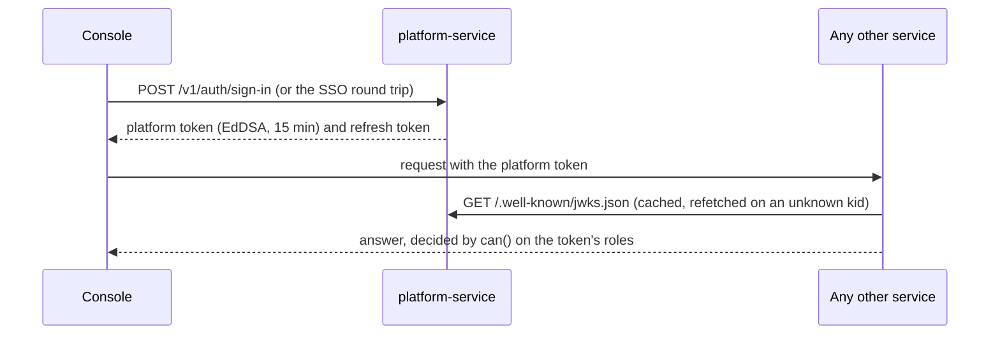

# Platform service

Status: current, checked against the code on 2026-11-18. Built: password, OIDC and SAML sign-in, sessions, teams, roles, API keys, policies and the audit log. Not built: MFA and sending invitations by mail.

The platform service decides who someone is and what teams they belong to. It owns the workspace, its teams, people,
their roles, sign-in, sessions, API keys, the workspace's policies and the audit log, and it is the only service that
issues identity tokens. It routes no other service's traffic: every other service checks a caller's token itself
against the public keys this service publishes.

## At a glance

| Item | Detail |
|---|---|
| Owns | Tenants, teams, users, members, roles and their assignments, sessions, invites, password credentials and resets, API keys, sign-in providers, domains, certificates and group rules, policies, the audit log |
| Ports | 8710 for the public app; 8711 for the internal app, bound to localhost (`OPS_PLATFORM_PORT`, `OPS_PLATFORM_INTERNAL_PORT`) |
| Code | `services/platform-service` (`ops_platform`), with `ops_signin` for OIDC and SAML, `ops_access` for `can()` and the policies, `ops_email` for reset links |
| Database | Own migration chain (`alembic_version_platform`, `services/platform-service/migrations`). Tables: `tenants`, `teams`, `users`, `members`, `roles`, `role_permissions`, `role_assignments`, `sessions`, `password_credentials`, `password_resets`, `api_keys`, `policies`, `audit_entries`, `platform_outbox`, `oauth_clients`, `oauth_address_counts`, and the sign-in tables `signin_providers`, `signin_domains`, `signin_identities`, `signin_flows`, `signin_certificates`, `signin_group_rules`, `signin_grants`, `signin_break_glass`, `signin_lockouts`, `signin_email_failures`, `signin_secrets` |
| Isolation | The service logs in as a role that owns no table and switches every transaction to `ops_platform_tenant` (`services/platform-service/src/ops_platform/store/tenancy.py:31`), with row-level security forced on every table; lookups before a tenant is known are SECURITY DEFINER functions ("Operations" below). Tests: `services/platform-service/tests/test_least_privilege.py`, `test_rls.py` |
| Secrets it holds | The token signing key (`OPS_PLATFORM_SIGNING_KEY`), the key that seals each workspace's sign-in secrets (`OPS_SECRETS_KEY`), the SAML service provider's key pair, the mail provider's settings. Passwords are PBKDF2-SHA256 hashes; API keys and refresh tokens are stored as hashes |
| Calls out to | agents-service (`GET /v1/teams/usage` before a team delete or a workspace close, and the platform events); tools-service (the platform events it subscribes to); each workspace's identity providers (OIDC discovery, SAML metadata, token endpoints); DNS for domain proof; the mail provider for reset links |
| Called by | The console and the SDK for sign-in and settings; every service for the key set (`GET /.well-known/jwks.json`), API key introspection and audit entries on the internal app, and names and summaries (`GET /v1/people-names`, `GET /v1/api-key-summaries`) |
| Events it sends | Through `platform_outbox` and the `platform_relay` process to `/v1/platform-events`: `member.removed` to tools-service, `team.created` to tools-service and agents-service, `policy.changed` and `api_key.changed` to agents-service (`services/platform-service/src/ops_platform/store/relay.py:23-30`) |
| Events it receives | Audit entries other services record with their own changes, on the internal `POST /v1/audit-events` (`ops_store.audit`) |
| When something is down | Other services keep verifying tokens against the cached key set, so a person stays signed in elsewhere until the token expires (15 minutes). Without an answer from agents-service, a team delete or workspace close is refused 503 `usage_unavailable`, never taken |
| Routes | API reference tab, HTTP API › Platform, built from `services/platform-service/openapi.json`; `make -C services/platform-service openapi-check` fails on drift. The internal app serves only `POST /v1/auth/introspect` and `POST /v1/audit-events`, both for service tokens, with each service's scopes capped by `OPS_SERVICE_SCOPES` |
| Use cases | uc-021, uc-023, uc-025, uc-026 |

## Run and test it alone

| Task | Command |
|---|---|
| Serve both apps in the foreground | `make -C services/platform-service run`; on the stack, `make restart SVC=platform` |
| Apply its migrations | `make -C services/platform-service migrate` |
| Tests on the test database | `make -C services/platform-service test` (`T=` names files) |
| Lint, strict types, tests and the OpenAPI gate | `make -C services/platform-service verify` |
| Regenerate `openapi.json` | `uv run python scripts/check_openapi.py --write` in `services/platform-service` (this service has no `openapi` target) |
| A local identity provider for SSO tests | `uv run python -m ops_signin.fake_idp --port 8790` |

## Credentials it issues

| Credential | Shape | Verified by |
|---|---|---|
| Platform token | EdDSA JWT, 15 minutes, `aud` listing every user-facing service, claims per spec section 4 | Each service, against `GET /.well-known/jwks.json` |
| Refresh token | `<session id>.<secret>`, rotated on every refresh; a reused one ends the session | platform-service |
| API key | `ok_<id>.<secret>`, secret shown once, SHA-256 at rest, optional expiry, optional target (one agent or workflow); scopes `read` (GET, HEAD, OPTIONS only) and `write`, one list (`ops_identity.KEY_SCOPES`) that the key check enforces and `GET /v1/settings/lookups` serves to the keys screen | platform-service, via `POST /v1/auth/introspect` |
| Service token | EdDSA JWT, 60 seconds, signed with the calling service's own key, `sub` bound to that key | The callee's `ServiceAuth` |
| Step-up token | EdDSA JWT, 5 minutes, same key and `aud` as the platform token, `kind` and `typ` `step_up`, `sub` and `email` the person who re-entered their password (`POST /v1/auth/step-up`) or signed in again at their SSO provider (`POST /v1/auth/step-up/sso/*`), audited as `auth.step_up` with the method | agents-service `require_step_up`, against the cached key set; refused as a session by every service |

## Settings

| Setting | Default | Notes |
|---|---|---|
| `OPS_PLATFORM_PORT`, `OPS_PLATFORM_INTERNAL_PORT` | 8710, 8711 | `make/env.mk` |
| `OPS_PLATFORM_URL` | `http://127.0.0.1:$(OPS_PLATFORM_PORT)` | Where other services fetch the key set |
| `OPS_PLATFORM_SIGNING_KEY`, `OPS_PLATFORM_SIGNING_KID` | unset, `platform-1` | Required outside dev; dev derives a key from a public seed under kid `platform-dev` |
| `OPS_PLATFORM_AUDIENCES` | every user-facing service | The `aud` of a person's token |
| `OPS_PLATFORM_TOKEN_TTL_SECONDS` | 900 | Use cases shorten it to watch a token expire |
| `OPS_PLATFORM_DEMO_PASSWORD` | `northfield-demo` | Dev only, for a person with no stored password; unset outside dev |
| `OPS_PLATFORM_PUBLIC_URL`, `OPS_CONSOLE_URL` | unset | platform-service's public origin (the OIDC redirect URI `/v1/auth/oidc/callback`, the SAML consumer URL `/v1/auth/saml/acs`, the SAML entity id `/v1/auth/saml`) and the console's origin (`/sso/callback`, `/reset-password/<token>`); unset, SSO and reset answer 503 |
| `OPS_SIGNIN_FETCH_RANGES` | `[]` | Private networks (CIDR) that identity-provider metadata and OIDC discovery may reach; every other fetch must be https to a public address, connected to the address checked (`ops_service_kit.public_address`) |
| `OPS_SIGNIN_FETCH_LOCAL` | `false` | Dev only (refused elsewhere): those fetches reach the local fake identity provider over http on loopback, unchecked |
| `OPS_SAML_SP_KEY`, `OPS_SAML_SP_CERTIFICATE` | unset | The SAML service provider's key pair, PEM: signs requests for a provider with `signRequests`, decrypts assertions encrypted to the certificate, and the certificate is published at `/v1/auth/saml/metadata`; unset, a provider cannot ask for either (400 `sp_key_missing`) |
| `OPS_SECRETS_KEY` | dev key | Seals each workspace's sign-in secrets (an OIDC provider's `clientSecretRef` names one, saved by a Security admin through `PUT /v1/settings/sign-in/secrets/{name}`); required outside dev |
| `OPS_PASSWORD_HASH_ITERATIONS`, `OPS_PASSWORD_MIN_LENGTH` | 600000, 12 | PBKDF2-SHA256 work factor (a lower stored count is rehashed at the next sign-in) and the shortest password a reset or invite accepts |
| `OPS_SIGNIN_FLOW_SECONDS`, `OPS_PASSWORD_RESET_SECONDS` | 600, 3600 | How long an SSO round trip and a reset link live |
| `OPS_MAIL_PROVIDER` and its settings | `none` | Reset links go out through `packages/ops_email`; `none` makes forgot answer 503 `mail_not_configured` |
| `OPS_PLATFORM_SEED_FILE` | `services/platform-service/tests/fixtures/people.json` | Dev seed: `team_ops` with an admin, a builder and an approver |
| `OPS_SERVICE_SIGNING_KEY`, `OPS_SERVICE_SIGNING_KID` | unset, `svc-dev` | A calling service's own key; required outside dev |
| `OPS_SERVICE_PUBLIC_KEYS` | `{}` | `{kid: {"service", "x"}}`: the services the internal app trusts |
| `OPS_WORKSPACE_RESTORE_DAYS`, `OPS_TEAM_DELETE_AFTER_DAYS` | 30, 30 | How long a closed workspace can be restored before the purge, and how long a team stays archived before it can be deleted; uc-529 sets the second to 0 |
| `OPS_AGENTS_URL` | `http://127.0.0.1:$(OPS_PORT)` | Where platform-service reads what still runs in a team before a delete or close |

## Policies

The workspace's rules, read and changed at `GET /v1/policies`, `GET /v1/policies/{key}` and `PUT /v1/policies/{key}`
(Govern › Policies in the console). They are defined once in `packages/ops_access/src/ops_access/policies.py`; this
table lists them as that file holds them on the date in the status line. A per-team policy holds a value per team; a team with none set takes the default.

| Key | Name | Scope | Default | What it does |
|---|---|---|---|---|
| `requesterMayDecide` | Requester may decide | team | on | The person who asked for a decision may also make it. Off is the two-person rule (Approvals › Advanced): someone else has to decide, unless the person is an Admin of the team. |
| `extractionFloor` | Extraction confidence floor | workspace | 0.8 | The lowest confidence an Extract from file step may accept; no step can ask for less. |
| `stepUp` | Step-up on every approval | workspace | off | Every approver confirms their sign-in again before deciding. Off: only operations that ask for it. |
| `publishReview` | Publish reviews | per team | major changes | Which of a team's publishes wait for review: always, major changes only (the default), or never. |
| `companySignInRequired` | Company sign-in required | workspace | off | People on the workspace's verified company domains sign in only through the company's provider; named break-glass Security admins keep a password. Off: passwords follow the sign-in providers. |
| `chatThreadsOwnerOnly` | Private chat threads | workspace | on | Each chat thread is read only by the person who started it. Off: the team's admins read them too. |
| `memoryRetentionDays` | Memory retention | workspace | none | How long agents keep what they remember about each person. Unset: kept until the person removes it. |
| `reviewSlaHours` | Review deadline | workspace | 8 | How long a publish review may wait, in wall-clock hours, before it shows as overdue. |
| `appChanges` | Ask before an agent changes anything in an app | per team | off | Ask before an agent changes anything in an app. Off: agents change apps without asking. On: the person in the chat confirms, or a reviewer of a chosen role approves. |
| `appChangesByApp` | Approval by app | per team | none: each app follows the team | Per app: use the team setting, or change without asking, ask the person, or ask a reviewer. |
| `toolWritesNeedApproval` | Approve every tool write | per team | off | Every tool write by the team waits for a person's approval, including the ones a tool lets run at once. |
| `appWritesNeedApproval` | Approve writes of these apps | per team | none listed | Writes from the listed apps wait for a person's approval. Other writes run unless their tool asks for one. |
| `appsChangeWithoutAsking` | Apps that change without asking | per team | none listed | Writes from the listed apps run in chat without asking the person first. Every other app asks before changes. |
| `aiSteps` | AI steps in workflows | per team | off | The team's workflows may use AI steps: Classify, Summarise, Extract from text, Draft. Off until turned on. |
| `taskAssist` | Task assist | per team | off | A typed task opens with AI help: its question, a summary, doubtful fields and a suggestion. Off until on. |
| `checkBeforeSend` | Check before sending | per team | off | Every write the team sends is checked against its sending policy first; a failure waits for a person. |
| `pageImages` | Page images to the model | per team | off | Document types in the team may show the model the page image of a scan or a doubtful field. Off until on. |
| `aiStepsMaskPersonalData` | Mask personal data in AI steps | per team | on | People see SSNs, card and account numbers, emails and phones masked in AI steps' output and in document type examples. A team may turn it off. |
| `egressNewHosts` | New app addresses | workspace | `ask_security` | What happens when an app or tool names an address the account has not allowed yet. |
| `mcpConnectionHours` | Assistant connection length | workspace | 8 | How long an assistant stays connected to a team's MCP address before the person signs in again. |
| `securityTeamAddsSecrets` | Only Security adds secrets | workspace | off | Only the security team adds secrets. Off: builders add and use their own team's secrets. |

The AI and sending policies `aiSteps`, `taskAssist`, `checkBeforeSend` and `pageImages` are off until a team turns them
on. agents-service, tools-service and documents-service read them per team when a step runs, a task opens, a write is
about to be sent or a page image would go to a model.

## Sign-in

A workspace's methods are rows in `signin_providers`, set by Security team admins at `/v1/settings/sign-in/providers`:
`password`, `oidc` (authorization code with PKCE) and `saml` (SP-initiated). A workspace with no enabled row signs in
by password, so turning off its only SSO provider never locks everyone out. A `signin_domains` row is a workspace's claim on an
email domain for one provider, with a token: it routes sign-in and makes people only once `POST
/v1/settings/sign-in/domains/{domain}/verify` has seen `ops-ai-verify=<token>` in the domain's TXT records (
migration 0017; resolvers from `OPS_SIGNIN_DNS_SERVERS`). One workspace can hold a domain verified, and another's
pending claim blocks nobody. Settings → Sign-in in the console sets providers and verifies domains. The
console asks `POST /v1/auth/options` for the typed email and shows those methods. Wrong passwords at sign-in and
step-up count together per person in `signin_lockouts` (migration 0019): five in fifteen minutes lock both for
fifteen (429 `signin_locked` with `Retry-After`), a right password clears the count and a used reset link ends the
lock; one person is sent at most three reset links an hour. The limits are `OPS_SIGNIN_MAX_FAILURES`,
`OPS_SIGNIN_FAILURE_WINDOW_SECONDS`, `OPS_SIGNIN_LOCKOUT_SECONDS`, `OPS_PASSWORD_RESET_MAX_PER_WINDOW` and
`OPS_PASSWORD_RESET_WINDOW_SECONDS`.

| Step | What happens |
|---|---|
| Start | `POST /v1/auth/sso/start` finds the provider by the email's domain (or by `provider`, the address id an app-portal tile opens as `/sso?provider=`), keeps state, nonce, PKCE verifier or SAML request id in `signin_flows`, and returns the provider URL and a `flowKey` |
| Answer | The provider returns to `/v1/auth/oidc/callback` or the SAML consumer URL: a provider saved since migration 0033 has its own, `/v1/auth/saml/acs/{spId}` with entity id `/v1/auth/saml/metadata/{spId}`; older ones keep `/v1/auth/saml/acs`. `packages/ops_signin` checks the answer against every certificate of the provider within its dates; the person is found by provider subject, then by email (never an admin of any team), then made in the provider's first sign-in team with its role (default `chat_user`), only for an email on the provider's domains; the browser goes to the console's `/sso/callback?code=` (303), or `?error=no_access` (nobody may sign in as this answer), `certificate_expired` (signed under an ended certificate) or `sign_in_refused` (any failed check) |
| App-portal tile | A response posted to a provider's own consumer URL that answers no flow is checked (signature, issuer, audience, Destination) and discarded; the browser goes to the console's `/sso?provider={spId}`, which starts a normal round trip. Nobody is signed in by a response no request asked for. The provider's `tiles` setting (on by default) turns this off |
| Certificates | `signin_certificates` (0033) holds each provider's trusted certificates with dates and source (`metadata`, `upload`, `manual`). A save with `saml.metadataUrl` reads them from the metadata (entity id must match); `POST .../providers/metadata` previews a URL or file; the daily `signin_watch` process re-reads metadata URLs, adds new certificates only for the same entity id, and tells Security admins (holders of `settings.manage` in the Security team: audit plus mail) of each new certificate and of one 30 and 7 days from its end and once ended. A certificate a metadata read no longer lists stays trusted until it ends |
| Groups | A provider's group rules live in `signin_group_rules` (0033): a group value, a team and a role (chat user, viewer, builder or approver; never admin, 400 `group_role`). At sign-in each matching rule gives its membership; two rules into one team give the higher role. `signin_grants` records which memberships a first sign-in or a group gave. With `groups.onMissing` `remove` (the default for a new provider; `keep` for one saved before), a membership only groups gave ends when the person signs in in none of its groups, audited `member.group_removed`, and tools-service is told as for any removal. A membership given by hand stays, and a missing, empty or Entra overage (`groups.link`) claim changes nothing |
| Break-glass | With the `companySignInRequired` policy on, a password for an email on a verified SSO domain gets the wrong-password refusal, except for the people on `signin_break_glass` (0033): Security admins named on `GET`/`PUT`/`DELETE /v1/settings/sign-in/break-glass/{userId}`, at most three (422 `break_glass_full`, `break_glass_not_security_admin`), who may always use a password and reset it. A person who loses `settings.manage` in the Security team stops counting at once. Each of their password sign-ins is audited `signin.break_glass_used` and told to the Security admins; the usual lockout applies. While required: the last one cannot be removed (409 `break_glass_last`), and with nobody counting, a provider with verified domains cannot be turned off or deleted (409 `last_sign_in_method`). A break-glass person is never linked to a provider by email |
| Test sign-in | `POST /v1/settings/sign-in/providers/{id}/test` (settings.manage) starts a `test` flow, also while the provider is off, and returns `redirectUrl` and `flowId`; the admin signs in at the provider in a new tab and is sent to `/settings/security/sign-in?test=<flowId>`. The answer is checked as any other, then kept on the flow (`signin_flows.test_result`): email, name, subject and groups, or the check that failed. Nobody is made, linked, given a membership or a session, and the flow never gets a handoff. `GET /v1/settings/sign-in/test-results/{flowId}` returns `waiting`, `ok` or `refused`, and 404 to anyone but the admin who started it |
| Complete | `POST /v1/auth/sso/complete` takes the code and the starting browser's `flowKey`, once, and issues a session whose `authMethod` is `oidc` or `saml` and whose `provider_id` is kept |
| Step-up | A password session re-enters its password; an SSO session goes back to its own provider with `prompt=login` or `ForceAuthn`, and the answer must be the same person with a fresh login |

## Teams

Workspace admins, people with the Admin role in every team (`*`; the dev seed's Wanjiru Kamau), create a team with its
first admin, rename it and archive or restore it at `/v1/settings/teams`. A name is unique in the workspace in any
case (`teams.name_key`). An archived team keeps what it owns, leaves its members' next tokens and `GET /v1/teams`, gives
its members no rights there and takes no new invitations; the Security team cannot be archived. Team admins manage
members and roles on `/v1/settings/members/*` as before.

## Workspace and team lifecycle

The workspace's owner is the one person with the built-in role Owner in every team (`*`), the only role holding
`workspace.manage`; a partial unique index keeps it to one. The first account admin becomes the owner when the
workspace is seeded or bootstrapped, and migration 0026 chose the earliest one for workspaces made before it.

| Action | Who | What happens |
|---|---|---|
| Transfer | The owner, to an account admin | The Owner assignment moves in one transaction under a lock on the tenant row; a lost race is 409 `owner_changed` |
| Leave the workspace | Anyone but the owner (409 `owner_must_transfer`) | Every membership and assignment goes, sessions end, their keys stop; the account stays for a later invite |
| Close (delete) | The owner, typing the name, with no run in progress | Status `closed`; every session but the owner's ends; every key is disabled with the close's own time, so restore re-enables only those. Everyone else is refused at sign-in, on every route and with a service token: 403 `workspace_closed` |
| Restore | The owner, while `closed` | Status back to `active`; 409 `purged` once the purge has started |
| Purge | The `workspace_lifecycle` background process, every 15 minutes | Workspaces closed longer than the window become `purging`, then `purged`: sessions, keys, assignments, members and sign-in settings go; tenants, users, teams, policies and audit entries stay |
| Leave a team | A member; not its last admin (409 `last_admin`) | The membership and its assignments go |
| Delete a team | An account admin, on an archived team past the window with no live workflow | Status `deleted`, name free again, members and assignments gone; the row stays for its audit entries |

Closing a workspace and deleting a team first ask agents-service's `GET /v1/teams/usage` for the team (runs in progress,
live workflow names). With no answer the action is refused with 503 `usage_unavailable`, never taken. Other services'
records of a deleted team or purged workspace stay unreachable until each service purges them, which is not built yet.

## Access checks

An admin checks one action for one person at `POST /v1/access/check`: the answer comes from the same `can()` the
services run, with the workspace's policies, and names the person checked when it refuses ("Maya asked for this", not
"You asked for this"). Each check is written to the audit log as kind `checked`, read as "Checked <person>'s access to
<action> on <area>". `GET /v1/me/why` answers the signed-in person's own locked button: the roles that grant the action
and who in the team can give roles; it is not audited. `GET /v1/settings/members/options` lists the team's active people
as picker choices by email (a Human Task sent back to a person), searched in the query, for anyone who may decide reviews.

## Operations

| Topic | Detail |
|---|---|
| Database role | The service connects as a login role that owns no table and is a member of `ops_platform_tenant`. Every transaction switches to that role; row-level security is forced on every table |
| Pre-tenant lookups | Sign-in by email, a session by id, a key by prefix and an invite by token hash (migration 0004), an email domain, a sign-in flow by state or handoff hash and a reset by token hash (migration 0010), and the workspaces due for purge (migration 0026) are SECURITY DEFINER functions owned by the NOLOGIN role `ops_platform_lookup`, whose only right is SELECT through SELECT-only policies |
| Migrator rights | Migration 0004 runs `ALTER FUNCTION … OWNER TO ops_platform_lookup`. The migrating role must be a superuser, or have CREATE on the schema and be a member of `ops_platform_lookup`. Compose's user is a superuser; a managed database usually needs the grant first |
| Key rotation | Publish the new public key beside the old one in the key set, switch `OPS_PLATFORM_SIGNING_KEY` and its kid, and drop the old key after the token TTL. Verifiers refetch once on an unknown kid |
| Sign-out reach | platform-service refuses a signed-out session at once; other services accept its token until it expires (15 minutes) |

## Gotchas

| Topic | Detail |
|---|---|
| Superuser hides RLS faults | The compose user bypasses row-level security, so `tests/test_least_privilege.py` runs the flows as a role that owns nothing; without migration 0004 they fail there and pass everywhere else |
| Definer functions and temp tables | Postgres searches a session's temporary schema first unless a function names `pg_temp` in its search_path, so a temp `users` table could shadow what a lookup reads. The lookups pin `pg_catalog, public, pg_temp` and qualify every table (migration 0005) |
| Foreign keys ignore RLS | A single-column reference let a tenant's row point at another tenant's team; every reference carries `tenant_id` (migration 0002) |
| String annotations and FastAPI | `api/app.py` has no `from __future__ import annotations`: its routes depend on functions local to the factory |
| Test teams | Fixtures create teams with scope `owned`; a scope `all` team reads the whole tenant and would hide team scoping |
| Policies survive a purge | The tenant role holds no DELETE on `policies` (migration 0011), so a purge keeps them |
| An archived team's own pages | An archived team leaves every switcher, so it is deleted from Access › Teams, not its Team › General page |

## Not built yet

| Item | Where it goes |
|---|---|
| MFA; a limit per client address on sign-in | Later slices of the [sign-in library](../../packages/ops_signin/overview.md) |
| SAML single logout; accepting an unsolicited assertion directly (tiles go round a normal sign-in instead) | Proposed |
| The Add SAML provider wizard, "Continue with <provider>" copy and the three member error messages, the CLI | In progress on the SAML sign-in design |
| Sending invitations by mail | The notifications slice; today the admin shares the link from the invite response |
| A pushed revocation list | Only if 15 minutes of reach after sign-out proves too long |
| Purging a deleted team's or a closed workspace's records in other services | Each service keeps them unreachable until it purges them |
