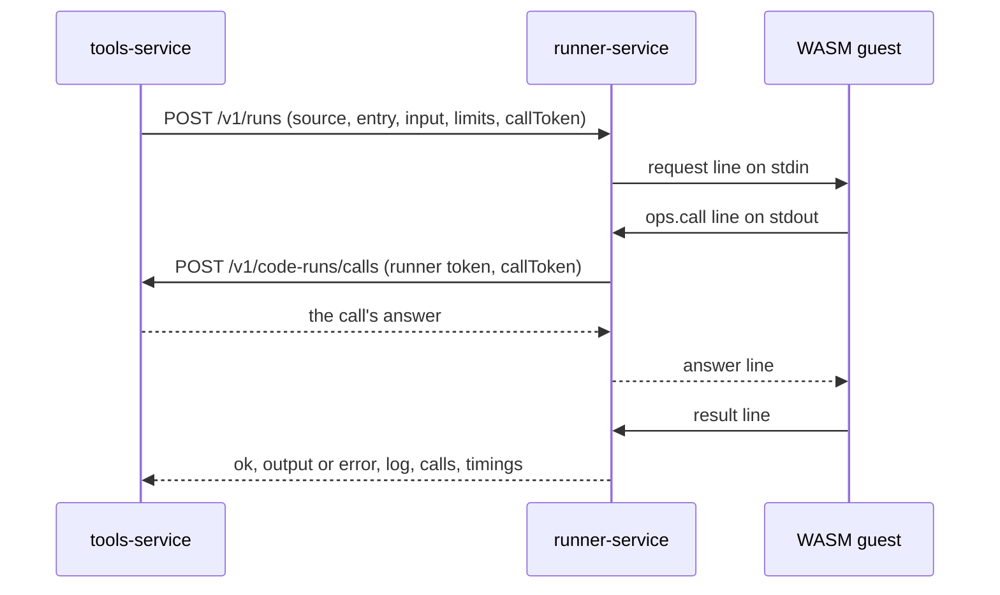

# Runner service

Status: current, checked against the code on 2026-11-18. Built: one route that runs a code tool's function. Pip packages and C extensions are not built.

The runner service runs the Python function behind a code tool and hands back its answer. The function runs inside a
WebAssembly sandbox that has no network, no host files, no secrets and no grants of its own, under memory, time and
call limits. When the function needs another tool, the call goes back through the tools service as the person or
workflow that started the run, so every rule a direct call meets still applies.

## At a glance

| Item | Detail |
|---|---|
| Owns | Nothing stored. A run's directory and pipes are deleted when it ends; its outcome and timings go on the tools service's call row |
| Port | 8770 (`runner_port`) |
| Code | `services/runner-service` (`ops_runner`), libraries `ops_service_kit` and `ops_identity` |
| Database | None |
| Isolation | Each run gets its own WASI store and its own `/app` directory with an empty environment; the tenant and team come from the caller's service token and go back on every `ops.call` (`services/runner-service/tests/test_app.py::test_each_call_goes_to_tools_service_as_the_runs_tenant_and_team`) |
| Secrets it holds | Its own service signing key only. `ops.secret(NAME)` leaves the sandbox as a handle, `{"$secret": NAME}`, which tools-service fills (`services/runner-service/tests/test_sandbox.py::test_a_secret_leaves_the_sandbox_as_a_handle`) |
| Calls out to | tools-service `POST /v1/code-runs/calls`, with its own service token (scope `tools:run`) and the run's call token (`services/runner-service/src/ops_runner/__main__.py:28`) |
| Called by | tools-service only, for an operation of a code module (`services/tools-service/src/ops_tools/code_runs.py:66`) |
| Events | None sent or received |
| When something is down | Without a tools address the runner refuses to start (`services/runner-service/src/ops_runner/__main__.py:19`). Without a runner, tools-service fails every code operation with `runner_unavailable` (`services/tools-service/src/ops_tools/code_runs.py:116`) |
| Routes | `POST /v1/runs` (service token only) and `GET /health`. The typed contract is `services/runner-service/openapi.json`; it is not shown in the API reference tab, since no person or SDK calls it |

## Run and test it alone

| Task | Command |
|---|---|
| Fetch the pinned Python build (26 MB) into `OPS_RUNNER_CACHE_DIR` and check its SHA-256 | `make -C services/runner-service wasm` (`make up` does it too) |
| Serve on :8770 in the foreground | `make -C services/runner-service run` |
| Tests, which run real guests on the pinned build | `make -C services/runner-service test` (`T=` names files) |
| Lint, types, tests and the OpenAPI gate | `make -C services/runner-service verify` |
| Restart the stack's copy | `make restart SVC=runner` |

## Runtime and settings

| Item | Detail |
|---|---|
| Runtime | CPython 3.12.0 compiled to WASI (VMware Wasm Labs build, pinned by URL and SHA-256 in `packages/ops_service_kit/src/ops_service_kit/settings.py:336-340`), run by wasmtime 49.0.0. The service refuses to start without the file or on a SHA mismatch |
| Request | `source`, `entry`, `input`, `limits`, `callToken`. The answer carries `ok`, `output` or `error`, `log` (the last 8 KB of stderr and `print`), `calls`, `createMs`, `executeMs` and `trace` |
| Settings | `runner_port` 8770, `runner_url` (where tools-service finds it), `runner_wasm_url`, `runner_wasm_sha256`, `runner_cache_dir`, `runner_compiled_dir` (wasmtime's compiled-module cache, default `runner_cache_dir/compiled`), `runner_concurrency` (default 2), and the caps `runner_max_memory_mb` 1024, `runner_max_time_s` 60, `runner_max_calls` 100 (`packages/ops_service_kit/src/ops_service_kit/settings.py:334-349`) |
| Deploy | Image target `runner` in `deploy/fly/Dockerfile`, which fetches the build at image time; Compose service `runner` in `deploy/compose/app.yaml`; Kubernetes workload `runner` from `deploy/k8s/generate.py`, with the compiled cache under `/tmp` and 1 GiB of memory |

## Walls

| Wall | How it holds | Test (`services/runner-service/tests/test_sandbox.py`) |
|---|---|---|
| No network | WASI preview 1 has no sockets: `socket.socket()` raises `OSError` | `test_a_socket_cannot_be_opened` |
| No host | The guest's only directory is the run's own `/app`; its environment is empty | `test_the_host_is_out_of_reach` |
| Memory | `store.set_limits(memory_size=…)`; past it Python raises `MemoryError`, reported `memory_limit` | `test_memory_past_the_cap_stops_the_run` |
| Time | Epoch interruption: one ticker thread advances the engine's epoch every 100 ms and each store's deadline is its limit in ticks, so overlapping runs keep their own limits | `test_a_loop_past_its_time_limit_is_stopped`, `test_overlapping_runs_keep_their_own_time_limits` |
| Calls | Counted by the host, not the guest: past `limits.calls` each call is refused `call_limit` | `test_calls_past_the_limit_are_refused` |
| Secrets | `ops.secret(NAME)` is a handle; the value never enters the sandbox | `test_a_secret_leaves_the_sandbox_as_a_handle` |
| Caps | The deployment's caps hold whatever a request asks for | `services/runner-service/tests/test_app.py::test_the_deployment_caps_hold_over_what_is_asked` |

A saved tool arrives as source, not a snippet the test builds: `services/runner-service/tests/test_loaded_source.py` runs
`scripts/sample-team/code/compute_levy_hold.py` as a file.

## How `ops.call` works

CPython in WASI cannot call host functions without ctypes, so the guest's stdin and stdout are the only channel: two
fifos in the run's directory. The prelude reads one request line, `ops.call` writes a call line and blocks on the
answer, and the run ends with one result or error line. `print` goes to stderr, the run's log, so it cannot write on
the channel. The runner posts each call to tools-service `POST /v1/code-runs/calls` with its own service token and the
run's `callToken`; tools-service decides it as the original caller's call. A call waits no longer than the run's own
time limit (`services/runner-service/tests/test_app.py::test_a_tool_that_answers_after_the_limit_fails_the_call_and_the_run_ends_at_it`).

## Not built yet

| Item | State |
|---|---|
| Pip packages and C extensions in a guest | not built: standard library only; a curated list is later work |

## Gotchas

| Gotcha | Consequence |
|---|---|
| A trapped store holds its pipe ends until it is dropped | Every read has a deadline (`select`) and the guest thread drops the store in `finally`; without both, the host hangs after a time-limit trap |
| wasmtime's cache config takes no `enabled` key | The cache toml carries only `directory` (`services/runner-service/src/ops_runner/wasm.py:64`); an `enabled` line fails engine start |
