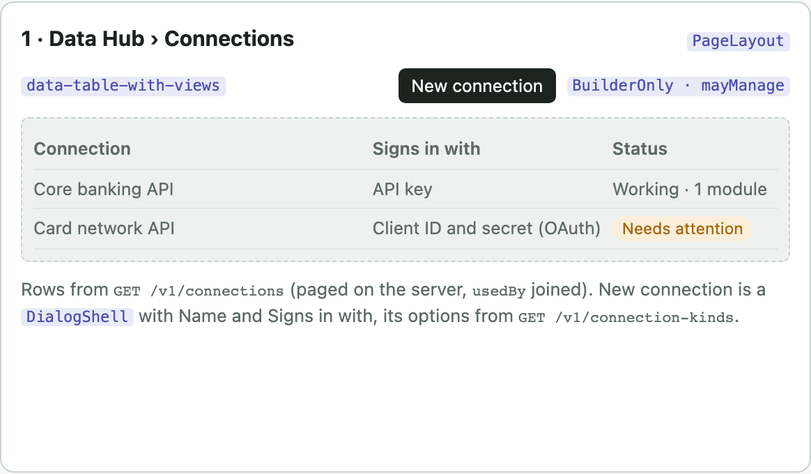
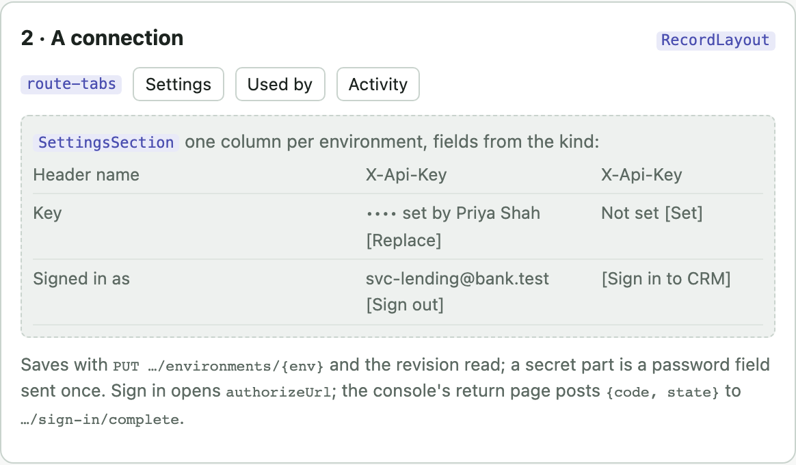

# Tools service design

Status: current. What tools-service does, its screens, API, data and sequences.

Status: current for an earlier change (connections and the one executor), an earlier change (MCP sign-in), an earlier change (mock answers) and an earlier change (the MCP server, slice 1: a team's reads over MCP with an API key). The tools service is the one way out for tool calls: a call resolves through the registry, passes the gateway's checks, signs in through its module's connection for the run's environment, and goes out through the egress client. Full product design: the tools system design in the planning notes, outside this repo.

## Flow

| # | Step | Where | State |
|---|---|---|---|
| 1 | A run calls `POST /v1/calls` with its `runContext.environment`: live runs and chats production, test runs and test chats test; absent is test | agents-service `activities/gateway.py` | built |
| 2 | Registry, schema, OPA, approval token, rate limit, check before sending | `app.py` | built |
| 3 | The executor asks `Authenticator.prepare` for the module's connection: refused unless the module's address is the connection's system address (scheme, host, port); then the strategy for its auth kind adds headers, query values or a client certificate for the environment | `auth/__init__.py` `STRATEGIES` | built |
| 4 | A kind that holds a token gets it from `Tokens`: the stored one while fresh, else a refresh or a client-credentials fetch under the token row's lock, through the egress client | `auth/tokens.py`, `store/connections.py` | built |
| 5 | The request goes out through the egress transport; a client certificate gets a pool of its own | `egress.py` | built |
| 6 | A read answered 401 is sent once more with a new token; a write is not (`AUTH_EXPIRED`) | `executor.py` | built |
| 7 | Every value resolved joins the scrub set; the call log keeps environment and connection | `executor.py`, `store/calls.py` | built |
| 8 | An MCP server's sign-in found from its 401 and metadata, issuer checked, run as the authorization code strategy with the server as `resource`; the MCP path signs in through the same authenticator | `auth/discovery.py`, `executor.py` | built |
| 9 | A call that says test answered from the operation's first matching mock answer, else its default, before step 5: error status, delay or timeout as a real answer would give them; production, and a call naming no environment, never | `executor.py`, `mocks.py` | built |

## Screens (low fidelity)

Content and components only; the console's builder composes them (purple tags are files under `apps/console/src/components`). The API below is built; the screens are not.

## API

| Method and path | Does | Who may | File | State |
|---|---|---|---|---|
| GET `/v1/connection-kinds` | Each auth kind with its fields (secret or plain, required, advanced, choices, default), the fields every environment has (`common`: the system address its credentials are bound to) and the client certificate fields | signed in | `connections/routes.py` | built |
| GET `/v1/connections` | One page by name, `search`; modules that use each joined | connections.view | `connections/routes.py` | built |
| POST `/v1/connections` | A draft: name and auth kind, owned by the acting team | connections.manage | `connections/routes.py` | built |
| GET · PATCH · DELETE `/v1/connections/{id}` | Detail with each environment's settings, which secret parts are set, who signed in, activity; rename or make available to teams (409 on a stale revision); delete refused 409 `connection_in_use` | view; manage | `connections/routes.py` | built |
| PUT `/v1/connections/{id}/environments/{env}` | One environment's settings, checked against the kind, and secret parts, written once into the secret store | connections.manage (a person) | `connections/routes.py` | built |
| POST `…/sign-in`, `…/sign-in/complete`, `…/sign-out` | Authorization code with PKCE S256: the address to send the browser to; the code and state the console hands back (once, ten minutes, the same person); forget the token | connections.manage | `connections/routes.py` | built |
| POST `/v1/connections/mcp` | An MCP server by its address: sign-in found from the server, client registered when offered and none given, a connection named after the server | connections.manage | `connections/routes.py` | built |
| POST `/v1/tool-modules/discover` | An MCP source with `connectionId` lists the tools with the connection's token; without sign-in, 400 `sign_in_required` | tools.create | `modules/routes.py` | built |
| POST `/v1/calls` | `runContext.environment` added (test or production; absent is test) | service token | `app.py` | built |
| GET `/v1/executions` | Each row adds `environment` and `connectionId` | signed in | `modules/routes.py` | built |
| GET `/v1/secrets` | Each row adds `connectionId`; rotate, scope and delete of a connection's part are 409 `connection_secret` | as before | `secrets/routes.py` | built |
| GET · POST `/v1/tool-modules/{id}/operations/{op}/mocks`, PATCH · DELETE `…/mocks/{mockId}` | An operation's mock answers in test: name, match, status, body, headers, delayMs, timeout, default | tools.view; changes tools.edit | `mock_routes.py` | built |
| POST `/mcp/test/{team}` | MCP over streamable HTTP, stateless: `tools/list` gives the team's published reads with schemas and `readOnlyHint`; `tools/call` runs one gateway call (the function `POST /v1/calls` calls) in test; a write is refused without a person; the log row keeps `channel` mcp and the client's name | API key or person token of the team, `tools.run` | `mcp_server.py`, `gateway_calls.py` | built |
| POST `/mcp/production/{team}` | 403 `production_off` until a team turns production on | as above | `mcp_server.py` | built |
| GET `/v1/executions` | Each row adds `channel` (api or mcp) and `clientName` | signed in | `modules/executions.py` | built |
| POST `/v1/connections/{id}/test` | Test connection: egress, token, one probe | connections.manage |   | planned |

## Data

All in tools-service's own chain (`tools_0028_connections`), every table keyed by `tenant_id`. `tool_modules.connection_id` points at `connections.id` with no foreign key, as it did when connections came from the seed.

| Table | Holds | Guarantee | State |
|---|---|---|---|
| `connections` | Name, auth kind, owning team, available-to teams, status and what the system refused, revision | Written only against the revision read (CAS) | built |
| `connection_environments` | Per environment: plain settings and each secret field's `tool_secrets` name | Written in the connection's transaction; cascades with it | built |
| `connection_tokens` | Access and refresh tokens (ciphertext), expiry, scopes, account, rotations; `person_id` '' for shared | Primary key (tenant, connection, environment, person); a refreshed token is stored only against the rotation it replaced (CAS), with no lock held during the token request; a caller that loses reads the winner's token | built |
| `oauth_states` | A sign-in in progress: state hash, person, PKCE verifier (ciphertext), redirect, expiry, used | Taken once by its person and connection before it expires; expired rows pruned on each new sign-in | built |
| `connection_audit` | Created, changed, secret set, signed in or out, refresh failed, deleted: names only | Written in the change's transaction; grows with people's changes, not with calls | built |
| `tool_secrets.connection_id` | Marks a connection's secret part | Changed only through the connection | built |
| `operation_mocks` | Mock answers per operation name and environment, in order, one default (`tools_0029`) | A new default clears the old one in the same transaction | built |
| `gateway_calls.environment`, `.connection_id` | What each call used | Written with the call's row | built |

## Sequences

### A call that refreshes a token

1. agents-service: `POST /v1/calls`, `environment: production`
1. Gateway checks pass; `Authenticator.prepare` reads the connection and its production row
1. `Tokens.access`: read the token; inside 60 s of expiry, POST the token address with the refresh token (egress client, no lock held); store the new tokens against the rotation read, or read the winner's
1. Send with `Authorization: Bearer`; on 401 for a read, step 3 again for that token only, then send once more
1. Scrub every token and secret value from the answer; log environment and connection

### Signing in once with the team's account

1. Console: `POST …/sign-in {environment}`; the service checks the sign-in address is on the allow-list, stores the state hash and the encrypted PKCE verifier for ten minutes
1. The browser goes to `authorizeUrl`; the person signs in; the system sends the browser to the console's return page with `code` and `state`
1. Console: `POST …/sign-in/complete {state, code}` under the same person's token; the state is taken once
1. The service exchanges the code with the verifier through the egress client and stores the tokens; status working; activity names the account
