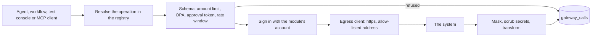

# Tools service

Status: current, checked against the code on 2026-11-18. Built: the registry, imports from OpenAPI and MCP, app accounts and sign-in, secrets, the egress allow-list, the gateway, mock answers, the MCP server and the call log. Not built: spec upload by file, MCP over stdio, a key management service.

The tools service is the one way out for tool calls. It keeps the registry behind the console's Tools and Apps pages:
each tool is an operation of a tool module, with who owns it, how the system is reached and signed in to, its
versions, its security reviews and which workflows may call it until when. Every call, from an agent, a workflow, the
test console or an outside assistant, is checked here against the operation's schema, limits and policy, signed in
with the right account, and sent only to an address the workspace allowed.

## At a glance

| Item | Detail |
|---|---|
| Owns | Tool modules, their versions, operations, mock answers, security reviews and workflow approvals; app accounts, their tokens and sign-ins in progress; secrets; the egress allow-list; sending policies; the call log; each team's built-in apps |
| Port | 8720; it decides with OPA on :8181 (`services/tools-service/policy/gateway.rego`) |
| Code | `services/tools-service` (`ops_tools`), with `ops_policy` for the cipher, `ops_plugin_sdk` for plugins, `ops_files_client` and `ops_documents_client` |
| Database | Own migration chain (`alembic_version_tools`, `services/tools-service/migrations`). Tables: `tool_modules`, `module_versions`, `module_operations`, `module_egress_hosts`, `module_approvals`, `operation_mocks`, `operation_rate_windows`, `tool_discoveries`, `tool_discovery_operations`, `app_cards`, `plugin_bindings`, `connections`, `connection_tokens`, `connection_audit`, `connect_links`, `oauth_states`, `app_credentials`, `mcp_links`, `tool_secrets`, `secret_audit`, `egress_hosts`, `egress_ranges`, `egress_audit`, `send_policies`, `send_checks`, `gateway_calls`, `gateway_fences`, `team_defaults`, `service_outbox` |
| Isolation | Every store transaction runs as `ops_tools_tenant` (`services/tools-service/src/ops_tools/store/tenancy.py:10`) under the generated tenant policy; account and token rows also carry the team policy. Tests: `services/tools-service/tests/test_tenants_kept_apart.py`, `test_team_isolation.py`, `test_call_isolation.py`, `test_mcp_team_scope.py` |
| Secrets it holds | Secret values (`tool_secrets`) and account tokens, AES-256-GCM under `OPS_SECRETS_KEY` with the tenant and name bound in, never returned and scrubbed from upstream answers; mailbox passwords and Microsoft 365 client secrets as Secrets-page secrets; the same key derives the code-run signer and the mailbox cursor key (`services/tools-service/src/ops_tools/code_runs.py:61`) |
| Calls out to | The systems tool modules name, over HTTPS on 443 to allow-listed hosts only, and MCP servers; OPA; agents-service (`GET /v1/workflow-refs`, `POST /v1/publish-requests`, events); platform-service; kb-service for the knowledge tools; documents-service for `read_file` and `read_document`; runner-service for code tools; models-service for the check before sending; mail for mailbox replies (`scripts/stack.sh:194`) |
| Called by | agents-service (`POST /v1/calls`, `GET /v1/grantable-operations`, `GET /v1/tools/{name}`, mailbox reads); kb-service (a connected app's knowledge source); documents-service (`GET /v1/plugin-templates`); runner-service (`POST /v1/code-runs/calls`); the console; outside assistants on `/mcp/{team}` |
| Events it sends | Through `service_outbox` and the `tools_relay` process to agents-service: the catalogue events below, `tool_access.requested`, `app_account.connected`, `app_account.needs_reconnect`; `policy.changed` goes to agents-service's `/v1/platform-events` (`services/tools-service/src/ops_tools/store/relay.py:21`). `app_account.connected` carries `at`, when the person signed in, and a refusal's `connectedEvent` carries `after`, when it refused; agents-service wakes a run's sign-in wait only with a sign-in from after its refusal, because one person's sign-ins share a key and the relay can deliver an earlier one late (`services/agents-service/src/ops_agents/api/engine_resume.py`) |
| Events it receives | `member.removed` (a leaver's own sign-ins and secrets go) and `team.created` (the team's built-in apps) from platform-service on `POST /v1/platform-events` |
| When something is down | agents-service unreachable: workflow approvals answer 503 `workflows_unavailable`. No runner: every code operation fails `runner_unavailable`. An unreachable judge holds a write the check before sending would judge. Each failed call names whose side failed ("Failures name their side" below) |
| Routes | API reference tab, HTTP API › Tools, built from `services/tools-service/openapi.json` |
| Design | [Design page](design.md), [identity and tenancy](../../architecture/identity-and-tenancy.md); proposed extensions in the [tool system design](../../design/tools/tool-system.md) and the [MCP server design](../../design/tools/mcp-server.md) |

> [!WARNING]
> **Known coupling.** tools-service imports agents-service code: the seed catalogue and the local executor
> (`services/tools-service/src/ops_tools/registry.py:15`, `services/tools-service/src/ops_tools/tools.py:11-12`,
> `services/tools-service/src/ops_tools/__main__.py:16`), and it lists `ops-agents-service` as a dependency (`services/tools-service/pyproject.toml:6-8`). Its gateway tests still
> live in `services/agents-service/tests/gateway`. A change to `ops_agents.activities` can therefore break
> tools-service, and tools-service cannot be installed or tested without agents-service's code until the catalogue
> moves out. The move is listed in the
> [service map](../../architecture/service-map.md).

## Run and test it alone

| Task | Command |
|---|---|
| Serve on :8720 in the foreground, seeded in dev | `make -C services/tools-service run`; on the stack, `make restart SVC=tools` |
| Apply its migrations | `make -C services/tools-service migrate` |
| Registry and API tests (starts compose) | `make -C services/tools-service test` (`T=` names files) |
| Gateway tests, which still live in agents-service | `make -C services/tools-service test-gateway` |
| Lint, strict types, tests and the OpenAPI gate | `make -C services/tools-service verify` |
| Regenerate `openapi.json` | `make -C services/tools-service openapi` |
| Use cases | `make usecase-test UC=uc-010`, `UC=uc-011`, `UC=uc-012`, `UC=uc-013`, `UC=uc-007` (uc-012 and uc-013 need a private network address for their fake bank) |
| Dev fake bank | `cd services/tools-service/scripts && uv run --project .. python -m fake_bank` serves `https://api.bank.test` on :8745 and prints the two egress settings; it reads the module from memory, so a changed `fake_bank/app.py` needs a restart. Tests: `tests/test_fake_bank.py` |

## How it works

| Part | Detail |
|---|---|
| Registry | `/v1/tool-modules`, the console's tool-modules contract (21 operations), with the console mock's rules: approval state, views and facets, staged changes, a major change opening a security review, workflow approvals that expire and that the requester never decides, and refusal of a literal credential in a header. `POST .../reviews/{id}/decide` (not in the console's contract yet) is Security's decision; approving the current version publishes it |
| Egress | `/v1/egress`: the tenant's allow-list of hosts and private ranges, every change audited; an add returns the entry as the list shows it (`entry`), so a screen can show the new row on whatever page it is on. A module's hosts are links into it. Every outbound request, discovery and calls alike, must be https on 443 to a listed host; when the connection opens, the host is resolved once, every address must be allowed (loopback, link-local and cloud metadata never; private ranges only when listed), and the connection goes to that checked address, so DNS cannot rebind between check and connect. No environment proxies, no redirects |
| Import | `discover` reads an OpenAPI 3.0 or 3.1 document (JSON or YAML) or an MCP server (initialize, tools/list over streamable HTTP) and lists every operation as a write; `operations/import`, and `create` given a `source`, re-read the source and take each operation's method, path, inputs and headers from it, the caller only picking operations and confirming reads. A re-import that no longer lists an imported MCP tool marks the module drifted, and a drifted module runs no calls |
| Secrets | `/v1/secrets`: create, rotate, delete and list. Values are AES-256-GCM encrypted with the tenant and name bound in, never returned, read on every call (a rotation reaches the next one), and scrubbed from whatever the upstream answers. Every create, rotate, delete and use is audited |
| Accounts | `/v1/apps/{app}/accounts`: how the platform signs in to one system, one account per row with an auth kind (`GET /v1/connection-kinds`: none, API key in a header or the query, username and password, bearer token, client ID and secret (OAuth), sign in with an account (OAuth authorization code with PKCE)) and its settings. An app may have a sandbox account, which test runs use; a live run never does. Every account names its system's address (`baseUrl`): the account's credentials go to that scheme, host and port only, so a module on any other address, even an allow-listed one, is refused `CONNECTION_HOST_MISMATCH` before a secret is read. A client certificate and a trusted server CA are a section of any account. Secret parts are written once from a person's request into the secret store (`CONN_<ID>_<FIELD>`, `connection_id` set) and never read back; the Secrets list shows them as the connection's and refuses to rotate, rescope or delete them there (409 `connection_secret`). Every change and sign-in is `connections.manage`, admins' by default; reads are `connections.view`. Writes are against the revision read (409 `stale_version`); a connection a module uses is not deleted (409 `connection_in_use`). Sign-in: `POST …/sign-in` answers the address to send the browser to (the sign-in address must be on the allow-list), and the console's return page posts `{code, state}` to `…/sign-in/complete` under the same person's token; the state is used once, within ten minutes. The dev seed's integration list loads as account rows with the same ids and no settings |
| MCP sign-in | `POST /v1/apps` with `serverUrl` takes a server's address and finds its sign-in from the server: its 401 names the protected resource metadata (RFC 9728; else the well-known address under its origin), which names the authorization server, whose metadata (RFC 8414) must carry that server as its `issuer` and offer S256. The connection is an `oauth2_auth_code` connection with `resource` the server, so sign-in, PKCE, refresh and rotation are shared; its client is the bank's registered one when given, else one registered with the server when it offers registration, else the request is refused naming what is missing. Every metadata, registration and token request goes through the egress client. Discovery and import of an MCP module list its tools with the module's or the source's connection token, keeping each tool's inputs; without a sign-in the server's 401 is `sign_in_required`. The MCP executor signs in as the http one does and retries a read once after a 401 |
| Mock answers | `/v1/tool-modules/{id}/operations/{op}/mocks`: an operation's mock answers in test, in order, each a status, body and headers, a delay or a timeout, optionally matching input values, one the default; changing them is `tools.edit` (not a module version: they never reach production). The one executor answers a call that says `environment: test` from the first that matches, else the default, before any egress: a status of 400 or more fails as the system's answer would, a timeout waits the operation's limit and fails `UPSTREAM_TIMEOUT`, a delay waits (all capped at 30 s), and a body is masked as a real one is. A call naming no environment, and every live call, never gets a mock. Try it's test answer reads the same mocks (`mockId` on the result). Keeping a Try it answer is a create with that answer's status and body. The tool step's `onTimeout: port` (`ops_engine`) leaves a timeout by its own port |
| MCP server | `/mcp/{team}` (`mcp_server.py`): an outside assistant (Claude Code, Cursor) connects with an API key or a person's token as `Authorization: Bearer` and lists and calls the team's tools over streamable HTTP, stateless with JSON answers (official `mcp` SDK, 2026-07-28 and the initialize handshake). Before the protocol: no credential is 401 with `WWW-Authenticate: Bearer`, a key or token of another team 403 `team_forbidden`, a caller without `tools.run` 403 `role_required` (keys hold it, register E28; viewers do not). `tools/list` is the team's published read operations (the modules its team sees, as the console scopes them) with their input schema and `readOnlyHint`; `tools/call` is one `GatewayCalls.call` (`gateway_calls.py`), the function `POST /v1/calls` also calls, as a test run, so the registry, schema, limits, OPA, rate window, executor, mocks and call log all apply. A module outside the team is refused 403 `team_forbidden` and logged; a write over MCP always needs a person's approval, whatever the operation declares, so slice 1 refuses it. Each row records `channel` (`api` or `mcp`) and the client's own name (`clientName`, a claim) |
| Mailboxes | `/v1/mailboxes/read`, `/wait` and `/test`: Gmail and IMAP mailboxes the Email received trigger watches, read here so the password (a Secrets-page secret) never leaves. agents-service sends the connection from its mailbox record; only service tokens with `deployments:run` in a team are served, the secret is looked up for that team, the host must be on the egress allow-list, plain IMAP only in dev and test . A Microsoft 365 mailbox is read and replied from through Graph with the team's own app registration: the Microsoft tenant and client id on the record, the client secret a Secrets-page secret; `login.microsoftonline.com` and `graph.microsoft.com` must be on the tenant's allow-list (checked before any call, then each request is dialled through it), Test connection names the token, read and Mail.Send steps and sends nothing, and `/wait` sleeps up to 15 seconds then lets the read decide (Graph has no IDLE here) |
| Files and Document types | The platform tools `read_file` (a team file's name, type, sensitivity and full text, found by id or by name, cut at 20,000 characters) and `read_document` (a document's fields with one of the team's document types) run behind the gateway like `open_case`, reading through documents-service as the calling team (`ops_tools/file_tools.py`); another team's file or type is not found, a file the scan has not cleared is refused, and reads are keyed by the file's bytes so a second read costs nothing. They are in every install's Platform tools module, and Connections shows them as Built in apps (uc-613) |
| Calls | `POST /v1/calls`. The tool resolves through the registry, which alone sets its access class. Refused before OPA and before any egress, each logged: a tool no module holds, a hidden operation, an unpublished module, input that fails the operation's schema (422 naming each field, unknown fields included), an amount over the operation's `amountMax` (403 `amount_over_limit`; 422 when the operation declares `amount` and the call leaves it out). Then OPA decides, writes need an approval token bound to the input, and writes are claimed and fenced as before. A call about to run for the first time spends one of the operation's `rateLimitPerMin`; past it the call is 429 `RATE_LIMITED` with `resetAt`, sends nothing and is logged |
| Security reviews | A module's security review is requested by its owner and decided by Security: under any token, an approver or admin on the workspace's Security team (its record, Settings > Workspace), never the requester (403 naming who decides); asking for changes needs a finding. Only the dev-header principal, which carries no roles, keeps the older rule of anyone but the requester. `view=security_review` lists modules with a pending review; each list row carries `pendingReview`. The console decides from Reviews > Tool modules or the module page |
| Editing a call | `PATCH .../operations/{id}` takes `method`, `path`, `headers`, `body`, `responseTransform` and `timeoutMs` on an `http` operation, validated as on add: https only, the URL on the module endpoint (a second system is a second module), no literal credential in a header, a body that is a JSON template; all 400. A method, path or body change is major (it opens a security review); headers, transform and timeout are minor. While the module has pending changes, calls run the published call shape (the baseline), so an edit reaches a system only once published |
| Response transform | A Jinja2 template over the parsed, masked and scrubbed response as `data` (`ops_tools.transform`), sandboxed and strict. A plain `{{ data.a.b }}` means the same as in Liquid; filters differ. A template that does not parse is refused at save; one that fails on a real answer returns `{response, transform_error}` and the call still succeeds. A render is bounded: range() totals 10000 items, no string is built past 100000 characters (`*`, `%`, the padding and replace filters and str methods are sized first), and a trace stops it at 1 s on a worker thread. Secrets are scrubbed before and after it |
| Team defaults | What every team gets from this service is declared in `ops_tools/defaults.py`: each built-in app (Knowledge bases, Mailboxes, Files, Document types, `modules/seed.py` `BUILT_IN`) as the team's own published module, protected as the platform's. An idempotent reconciler creates what a team lacks and replaces a copy nobody changed when `DEFAULTS_VERSION` rises, leaving a changed copy and a tool the team already holds elsewhere; `team_defaults` records each team's version, and each start brings every team behind it up to date. platform-service's `team.created` event provisions a new team (`services/tools-service/src/ops_tools/platform_events.py`), and a team's first lookup does too |
| Executors | One executor for every kind. A module with a connection signs in through it for the call's environment (`runContext.environment`: live runs production, everything else test, absent test): the strategy for its auth kind (`ops_tools.auth.STRATEGIES`) adds headers, query values or a client certificate after the operation's own, a kind holding a token gets it from `Tokens` (fresh, or refreshed through the egress client with no lock held: one request at a time per token in a process, stored against the rotation it replaced, a caller that loses reading the winner's token), a read answered 401 is sent once more with a new token, a write is not (`AUTH_EXPIRED`), and a token request the system refuses marks the connection needs attention. A connection record with no environment adds nothing; one set for test but not production refuses a production call (`CONNECTION_NOT_SET`). `http` calls the module's base address, which on a module with a connection is the connection's for the call's environment (a hand-built operation on one names a path, and a sign-in header or a module endpoint beside the connection is refused at save): `{arg}` fills the path, a `{{arg}}` body template or the remaining arguments form the body or query, the operation's `timeoutMs` (1000 to 120000) or else the module's timeout applies, `{{NAME}}` headers are filled from secrets, and masked output paths are redacted. `mcp` calls an imported MCP tool through tools/call. `stub` answers with the operation's example, its mock in the `example` environment (seeded systems with no upstream; the example lives there, not on the operation, and test-environment calls never read it). `local` runs the Runtime's demo tool of the same name |
| Failures name their side | Every failed http or MCP call carries a code and `side`. Ours: `EGRESS_DENIED`, `CONNECT_FAILED` (refused, unreachable, or the name did not resolve), `TLS_FAILED`, `CONNECT_TIMEOUT`, `POOL_TIMEOUT`. The upstream's: `UPSTREAM_TIMEOUT` (connected, no answer in time), and `RATE_LIMITED`, `INVALID_ARGUMENTS` or `UPSTREAM_ERROR` with the status it answered. A plugin's `error_when` makes a 200 answer holding the system's error an `UPSTREAM_ERROR` too, in the system's words (`docs/guide/plugins.md`). Messages are fixed phrases naming the host and phase, never an address or a header value; `/v1/executions` rows carry `errorCode`, `errorMessage` and `failureSide` |
| No cookie jar | The egress client is shared by every tenant, workflow and caller, so it keeps no cookies: an upstream's Set-Cookie is dropped and never sent on a later call; only an operation's own `Cookie` header goes out (`ops_tools.egress.no_cookie_jar`) |
| Test console | `POST /v1/tool-modules/{id}/test` runs the gateway's decision. On the `stub` target it answers with the stub. On `sandbox` (the console's Real) a read or a write is the real call: the published call shape through the same executor, egress policy, secrets and masks, on the connection's test sign-in, with its latency and `reachedHost`. A test call spends no rate; a real write is in the executions log with `channel: console`, under the person who sent it. The module's own team tries it as `owner`, the only entry in `runContexts`, without any workflow approval: calls run for real on a published module, and a bound field takes the value typed. A write that asks for an approval is not made one up; `simulateApproval` counts on the stub target only. uc-038 drives both against postman-echo.com with `OPS_LIVE_EGRESS=1` |
| Write approval | Each operation carries `approvers` (1 or 2 distinct people of the run's team); whether the asker may decide is the team's `requesterMayDecide` policy (default on; a team admin turns the two-person rule on under Approvals › Advanced, which never binds an Admin of the team), and the operation's own `requires_approval` setting (a write waits unless it is off) is edited in the same way; `approverTeam` is still stored and answered, and agents-service ignores it, edited through `PATCH .../operations/{id}`: loosening any of them is a major change. `GET /v1/tools/{name}` answers the policy to the review service, and `/v1/calls` sends `approvers_required` to OPA, which refuses a token naming fewer people. While a module has staged edits or a major version waits for Security, calls and the policy answer take the published operations (the baseline); a module never published keeps no baseline. While a version waits for Security, adding, importing or editing operations, discarding changes and publishing another version are refused (409), so the approved version is exactly what calls switch to. Changes requested ends the review: a module never published returns to draft, and a published one keeps its published operations while the declined version is revoked. Publish decides major by comparing the operations about to go live with the published ones (method, path, body, inputs, access, approval required, exposed, record binding, amount limit and the approval policy: `store.modules.REVIEWED`, the same list calls read from the published operations while edits are staged). While edits are staged, an operation added since the published version is not served, listed or grantable (`store.modules.served_operations`), not from the edit history, so a declined edit left in place goes back to Security with the next publish. Access is Read or Write only: a stored operation with any other class is refused when read, never treated as a read |
| Decide and mint | `POST /v1/calls/decide` (service token, same body as `/v1/calls`) runs the same checks through `GatewayCalls.call(decide_only=True)` and answers `{verdict: allow\|needs_review\|refuse, reason, inputHash, approversNeeded, editable, code}`; nothing is logged, claimed, spent or sent. `POST /v1/approvals` (`approvals.py`) mints the approval token for `{binding: {threadId or runId, step, tool, inputHash, workflow, system}, input, approvers}`: the input must hash to `inputHash` (422 `input_hash_mismatch`), a step that already sent a write with another input is 409 `interrupt_closed`, a call the decision refuses is refused, and the person the call acts for (`X-Acting-For`) counts as an approver only while `requesterMayDecide` lets an asker decide or the team asks the person (403 `requester_cannot_approve`). Whether each approver holds the reviewer role is checked by agents-service before it asks. The token is never stored |
| Check before sending | With a team's `checkBeforeSend` on, a write with no approval token is judged against the team's sending policy (`GET`/`PUT /v1/send-policy`, versioned) by one model call through its own key (`tools:check`) before it runs; a forbidden one is refused 409 `needs_review` with the reason. A judgement is kept per payload and policy version; older versions' are deleted when a new one is saved, and any past 30 days. An unreadable setting counts as on and an unreachable judge holds the write (register E39). |
| Grantable operations | `GET /v1/grantable-operations` (service token, the token's tenant): every enabled operation of a published module that has not drifted, the conditions `/v1/calls` checks before it runs one, with module, description, access class, input as JSON Schema and whether a call waits for approval. agents-service lists, grants and hands a run its tools from here. `GET /v1/tools/{name}` answers a registry operation's access class for the caller's tenant, and its `outputSchema`: the response schema an OpenAPI import kept (`module_operations.response_schema`), else an open schema inferred from its example response, else null |
| Executions | `GET /v1/executions?tool&moduleId&thread&decision`: every call as the console's ToolCallRow, with `subject` (from `sub`), `actor` (from `act`), run, step, approval token fingerprint, decision and deny reason. Module activity reads the same rows |
| Traffic | Each module's and operation's `calls24h`, `errorRate` and `p95Ms` come from one aggregate over `gateway_calls` per read (`CallLog.traffic`, GROUPING SETS per operation and module), counting calls that reached the system (`ok`, `error`) in the last 24 h; refusals are `denied24h`. Activity groups the same rows into 14 UTC days (`CallLog.daily`). An approval is expiring in its last 7 days |

## Catalogue events

What tools-service's outbox and `GET /v1/tool-catalog` carry for agents-service's copy of the tool catalogue
(`packages/ops_store/src/ops_store/outbox.py`). Each is written in the transaction of the write it reports
(`ops_tools.store.modules.report_module`) and keyed `<id>@<revision>`; the resync returns the same payloads. Every
event names its tenant and team; none carries a secret, a credential or a person's state of an app. Fields are added
with defaults; a payload model refuses fields it does not name, so a receiver deploys before its sender.

| Event | Key; revision | Fields | Team |
|---|---|---|---|
| `tool.module.published`, `tool.module.changed` | module id; module revision | `id`, `name`, `title`, `app`, `ownerTeam`, `status`, `version`, `templateKind` (builtin, plugin, custom), `appCardId`, `deleted`, `truncated` (over 16,384 bytes: no operations, not applied by a receiver); per operation `id`, `name`, `title`, `description` (at most 500 characters), `access`, `requiresApproval`, `enabled` | the module's, or the acting team for a workspace-level one |
| `tool.team_state.changed`, `via: approval` | `approval:<module>` per team; module revision | `moduleId`, `operations`, `expiresAt`, `deleted` | the granted team |
| `tool.team_state.changed`, `via: added` | `added:<module>` per team; the team state's own revision | `moduleId`, `operations` (names added), `waits` (added names whose answer waits), `deleted`. Model only: no sender yet | the team |

## Decisions

| Decision | Why |
|---|---|
| The registry is the one source of a tool's access class and of the tools agents may hold. The dev seed holds the console modules only, run from their stubs; the agents fixture catalogue is seeded as module operations run `local` in tests alone | Two sources let reviews, agents and the gateway disagree on a tool; on the stack a fixture tool would reach agents and run on fixture data |
| A module and its children are one aggregate written in one transaction, only against the revision read | Two concurrent edits cannot overwrite each other; the loser gets 409 |
| Keys lead with `tenant_id`, and every tools table carries the tenant policy for `ops_tools_tenant`, `tool_modules` last (migration 0086). A module is held to its tenant, not its team, and the store names the team in code (`store/modules.py` `team_modules`, `granted`) | Every tenant's dev seed reuses the console's ids, and a module may have no team or be granted to another team's workflow, so a team policy on the module row would hide modules a team is allowed to call |
| Schema validation happens in the gateway, before OPA | the console's test console promises per-field errors, so the input is checked against the schema, not only normalised |
| The call log keeps a fingerprint of an approval token (`apt:` + 32 hex), never the token | The log identifies which approval allowed a write without holding bearer material |
| Locally run tools validate against the Runtime's input, not the console seed's picture of them | The seed's `send_reply` and `place_wire_hold` fields differ from what the Runtime sends |
| The dev seed refreshes modules nobody has edited (revision 0) and leaves edited ones | A changed seed reaches an existing dev database without erasing anyone's work |
| The egress check runs inside the connection (httpcore's network backend), not before the request | Checking a name and then letting the client resolve it again lets DNS answer differently in between; a test shows the old shape dialling 10.0.0.5 |
| Private ranges are reachable only when listed; loopback, link-local and metadata never | A bank's own systems sit on private addresses, so a blanket deny forbids the product's main use; listing both host and range keeps the metadata endpoint and stray internal hosts out |
| Imported operations are writes until a person confirms a read | A name that looks like a read proves nothing; a wrong guess would run a write without an approval token |
| A secret is bound to its tenant and name in the encryption, and resolved values are scrubbed from outputs | A ciphertext copied under another name fails to decrypt, and an upstream that echoes headers cannot carry the value into the call log |
| Workflows are agents-service's: tools-service reads them on `GET /v1/workflow-refs` with its service token, caches each tenant's list for 30 s, and answers 503 `workflows_unavailable` when agents-service cannot be reached | A fixture list refused every real workflow, and a fallback would decide an approval on data that is not there |
| At start-up, module versions the seed left waiting for review are opened in Reviews through `POST /v1/publish-requests` with tools-service's own token, scoped to the module's team with `tools:publish` and naming the publisher, so Reviews records it as opened on their behalf; open tool access requests go to their system workflow once (`services/tools-service/src/ops_tools/modules/review_handoff.py`) | Reviews has one owner, agents-service, so tools-service asks it to open a review instead of keeping a copy |
| An approval records its workflow's owning team when requested; a team id tools-service has no record of is refused 422 | Visibility checks stay synchronous, and a workflow nobody here owns must not fall to the all-scope team, which would let any team decide it |
| The test console runs as the owner only, with values the builder types, not workflow or case contexts | Real cases need agents-service to expose each thread's case fields |
| An operation's rate limit is counted per tenant and operation in Postgres (`operation_rate_windows`), one atomic upsert per call, in fixed one-minute windows on the database clock; only a first execution that passed every other check spends one | The limit protects the upstream, which sees one caller whatever workflow asked, and the count must hold across gateway processes and restarts; refusals and replays spending slots would make the limit stricter than set. A window edge can let 2N through in 60 s |
| The amount limit reads the operation's `amount` input, in one function the gateway and the test panel share (`ops_tools.limits`); an amount limit on an operation without one is refused at save | Two copies let the panel and real calls disagree; a limit with nothing to read is shown and never holds |
| Staged call-shape edits are not live; calls read the baseline while changes are pending | Staged operation edits apply in place, so an edited path would otherwise run before publish and, when major, before Security's review |
| A transform sees the response already scrubbed | Scrubbing only the rendered output let `reverse`, `join` or a key lookup into an error re-encode a secret past it |
| A transform's strings are sized before they are built | A trace deadline cannot interrupt one C-level call; `"a"|center(300000000)` took 1.5 GB before any check |

## More detail

| Topic | Detail |
|---|---|
| One call from the log | `GET /v1/executions/{id}` answers the row `GET /v1/executions` lists, under the same team scope, so an Activity row opens to its call; an id that is not a call, or a call on a module the caller's team does not see, is 404 |
| Call log tenancy | `gateway_calls.tenant_id` is the caller's tenant, written at `POST /v1/calls` (migration 0015 fills older rows from their module's tenant; a row on no known module stays null and is read by nobody). Every read filters on it: the executions list and one call, a module's traffic (`calls24h`), its activity tab, and the thread filter. `tests/test_calls.py` proves a second tenant sees none of the first's calls |
| Write approval policy | Per operation: `approvers` (1 or 2, of the run's team) and `stepUp`; whether the asker may decide is the team's `requesterMayDecide` policy, default on; a team admin turns the two-person rule on under Approvals › Advanced, which never binds an Admin of the team. `stepUp`, which asks the approver to re-authenticate even with one approver (two approvers imply it). Served on `GET /v1/tools/{name}` as `approval.stepUp` and on the grantable operations as `stepUp`; every change is reviewed by Security before calls see it |
| Bank module after a document change | `uv run python scripts/reimport_bank_module.py [--as <builder email> --decide-as <Security approver email>]` imports the operations the module lacks (`search_customers` by name, address or last-four SSN, `add_customer_note`), sets `place_hold` to one approver from `team_ops` with no self-approval, and requests the Security review. Tests: `tests/test_reimport_bank_module.py` |
| Settings | `OPS_CONSOLE_URL` (where a connection's sign-in returns: `/connections/sign-in/return` on it; unset, no sign-in starts), `OPS_SECRETS_KEY` (64 hex; the dev default is refused outside dev), `OPS_EGRESS_CA_FILE` (an internal CA to trust), `OPS_EGRESS_RESOLVE` (dev only: fixed answers for names, used by the use cases) |

## Not built yet

| Gap | State |
|---|---|
| Uploading a spec file (`fileId`), MCP over stdio, a key management service behind the cipher port | not built |
| A team a connection is made available to seeing it in the list (only its modules may use it); certificate expiry warnings; each person signing in with their own account | not built |
| Tenancy on agents-service's workflow registry: `/v1/workflow-refs` serves every row to any tenant-scoped token holding `workflows:view` (`services/agents-service/src/ops_agents/api/routers/workflows.py:586`) | not built |
| The catalogue and local executor moved out of `ops_agents` (the coupling above) | not built |
