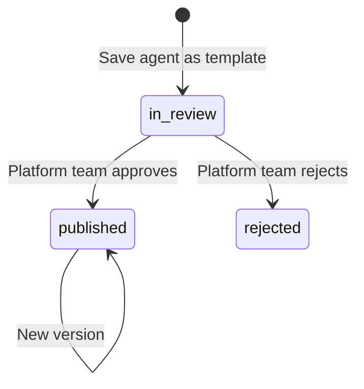

# 12 Prompts: templates and the generator

Status: draft for review.

Builds on ADR-0011 (prompt management) and ADR-0008 (AI gateway) in `../architecture/decisions/`, and
on agents and edit classes in `agent-builder.md`, evals in `evals-and-release.md` and skills in
`skills.md`. The mock is the reference for UI and API shape: `apps/console/src/lib/types/templates.ts`,
`apps/console/src/lib/types/prompts.ts`, `apps/console/src/lib/api/templates-contract.ts`,
`apps/console/src/lib/api/prompts-contract.ts`, their `-http.ts` clients,
`apps/console/src/lib/api/mock/templates/`, `apps/console/src/lib/api/mock/prompts/`,
`apps/console/src/hooks/template-queries.ts`, `apps/console/src/hooks/prompt-queries.ts`,
`apps/console/src/components/agents/template-wizard.tsx`,
`apps/console/src/components/prompts/`, `apps/console/src/app/agents/_parts/templates-tab.tsx` and
`apps/console/src/app/agents/[id]/_parts/instructions-assist.tsx`.

## 1. Summary

Two features help operations teams write good agent instructions without a prompt engineer, and
none of them moves the instructions off the agent version (ADR-0011). **Agent templates** are
platform-owned, versioned starting points (email triage, reply drafting, document extraction, policy
Q&A and seven more): "New agent" opens a five-step dialog that copies a template's role, model,
instructions, guardrails and starter tests into a new draft agent, offering only the knowledge bases
that exist and the tools the team may grant. Teams can propose a template from an agent; the
platform team reviews it. The **prompt generator** turns grouped feature fields (purpose, behaviour,
process, tools and knowledge, compliance, output) into structured instructions through the AI
gateway, streams them, lints them against the agent's real grants and variables with one-click
fixes, compares them with the current text and writes them into the field; saving is a re-test edit.

## 2. Scope

| In | Phase |
|---|---|
| Template catalog: list, facets, preview, versions, starter tests | 1 |
| Create an agent from a template version (one call), with starter tests into the agent's evals | 1 |
| Save an agent as a template (submission, visible to the submitting team, reviewed by the platform team in the Reviews queue as a `template_publish` review; the review runs the starter tests against an agent instantiated with the template's defaults in `test`, and a starter test that fails blocks at every tier) | 1 (`04` 4.9, 5.11.4, ADR-0012) |
| Prompt generator: feature fields, streamed generation, stop and regenerate, per-section rewrite, token and cost estimate, lint with fixes, compare, apply | 1 |
| Variables list and validation | 1 |
| Attach skills while creating from a template | Later (after `11` phase 2) |
| Template publishing by the platform team in the console | 1, through the same `template_publish` review (`04` 7, template page Request publish) |

| Out | Spec |
|---|---|
| Where instructions are stored, agent versions and edit classes | `01` |
| How the suite runs and gates a version | `04` |
| Skills (procedures loaded on demand, and always-on shared text) | `11` |
| The gateway call itself, aliases and budgets | `03`, ADR-0008 |

Shared instruction text such as a disclosure, a tone guide, a policy rule or a reply format is an
always-on skill (`11` 4, decided 2026-10-08): a Platform-owned skill with `loading: always` that the
runtime adds to every turn after the agent's own instructions. It has versions, a review on publish and a
"used by" list like any skill, and an agent pins the version it reads. The agent's instructions keep its
role and main prompt and never reference other text. Earlier drafts of this spec had a separate prompt
block entity; ADR-0011 records why it existed and is superseded.

## 3. Traceability

| Problem statement item | How this spec serves it | Section |
|---|---|---|
| Throughput: the marginal effort of workflow N | Templates and always-on skills make the second agent of a kind cheaper than the first | 5.1, 5.3 |
| Edit classes | Applying generated text is a re-test edit on the agent; nothing here bypasses a save | 5.2, 5.3 |
| Design lessons: rules compete; tools not mentioned are not used; trust facts never in-band | Lint flags conflicting rules, tools mentioned but not granted, unknown variables; variables are filled by the runtime, never by message text | 5.2 |
| Design lessons: stable prompt first for caching | Always-on skills are stable text added after the instructions; volatile values come from variables | `11` 5.3 |

## 4. Domain model

### 4.1 Agent template

| Field | Type | Notes |
|---|---|---|
| `id`, `version` | string, integer | Immutable per version |
| `name`, `category`, `summary`, `description` | string | Category groups the gallery |
| `status` | `published` \| `in_review` \| `rejected` | Submissions start `in_review` |
| `ownerTeam`, `submittedBy` | string | Platform for published templates |
| `riskTier` | `low` \| `medium` \| `high` | The tier the template's tools and purpose suggest; the workflow's tier still decides the gate (`01` 5.2) |
| `role`, `model`, `channels` | | Defaults for the new agent |
| `expectedTools[]` | `{name, purpose, access}` | Tool names, not ids: the catalog differs per bank |
| `expectedKnowledge[]` | string | Knowledge base names the instructions assume |
| `instructions`, `guardrails` | | Copied into the new agent; shared text comes from the template's suggested always-on skills |
| `example` | `{input, output}` | One worked interaction shown in the preview |
| `starterTests[]` | `EvalCaseInput` | Copied into the agent's own test set |
| `missingKnowledge[]`, `unavailableTools[]` | string | Computed per request for the current team |

### 4.2 Prompt spec (generator input)

| Group | Fields |
|---|---|
| Purpose | `role`, `serves` (staff role), `goals[]`, `outOfScope[]` |
| Behaviour | `tone`, `readingLevel`, `languages[]`, `verbosity` (`brief`, `standard`, `detailed`), `whenUnsure`, `escalationTriggers[]` |
| Process | `steps[]`, `decisionRules[]`, `requiredChecks[]` |
| Tools and knowledge | `toolUse[] {tool, when}` (granted operations only), `knowledge[]`, `citationRule`, `neverWithTools[]` |
| Compliance | `disclosures[]`, `forbiddenPhrases[]`, `piiHandling`, `regulatoryNotes` |
| Output | `format` (`email`, `json`, `bullets`, `memo`, `chat`), `structure`, `variables[]`, `examples[] {input, output}` |

The `PromptContext` sent with it is `{model, grantedTools[], collections[]}` from the agent draft.

### 4.3 Variable

`{key, label, example, source}`; written `{customer.first_name}` in instructions and skills. Phase 1
keys: `customer.first_name`, `customer.last_name`, `customer.preferred_language`,
`account.masked_number`, `case.id`, `case.queue`, `case.sla_due`, `staff.name`, `agent.name`, `today`.

## 5. Behaviour

### 5.1 Templates

1. The gallery lists published templates plus the current team's own submissions; submissions cannot be used to create an agent.
2. Create-from-template takes the template id and the version the person saw. A newer version since then returns 409 and the dialog reopens it.
3. Configure lists only knowledge bases that exist and tools in the team's scope (the same scope as `GET /tools`). Expected ones are preselected. Missing knowledge and unavailable tools are named with what to do; neither blocks creation.
4. A chosen tool outside the team's scope returns 403 and creates nothing.
5. A taken handle returns 409; the dialog returns to Configure with the error on Name.
6. The agent is created as a draft at version 1 with the note "Created from <template> v<n>". Starter tests are added to the agent's own set when chosen, with collections narrowed to the knowledge actually attached.
7. Save as template copies the agent's latest saved version, not unsaved edits, and creates an `in_review` submission owned by the team.

### 5.2 Generator

1. Each step validates inline before Next: role and one goal; tone and one language; one procedure step; a "when" for each chosen tool; variables in the known list; examples complete.
2. Generation streams sections in a fixed order (role and purpose, behaviour, procedure, tools and knowledge, compliance, output). Empty sections are left out.
3. Stop keeps the text so far; Regenerate replaces it. Leaving the step while streaming stops it.
4. Rewrite takes one section and an instruction and returns that section only; other sections do not change.
5. After generation, each rewrite and each fix, the server re-analyses the whole prompt and returns the token count, a cost estimate per 1,000 runs at the model's list price, and findings.
6. Lint rules:

| Rule | Severity | Finds | Fix |
|---|---|---|---|
| `conflicting_rules` | error | An "Always X" and a "Never X" on the same normalised phrase | Removes the later line |
| `unknown_variable` | error | `{key}` not in the variable list | Replaces with the closest known key when close enough |
| `tool_not_granted` | warning | A catalog tool name the agent is not granted | Removes the lines that mention it |
| `missing_citation_rule` | warning | Knowledge is attached and nothing says to cite | Adds the citation rule to Tools and knowledge |
| `too_long` | warning | More than 1,800 tokens | None; use Rewrite |

7. Apply is disabled while streaming or while any error-level finding remains. Apply writes the composed text into the Instructions field only; on the agent page that is an unsaved change, and saving it creates a version with the re-test edit class.
8. Compare shows a line diff of the current instructions against the composed result.

## 6. API

| # | Operation | Request | Response | Errors | Phase |
|---|---|---|---|---|---|
| P1 | `GET /agent-templates` | list params; filters `category`, `riskTier`, `status` | `ListResult<AgentTemplate>` with facets | | 1 |
| P2 | `GET /agent-templates/{id}` | | `AgentTemplateDetail` with `missingKnowledge`, `unavailableTools` for the caller's team | 404 | 1 |
| P3 | `POST /agents/from-template` | `CreateFromTemplateInput` (`templateId`, `templateVersion`, name, owner, model, collections, toolIds, instructions, guardrails, `includeStarterTests`); `Idempotency-Key` | `{agentId, agentName, testsAdded}` | 409 newer version or handle taken; 403 tool outside scope | 1 |
| P4 | `POST /agent-templates/submissions` | `agentId`, name, category, summary, note | `AgentTemplate` (`in_review`) | 409 name taken | 1 |
| P5 | `POST /agent-templates/{id}/versions` | template content and starter tests, `note` | `AgentTemplateVersion` (draft) and its `template_publish` review | 403 platform role only | 1 |
| P6 | `GET /prompts/variables` | | `PromptVariable[]` | | 1 |
| P7 | `POST /prompts/generate` (SSE) | `{spec, context}` | `section`, `delta`, `done {analysis}` events | 400 no role; 503 gateway | 1 |
| P8 | `POST /prompts/rewrite-section` | `{section, instruction, context}` | `PromptSection` | 400 no instruction | 1 |
| P9 | `POST /prompts/analyze` | `{sections, context}` | `PromptAnalysis` | | 1 |

Decisions on template submissions and template versions are `04` operation 48 on the `template_publish` review; this spec has no decision endpoint of its own.

P7 to P9 run through the AI gateway with the platform's prompt-builder alias and are metered to the
calling team. Lists paginate as every list does (`01` 6). JSON Schemas follow the TypeScript types
named in the header.

## 7. UI mapping

| Route or dialog | API | Gaps between mock and spec |
|---|---|---|
| `/agents` → New agent (`DialogShell` xl + `Stepper`: Choose a template, Configure, Instructions, Guardrails, Review) | P1, P2, P3 | Skills step omitted until `11` ships; starter tests use the evals API in the mock rather than P3 |
| `/agents?tab=templates` (tab, grid or table, facets) → template `DetailSheet` → Use template | P1, P2 | A tab, not a route: templates are chosen while creating an agent, and the tab keeps the list it adds to one click away |
| `/agents/[id]` → More → Save as template (`DialogShell` md) | P4 | Review happens outside the console in phase 1 |
| `/agents/[id]` Instructions → Generate instructions (`DialogShell` xl + `Stepper`, seven steps) | P6–P9 | Mock generation is deterministic text from the fields |
| `/agents/[id]` Instructions → Attach always-on skill (the Skills section's Attach skill dialog, filtered to Always on); always-on pins listed under the field | `11` | |

## 8. Security, audit and evidence

| Topic | Rule |
|---|---|
| Who may | Any agent editor may use templates and the generator. Template publish: platform role |
| Scope | Template tool lists and generator tool pickers show only the team's scope; the server re-checks on create |
| Audit | Agent created from template (template id and version), template submitted, generation requested (spec hash, tokens, cost; not the text) |
| Evidence | Agent version evidence lists the template it was created from; pinned skills, always-on ones included, are evidence under `11` |
| Trust | Variables are filled from the case and session by the runtime, never from message text (design lessons, "never put trust facts in-band") |

## 9. Non-functional

| Item | Target |
|---|---|
| Generation first section | Under 3 s at p95 through the gateway |
| Analyze | Under 300 ms for 2,000 tokens |
| Retention | Template versions are kept for the life of any agent version that pins them |

## 10. Acceptance tests (phase 1)

| # | Test | Fails when |
|---|---|---|
| T1 | Create an agent from "Customer reply drafting" with defaults; open it | The agent is not a draft at v1, its instructions differ from the template, or its evals lack the three starter tests |
| T2 | Create from "Collections outreach drafting" as a team without `get_account_arrears` | Configure does not name the missing tool and knowledge base, or creation is blocked by them |
| T3 | Create twice with the same name | The second does not return to Configure with the handle error |
| T4 | Generate from the agent page, add `{customer.firstname}` to a step | Lint does not flag it, or the fix does not produce `{customer.first_name}` |
| T5 | Add "Never cite …" opposite the citation rule | `conflicting_rules` is missing or Apply stays enabled |
| T6 | Apply generated text, then save | The new version's change is not instructions, or evals do not start on it |
| T9 | Stop generation half-way | Text so far is lost, or streaming continues |

## 11. Open questions

| # | Question | Blocks |
|---|---|---|
| Q2 | Should the generator's output be kept as a draft record for audit, or is the agent save enough? | 8 |
| Q3 | Which model alias does the prompt builder use, and is its cost charged to the team or the platform? | P7 |
