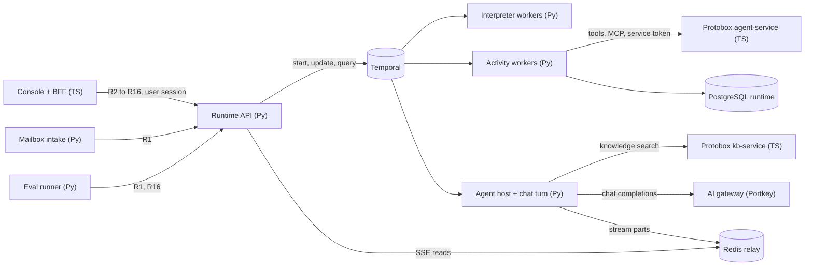
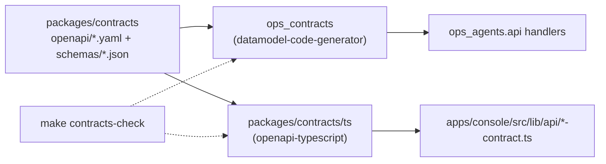

# 17 Python service skeleton

Status: draft for review. Binding inputs: ADR-0001 (Temporal), ADR-0002 (Python for everything that
executes or judges a workflow), ADR-0004 (environments, worker pools, egress), ADR-0005 (identity),
ADR-0006 (PostgreSQL, run journal), all in `docs/architecture/decisions/`; the service map
(`docs/architecture/service-map.md`), which this spec refines; spec `14` (Runtime service). ADR-0014 (agent loop library: Pydantic AI) and spec `15` (agent
kernel contract) set the agent loop; spec `16` (interpreter, in draft) sets the node types, so its
internals are referenced by name only.

## Summary

This spec answers how the real agent service gets built and on what. The answer is one Python
codebase, `services/runtime/`, that holds the Runtime API (FastAPI), the Temporal interpreter
workers, the activity workers, the agent kernel and the chat turn worker as separate packages in one
uv workspace, with layers that import in one direction only. Protobox stays the TypeScript home for
the Data Hub (tools, MCP, knowledge) and the admin; the Runtime calls it over HTTP with a service
token. Contracts are authored once as OpenAPI 3.1 and JSON Schema in `packages/contracts` and
generated into Pydantic models and TypeScript types. One developer can stand up a walking skeleton in
a week: a plan runs a no-op node, an agent node replies through a fake gateway, a human step waits
and resumes, and the console's Cases page lists the run.

## 1 The Python side in one picture

| Process | Language | Repo | Spec |
|---|---|---|---|
| Runtime API (runs, chat, deployments, internal) | Python, FastAPI | ops-ai `services/runtime/` | `14` 4 |
| Interpreter workers, one per tier (`interp-<tier>`) | Python, Temporal workflow code | ops-ai `services/runtime/` | `14` 3.1, `16` (in draft) |
| Activity workers (`act-<tier>`) | Python | ops-ai `services/runtime/` | `14` 3.1 |
| Agent-block host (`agent-<tier>`) | Python, agent kernel | ops-ai `services/runtime/` | `14` 3.1, `15` |
| Chat turn worker (`chat-<tier>`) | Python, agent kernel plus stream relay | ops-ai `services/runtime/` | `14` 3.1, `07` |
| Eval runner | Python | ops-ai `services/eval-runner/` | `04` |
| Knowledge ingest | Python (parsers already exist as a library) | ops-ai `services/knowledge-ingest/` | `02` |
| Mailbox intake | Python | ops-ai `services/mailbox-intake/` | `03` 4.6 |
| Agent service: Data Hub, tools, toolsets, MCP servers and sessions | TypeScript, NestJS | protobox `services/agent-service/` | `03` |
| KB service: knowledge search and wiki pages | TypeScript, NestJS | protobox `services/kb-service/` | `02` |
| Protobox admin, Ops AI console and its BFF | TypeScript, Next.js | protobox, ops-ai `apps/console/` | ADR-0002 |



Protobox's tool and knowledge routes stand in for the data gateway (section 10) behind one client
interface in `ops_shared.clients`, so the gateway of spec `03` replaces them without activity changes.

## 2 Repository and package layout

Amended 2026-10-10: the layout below is what the experiment series built (`services/runtime/` as one uv workspace of `ops_*` packages). The service map proposal (`docs/architecture/service-map.md`) refactors it into per-service `domain, app, adapters, api` layers after the series; its migration table maps each package to a service and layer.

`services/runtime/` replaces `services/interpreter/` (backend overview section 2, `14` open question
1). What changes from the overview: the interpreter's `nodes/` and `agent_host/` become packages
inside the Runtime workspace; run start and the run journal move here from `control_plane.runs`; the
Runtime API is its own FastAPI app instead of routes in the control plane; the agent loop is its own
package so the eval runner can import it without importing Temporal.

```text
services/runtime/
  pyproject.toml                 uv workspace root; shared ruff, pyright and pytest config
  uv.lock                        one lock for every package below
  Dockerfile                     one image, entrypoint chosen per process kind (section 9)
  alembic.ini
  migrations/                    Alembic revisions for schema `runtime` only
  packages/
    ops_contracts/               generated Pydantic models from packages/contracts; never hand-edited
    ops_shared/                  Settings, logging, tracing, identity, run context, envelope, HTTP clients
      clients/                   Protobox, AI gateway, files, identity clients behind Protocol interfaces
    ops_agent_kernel/            agent loop per ADR-0014 and spec 15; no Temporal import
    ops_agents/activities/              activity functions: tools, knowledge, cases, files, journal, agent, chat turn
    ops_interpreter/             the one Temporal workflow type, node dispatch, payload codec, worker entrypoints
      nodes/                     one module per node type (no_op, agent, human_step, classify_intent, ...)
    ops_agents/api/             FastAPI app, routers, auth, idempotency, SSE
      routers/                   runs.py, chat.py, deployments.py, internal.py
  tests/
    fixtures/                    the only place test data lives: plans, histories, canned model replies
    unit/                        pure logic: plan validation, envelope, settings
    workflow/                    interpreter under WorkflowEnvironment time-skipping
    replay/                      recorded histories replayed against the current build
    integration/                 against the compose stack (PostgreSQL, Redis, Temporal dev server)
    api/                         Runtime API through an ASGI client
  scripts/
    check_standards.py           the standards script of section 8
```

`services/files/` and `services/knowledge-ingest/` keep their own `pyproject.toml` and `uv.lock` for
now (`services/files/pyproject.toml:1-51`); a shared lock at `services/` is open question 4.

### Rules

| Rule | Detail | Checked by |
|---|---|---|
| Layers import one direction | `ops_contracts` → `ops_shared` → `ops_agent_kernel` → `ops_agents.activities` → `ops_interpreter` → `ops_agents.api`. A package imports only packages to its left. The interpreter imports activity function references to schedule them, inside `workflow.unsafe.imports_passed_through()` | `check_standards.py` rule 1 |
| No I/O in workflow code | Nothing under `ops_interpreter/` outside `worker.py` and `codec.py` opens a socket, file, clock or random source; time comes from `workflow.now()`, randomness from `workflow.random()` | Temporal sandbox at run time; `check_standards.py` rule 2 |
| Fixtures in one place | Test data lives only under `tests/fixtures/`; no sample plans, canned replies or demo records in `packages/` | `check_standards.py` rule 3 |
| Settings through one object | Each process builds one `Settings` (pydantic-settings) at boot and passes it down; a missing or malformed value stops the process before it serves or polls | `check_standards.py` rule 4 |
| No env reads elsewhere | `os.environ` and `os.getenv` appear only in `ops_shared/settings.py` | `check_standards.py` rule 4 |
| Generated code is generated | `ops_contracts/` is rewritten by `make contracts`; a hand edit fails the sync check | Contract sync check (section 4) |

The console's equivalents: `apps/console/CLAUDE.md:9-22` (layers, one env file), `AGENTS.md:9` (fixtures).

## 3 Libraries

Versions are the latest on PyPI on 2026-10-10. Pins in `pyproject.toml` use `>=` the minor shown
and `<` the next major; the lock file pins exact versions.

| Purpose | Library | Version verified | Why | Licence |
|---|---|---|---|---|
| Durable execution | `temporalio` | 1.34.0 (2026-09-30) | ADR-0001; workflow sandbox, Worker Versioning, Updates, `WorkflowEnvironment` and `Replayer` for tests | MIT |
| HTTP API | `fastapi` | 0.143.0 | Pydantic-native request and response models, dependency injection for auth and settings, OpenAPI serving | MIT |
| ASGI server | `uvicorn` | 0.54.0 | Standard FastAPI server; graceful shutdown on SIGTERM | BSD-3-Clause |
| SSE responses | `sse-starlette` | 3.5.0 | `EventSourceResponse` with ping and disconnect detection for R6, R11, R12 | BSD-3-Clause |
| Models | `pydantic` | 2.14.0 | Generated contract models, run context, plan validation | MIT |
| Settings | `pydantic-settings` | 2.15.0 | One validated `Settings` object from env at boot | MIT |
| Outbound HTTP | `httpx` | 0.28.1 | Async client with timeouts, connection pools and transport mocking for tests | BSD-3-Clause |
| SQL toolkit | `sqlalchemy` (Core, async) | 2.1.4 | Typed query building for the journal and run index without an ORM session model; works with Alembic | MIT |
| Migrations | `alembic` | 1.20.0 | Reviewed, ordered migrations the bank's DBAs can read as SQL (`alembic upgrade --sql`) | MIT |
| PostgreSQL driver | `asyncpg` | 0.32.0 | Fast async driver under SQLAlchemy; Apache-2.0, where `psycopg` 3.3.6 is LGPL-3.0-only | Apache-2.0 |
| Stream relay | `redis` (redis-py) | 8.1.0 | Redis Streams for chat stream parts with a 10-minute expiry (`14` open question 3); no job queue on it | MIT |
| Tracing and metrics | `opentelemetry-sdk`, `opentelemetry-exporter-otlp` | 1.45.1 | One trace per run, span per step and activity attempt (`14` 8); OTLP to the bank's collector | Apache-2.0 |
| FastAPI tracing | `opentelemetry-instrumentation-fastapi` | 0.66b1 | Server spans with W3C context propagation from the BFF | Apache-2.0 |
| Temporal tracing | `temporalio.contrib.opentelemetry` | ships with `temporalio` | Interceptor that propagates trace context across workflow and activity boundaries (**unverified** for 1.34; checked on day 3 of section 11) | MIT |
| Logging | `structlog` | 26.1.0 | JSON lines with bound context (`run_id`, `step_id`, ...); stdlib logging routed through it | MIT OR Apache-2.0 |
| Agent loop | `pydantic-ai` | 2.55.0 (2026-10-09, per ADR-0014) | Per ADR-0014, kernel contract in spec `15`; runs as a plain agent run inside the agent-block host and chat turn activities, with deferred tools for approvals and the AI SDK UI stream adapter | MIT |
| Contract codegen (Python) | `datamodel-code-generator` | 0.83.0 | OpenAPI 3.1 and JSON Schema 2020-12 to Pydantic v2 models | MIT |
| Contract codegen (TypeScript) | `openapi-typescript` (npm) | 7.13.0 | OpenAPI 3.1 to TS types for the console, no runtime | MIT |
| Tests | `pytest`, `pytest-asyncio` | 9.1.1, 1.4.0 | Async tests for activities and the API | MIT, Apache-2.0 |
| Workflow tests | `temporalio.testing` | ships with `temporalio` | `WorkflowEnvironment.start_time_skipping()` fast-forwards timers, so a 4-hour SLA test runs in seconds; `ActivityEnvironment` for activity unit tests; `Replayer` for replay tests | MIT |
| Lint and format | `ruff` | 0.17.0 | One tool for lint, import order and format; same rule set as `services/files/pyproject.toml:38-40` | MIT |
| Type check | `pyright` (strict) | 1.1.414 | Already the strict checker in `services/files/pyproject.toml:42-45` and backend overview section 6; `mypy` 2.4.0 (MIT) is the alternative the task named, see open question 3 | MIT |
| Packaging | `uv` | 0.13.0 | Workspaces, one lock, fast installs in CI and Docker | MIT OR Apache-2.0 |

SQLAlchemy Core over plain asyncpg SQL: the Runtime has a handful of tables (`14` 7) but the run index
query behind R2 takes optional filters, views and sort orders, which is where hand-built SQL strings
go wrong. Core builds those queries with types and keeps them in SQL shape. The ORM is not used.

## 4 Contracts flow



| Step | What happens |
|---|---|
| 1 | Operations are written by hand in `packages/contracts/openapi/` (one file per area: runs, chat, deployments, cases, ...), domain types and the workflow definition in `packages/contracts/schemas/` as JSON Schema 2020-12 |
| 2 | `make contracts` runs `datamodel-code-generator --output-model-type pydantic_v2.BaseModel` into `services/runtime/packages/ops_contracts/` and `openapi-typescript` into `packages/contracts/ts/`; both outputs are committed |
| 3 | `make contracts-check` regenerates into a temporary folder and diffs against the committed files; any difference fails CI and the pre-commit hook |
| 4 | The console's `*-contract.ts` interfaces (`OpsApi`, `CasesApi`, ...) keep their method shapes and import their parameter and result types from `packages/contracts/ts` instead of `src/lib/types/`, one area at a time; the mock keeps implementing the same interfaces |
| 5 | The Runtime API serves the committed OpenAPI document at `/v1/openapi.json`; a test asserts every route FastAPI registers appears in it with the same path and method |

**Recommendation on backend overview open question 3:** hand-write the OpenAPI first. Reasons: there
are three consumers (Python services, the console, Protobox's NestJS services), so the source should
be a format none of them owns; the console types already exist and are moved into OpenAPI once, area
by area, starting with runs; and reviewers read one YAML file per area. This differs from ADR-0002
line 59 ("Pydantic models are the source") and spec `14` section 4, which both generate OpenAPI from
Pydantic. Either ADR-0002 is amended or this section flips; open question 1.

## 5 Runtime API service

| Part | Module | Detail |
|---|---|---|
| App factory | `ops_agents/api/app.py` | `create_app(settings)` builds the app, mounts routers under `/v1`, installs middleware, opens the Temporal client, SQLAlchemy engine and Redis pool in the lifespan handler and closes them on shutdown |
| Runs router | `routers/runs.py` | R1 to R9 and R16 (`14` 4.1) |
| Chat router | `routers/chat.py` | R10 to R15 |
| Deployments router | `routers/deployments.py` | R17 (later), R18, R19 |
| Internal router | `routers/internal.py` | R7 and R14 for the case and review services, R15 for the registry; refuses user sessions |
| Health | `routers/health.py` | `/healthz` (process up), `/readyz` (database, Temporal and Redis reachable) |

### Auth

| Caller | What it sends | What the middleware does |
|---|---|---|
| Console BFF | Workload credential (service token in phase 1, mTLS or SPIFFE later per ADR-0005 line 28), the user's session token, `X-Team-Id` | Verifies both; builds `Principal{user_id, team_ids, role}` from the session claims; checks `X-Team-Id` is one of the user's teams, else 403 with `error.team` so the console can offer to switch (`apps/console/src/lib/api/contract.ts:214-224`) |
| Case and review services | Workload credential only | Allowed on `internal` routes only; R7 and R14 refuse a user session (`14` R7) |
| Mailbox intake, eval runner, data gateway | Workload credential only | Allowed on R1 and R16 with the caller's name recorded as trigger source |
| Bank systems on R17 | Deployment API key with `runs:write` | Checked against the registry (later) |

Auth is a FastAPI dependency per router, so a route without it fails `check_standards.py` rule 5.
In `dev` only, a `dev` auth mode accepts a fixed user for the walking skeleton; `Settings` refuses
that mode when `environment` is `test` or `production`.

### Envelope and errors

The console reads `body.data` on success and `body.error.message` and `body.error.team` on failure
(`apps/console/src/lib/api/http.ts:41-48`). Protobox's exception filter already emits
`success: false` with a `code` (`protobox/packages/nestjs-common/src/filters/api-exception.filter.ts:33-35`, `:85`).
The Runtime API uses the same shape:

| Case | Body |
|---|---|
| Success | `{ "success": true, "data": ... }`; lists return `data: { items, total, page, pageSize, viewCounts? }` |
| Error | `{ "success": false, "error": { "code", "message", "status", "requestId", "team"?, "details"? } }` |

| Error class | Status | `code` |
|---|---|---|
| `ValidationFailed` | 400 | `validation_failed` (Pydantic errors in `details`) |
| `Unauthenticated` | 401 | `unauthenticated` |
| `Forbidden`, `WrongTeam` | 403 | `forbidden`, `wrong_team` (with `team`) |
| `NotFound` | 404 | `not_found` |
| `Conflict` | 409 | `turn_active`, `run_not_waiting`, `idempotency_mismatch` |
| `StepUpRequired` | 422 | `step_up_required` (spec `13`, money approvals) |
| `DependencyUnavailable` | 503 | `temporal_unavailable`, `registry_unavailable` (`14` 5.1) |

Spec `14` section 4 names RFC 9457 problem details; this envelope carries the same facts inside
`error` so the console client needs no change. Open question 2.

### Idempotency and streaming

| Concern | Rule |
|---|---|
| Idempotency keys | R1 derives `runId` from `(environment, workflowId, trigger.key)` and lets Temporal refuse a duplicate workflow id; R7 and R14 use the caller's `updateId` as the Temporal Update id; R11 uses `clientMessageId`; R16 and R17 take an `Idempotency-Key` header stored in `runtime.idempotency_key(key, caller, request_digest, response, expires_at)` for 24 hours. The same key with a different body digest returns 409 `idempotency_mismatch` |
| SSE | R6, R11 and R12 return `EventSourceResponse`. Parts are read from the Redis stream `runId:turnId` (chat) or `run:<runId>` (run events), each event carries its stream id as `id:` so `Last-Event-ID` resumes; a 15-second ping keeps proxies open; a client disconnect stops the read and never cancels the turn (R13 does that) |

## 6 Temporal workers

| Process | Entrypoint | Task queue | Registers | Concurrency default |
|---|---|---|---|---|
| Interpreter worker | `python -m ops_interpreter.worker --tier low` | `interp-<tier>` | The interpreter workflow type only | 200 workflow tasks (**unverified**, set by load test) |
| Activity worker | `python -m ops_agents.activities.worker --tier low --kind act` | `act-<tier>` | Tool, knowledge, case, files, journal and child-start activities | 50 activities |
| Agent-block host | `python -m ops_agents.activities.worker --tier low --kind agent` | `agent-<tier>` | Agent activities that call `ops_agent_kernel` | 20 activities |
| Chat turn worker | `python -m ops_agents.activities.worker --tier low --kind chat` | `chat-<tier>` | The streaming turn activity | 20 activities |

| Concern | Rule |
|---|---|
| Registration | Each entrypoint lists its workflows and activities explicitly in one `REGISTRY` tuple per kind; there is no auto-discovery, so a code review sees what a pool can run |
| Sandbox | Workflow code runs in the default Temporal sandbox. Pydantic models and plan types are imported with `imports_passed_through()`; the Pydantic data converter is installed on client and worker; the payload codec (ADR-0004) encrypts every payload before it reaches the server |
| Versioning | Interpreter workers start with a Worker Deployment Version (`build_id` = image digest) and runs are Pinned (ADR-0004, `14` 8) |
| Heartbeats | Any activity that can run past 10 seconds heartbeats with its progress (for example the agent loop's turn count) and sets `heartbeat_timeout`; a lost worker is detected within that timeout instead of the start-to-close timeout |
| Retries | Retry policies are set per node type in the plan; `deny`, `budget_exceeded` and validation errors raise non-retryable `ApplicationError` (`14` 5.2, 5.4) |
| Graceful shutdown | On SIGTERM the worker stops polling, waits up to `graceful_shutdown_timeout` (30 s default, 130 s on the chat pool to cover the 120 s turn cap) for running activities, then exits; Kubernetes `terminationGracePeriodSeconds` is set 10 s above it |
| Tier isolation | One image, but each tier's Deployment runs in its own namespace with its own workload identity, so a `low` pod cannot poll `medium` (`14` 8, ADR-0004) |

**How the chat turn worker differs.** A chat turn is a long activity that writes stream parts to
Redis as the model produces them, instead of returning one result at the end. It heartbeats on every
part, checks for cancellation (R13) between parts, keeps partial text on failure (`07` turn states),
and is the only activity kind that needs Redis egress. Its pool is sized for concurrent open streams
and its first-part target is 500 ms p95 (`14` 8).

## 7 Local development

### Compose stack

`deploy/compose/compose.yaml` (planned in `deploy/compose/README.md:1-12`) gains the Runtime's
dependencies. Services run on the host with reload.

| Container | Image | Purpose |
|---|---|---|
| Temporal dev server | `temporalio/temporal` running `temporal server start-dev` (**unverified** image name) | Server plus UI on 8233 |
| PostgreSQL `ops` | `postgres` | Schema `runtime` and the other control-plane schemas |
| Redis | `redis` | Stream relay |
| Fake AI gateway | `services/runtime/tests/fakes/ai_gateway.py`, FastAPI | Answers `/v1/chat/completions` from canned replies in `tests/fixtures/model/`, including streamed chunks, so no model key is needed |
| Portkey gateway | `portkeyai/gateway` (**unverified** image name), profile `portkey` | Real AI gateway data plane when a developer has a model key |
| Fake data gateway | `tests/fakes/data_gateway.py` | Answers tool and knowledge calls from fixtures; switchable to a local Protobox at `localhost:4100` |

### Make targets

Protobox's dev targets that this mirrors:

| Protobox target | File | Runtime equivalent |
|---|---|---|
| `infra` | `protobox/make/infra.mk:31` | `make runtime-infra` (compose up) |
| `dev` | `protobox/make/protobox.mk:144` | `make runtime` (infra, migrations, API and all four worker kinds for tier `low`, logs to `.logs/`) |
| `dev-stop`, `restart`, `logs` | `protobox/make/protobox.mk:399`, `:138`; `make/surfaces.mk:96` | `make runtime-stop`, `runtime-restart`, `runtime-logs` |
| `dev-health` | `protobox/make/protobox.mk:236` | `make runtime-health` (calls `/readyz`, lists Temporal pollers per queue) |
| `seed-demo` | `protobox/make/protobox.mk:389` | `make runtime-seed` |
| `test` | `protobox/Makefile:43` | `make runtime-test` (unit, workflow, api); `make runtime-test-int` against compose |
| `db-migrations` | `protobox/make/infra.mk:142` | `make runtime-migrate` (Alembic) |
| `usecase-test` | `protobox/make/usecase.mk:26` | `make runtime-e2e` (section 11 proofs) |
| (none) | | `make runtime-replay` (replay `tests/replay/histories/` against the current build) |
| (none) | | `make contracts`, `make contracts-check` |

### Switching the console to the real API

`apps/console/src/lib/api/index.ts:9-12` picks the HTTP client when `NEXT_PUBLIC_OPS_API_URL` is set
and the mock otherwise; that file is the only one allowed to read env (`apps/console/CLAUDE.md:22`).
One base URL serves every area, so pointing it at the Runtime API alone breaks every page the Runtime
does not serve. Until the control plane exists, the console's Next.js server routes `/runs*`,
`/workflows/*/runs` and `/chat/*` to the Runtime and everything else to the mock behind the same base
URL (a dev-only proxy route in the BFF; **unverified** that the BFF has a place for it today). The
switch stays one env value.

### Seed data and the headless proof

`make runtime-seed` loads from `tests/fixtures/seed/`: one compiled no-op plan, one plan with an agent
node and a human step, the registry stub answers for `resolveTrigger` and `getPlan`, and one team
matching the mock's `DEFAULT_TEAM_ID` (`apps/console/src/lib/api/index.ts:23`). The task said the
console already uses Playwright for a headless proof; no Playwright dependency or test was found in
`apps/console/package.json` or the repo outside `pnpm-lock.yaml`, because the headless proofs so far
ran Playwright from another repository's `node_modules`. The proof must be added. Default:
add `@playwright/test` to the console with one spec that loads `/cases` with the real API and asserts
the seeded run row and zero console errors (the smoke rule in `docs/specs/design-lessons.md:121`).

## 8 Standards and the verify gate

`make verify` in `services/runtime/` runs, in order, and fails on the first error:

1. `ruff format --check` and `ruff check`
2. `pyright` strict over `packages/` and `tests/`
3. `pytest tests/unit tests/workflow tests/api tests/replay`
4. `make contracts-check`
5. `python scripts/check_standards.py`

The repo's pre-commit hook (`.githooks/pre-commit`, which runs `pnpm verify` today) also runs
`make -C services/runtime verify` when a staged file is under `services/` or `packages/contracts/`.
`--no-verify` is not used (`AGENTS.md:12`).

| # | Rule `check_standards.py` enforces | How it proves it |
|---|---|---|
| 1 | Layer direction | Parses imports with `ast`; any import of a package to the right in the order of section 2 is reported with `file:line` |
| 2 | No I/O in workflow code | Under `ops_interpreter/` (except `worker.py`, `codec.py`), reports imports of `httpx`, `sqlalchemy`, `redis`, `socket`, `os`, `time`, `random`, `datetime.now` and `open(` |
| 3 | Fixtures only under `tests/fixtures/` | Reports `.json`, `.yaml` and `.eml` files under `packages/`, and string literals over 2 KB in `packages/` |
| 4 | Env read only in `ops_shared/settings.py` | Reports `os.environ`, `os.getenv` and `dotenv` anywhere else, and any `.env` file in the tree |
| 5 | Every route authenticated | Imports the app and reports any route except `/healthz`, `/readyz` and `/v1/openapi.json` without the auth dependency |
| 6 | Log fields present | Reports `logging.getLogger` and `print(` in `packages/`; logging goes through `ops_shared.logging.get_logger`, which binds the context below |

### Logging and tracing conventions

| Field | On every log line and span | Source |
|---|---|---|
| `run_id`, `workflow_id`, `version`, `environment`, `tier` | When inside a run | Run context, bound by a Temporal interceptor for workflows and activities |
| `step_id`, `attempt` | Inside a step | Activity info |
| `turn_id`, `session_id` | Inside a chat turn | Turn input |
| `gateway_call_id`, `model_call_id` | On the line and span of each gateway call | Returned by the gateway; also written to the journal row (`14` 5.7) |
| `request_id`, `trace_id` | Always | Middleware or interceptor |
| `team_id`, `principal` | On API requests | Auth dependency |

Message text, email bodies and model output are never logged; only their `fileId` is (backend overview section 7).

## 9 Deployment

| Item | Rule |
|---|---|
| Images | One image built from `services/runtime/Dockerfile`; Kubernetes Deployments per process kind and tier choose the entrypoint. Separate images per kind are possible later if a packaged agent's dependencies bloat the base |
| Manifests | Per ADR-0004: one namespace per tier with the interpreter, activity, agent and chat Deployments of that tier; the Runtime API in its own namespace per environment; Temporal Worker Controller resources for interpreter Deployments (ADR-0004 line 42) |
| Config | Env vars injected from the bank's secret store (ADR-0004 line 29) into the pod; `Settings` validates them at boot; no config files with secrets in the image |
| Health | API: `/healthz` liveness, `/readyz` readiness. Workers: a small HTTP listener on 8081 with `/healthz` (process up) and `/readyz` (Temporal client connected and polling); readiness turns false at SIGTERM |
| Egress | Default-deny network policy (ADR-0004 line 28). Interpreter: Temporal only. Activity: Temporal, Protobox or data gateway, files, identity, PostgreSQL. Agent host: Temporal, AI gateway, data gateway, identity. Chat: same plus Redis. API: Temporal, PostgreSQL, Redis, registry, identity |
| Provenance | Non-root, read-only root filesystem. SBOM in CycloneDX from the uv lock at build; image signed with cosign and verified by the cluster's admission policy; base image from the bank's registry (**unverified** which registry and signing tool the bank runs) |
| Python version | One minor version across the workspace, set in `requires-python` and the base image. Default 3.14: in bugfix support until October 2027 and security support until October 2030 (devguide). The two existing packages pin `>=3.12,<3.13` (`services/files/pyproject.toml:6`), and 3.12 is security-only, so they move with the workspace. A minor upgrade happens once a year after `make verify` and the replay corpus pass on the new version |

## 10 How Protobox calls it and how it calls Protobox

### Runtime dependencies mapped to Protobox routes that exist today

All Protobox routes are under the global prefix `api/v1`
(`protobox/services/agent-service/src/main.ts:22`). Paths below omit it.

| Spec `14` dependency | Protobox route | File:line | Gap |
|---|---|---|---|
| 5.2 tool call | `POST /tools/:id/execute` | `protobox/services/agent-service/src/tools/tools.controller.ts:723` | No run context token, OPA decision or approval-token check; execution is gated per action in the executor (`tools.controller.ts:724`, comment) |
| 5.2 tool list for a module | `GET /toolsets/:slugOrId/tools` | `protobox/services/agent-service/src/tools/toolsets.controller.ts:114` | No module version pins |
| 5.2 call log | `GET /tools/executions/:executionId`, `/trace` | `tools.controller.ts:591`, `:624` | Not joined by `runId` |
| 5.2 call log write | `POST /tools/internal/log-execution` (`X-MCP-API-Key`) | `tools.controller.ts:805` | Shared-secret header; replaced by service token |
| 5.2 MCP server registry | `POST /mcp/servers/:slug/resolve`, `/keys` | `protobox/services/agent-service/src/mcp/mcp-servers/mcp-servers.controller.ts:80`, `:152` | Candidate module adapter only |
| 5.2 MCP sessions | `POST /mcp/sessions`, `GET /mcp/sessions/:id/events` | `protobox/services/agent-service/src/mcp/mcp-session.controller.ts:64`, `:196` | Not opened beyond route list |
| 5.3 knowledge search | `POST /knowledge/search` | `protobox/services/kb-service/src/knowledge/knowledge.controller.ts:881` | Workspace auth, no run context, no `noAnswer` threshold, citation version not checked |
| 5.3 wiki page index | `GET /knowledge/pages/index` | `knowledge.controller.ts:1909` | |
| 5.3 wiki page read | `GET /knowledge/:id`, `GET /knowledge/:id/revisions/:n` | `knowledge.controller.ts:2588`, `:2504` | Revision read exists, so pinning a revision (`14` open question 6) is possible |
| 5.4 model call | `POST /agents/completion` | `protobox/services/agent-service/src/chat/chat.controller.ts:213` | Not used; the Runtime calls the AI gateway directly (ADR-0008) |

**Must be built:** registry reads (`14` 5.1), the run context mint (5.5), case operations (5.6), audit
ingest (5.7), files service internal writes (5.8). None exist in Protobox.

### Service-to-service auth

Protobox's `AuthGuard` reads `X-Gateway-Token`; when the token's payload has `type: "service"` it
verifies it as a service token and requires `X-Workspace-Id`
(`protobox/packages/nestjs-common/src/guards/auth.guard.ts:107-108`, `:166-195`). The token is made in
`createServiceToken` (`protobox/packages/platform-core/src/jwt/index.ts:313-343`). The Python client
in `ops_shared.clients.protobox` must send:

| Header | Value |
|---|---|
| `X-Gateway-Token` | HS256 JWT signed with the shared `GATEWAY_JWT_SECRET` (`auth.guard.ts:78`), claims `type: "service"`, `app: <AppId>`, `rid: <request_id>`, `iss: "platform-service"`, `iat`, `exp` at most 5 minutes (`jwt/index.ts:44`, `:48`) |
| `X-Workspace-Id` | The Protobox workspace mapped to the run's team |
| `X-Service-Name` | `ops-runtime`; Protobox then skips its response envelope and returns the raw body (`protobox/packages/nestjs-common/src/interceptors/response.interceptor.ts:83-89`) |

Two gaps. `AppId` is `'chanl' | 'protobox' | 'platform'` (`protobox/packages/platform-core/src/types/index.ts:11`),
so an `ops-runtime` caller needs a new value or reuses `platform`. A shared symmetric secret means any
holder can mint tokens for any workspace, which falls short of ADR-0005's workload identity
(ADR-0005 line 28); acceptable for the `dev` skeleton, replaced by mTLS or SPIFFE before `test`.
Open question 5.

Protobox calls the Runtime only through the data gateway's workflow-tool path (R1 with `parentRunId`, `14` 5.2).

## 11 Walking skeleton for one developer in one week

| Day | Step | Proof (command and what it must show) |
|---|---|---|
| 1 | Workspace, `Settings`, logging, `/healthz` and `/readyz`, compose with Temporal dev server, PostgreSQL, Redis; `make verify` green with `check_standards.py` rules 1, 4, 5 | `make runtime-health` prints 200 for both endpoints; `check_standards.py` fails when an `os.getenv` is added to `ops_agents.activities`, then passes when removed |
| 2 | Contracts for R1, R2, R3, R7 in `packages/contracts/openapi/runs.yaml`; `make contracts`; Alembic migration for `runtime.run`, `runtime.run_step`; interpreter workflow with node type `no_op`; R1 starts it | `make runtime-e2e STEP=noop`: R1 returns 201 with a `runId`; Temporal UI shows the run completed; `runtime.run_step` has one row; a second R1 with the same key returns 200 and the same `runId` |
| 3 | `agent` node calling `ops_agent_kernel` with a stub loop through the fake AI gateway; journal records `model_call_id` | R3 shows step `agent` with the canned reply's `outputRef` and a `model_call_id`; the trace in the console exporter has one span per step with `run_id` and `step_id` |
| 4 | `human_step` node: Update handler `actionDecided` plus a durable timer; R7 on the internal router | Run sits in `waiting` in R3; R7 with `actionDecided` resumes it to `completed`; a time-skipping test proves the timer path fires after the SLA without a decision; replaying the recorded history passes |
| 5 | R2 with views and `viewCounts`; console proxy route; Playwright spec | With `NEXT_PUBLIC_OPS_API_URL` set, `/cases` lists the seeded runs, the `needs_person` count matches the waiting run, zero console errors |

Each proof is watched failing once before it is trusted: day 2 with the worker stopped (R1 returns 201
but the run never completes, so the check must fail), day 4 with R7 sent to the wrong run (404).

## 12 Open questions for the owner

| # | Question | Default |
|---|---|---|
| 1 | Is the contract source hand-written OpenAPI and JSON Schema (this spec) or Pydantic models with generated OpenAPI (ADR-0002 line 59, spec `14` 4)? | Hand-written OpenAPI first; amend ADR-0002 and spec `14` |
| 2 | Does the error body follow the console's `{ success: false, error: {...} }` or RFC 9457 `application/problem+json` (spec `14` 4)? | The console's envelope, with RFC 9457's `type` URI carried as `error.type` |
| 3 | Type checker: pyright strict (already in `services/files`, backend overview section 6) or mypy strict as the task named? | pyright strict, one checker for every Python package |
| 4 | Does the uv workspace root sit at `services/runtime/` or at `services/` so files, knowledge-ingest, eval runner and mailbox intake share one lock? | `services/runtime/` now; lift to `services/` when the second service gets a server |
| 5 | Is the Protobox HS256 service token acceptable between the Runtime and Protobox in `dev`, and what replaces it in `test`? | Accept in `dev` with a new `AppId` value `ops-runtime`; mTLS through the bank's mesh from `test` |
| 6 | Python minor version for the workspace? | 3.14, moving the two existing packages off 3.12 |
| 7 | One image for every process kind, or one per kind? | One image until a packaged agent's dependencies make it too large |
| 8 | Does the console reach the Runtime through a BFF proxy route during the skeleton, before the control plane exists? | Yes, a dev-only route in the console's Next.js server that sends run and chat paths to the Runtime and the rest to the mock |

## 13 Sources

Files opened for this spec (ops-ai paths relative to ``).

- `docs/architecture/service-map.md` (whole); `docs/specs/runtime-service.md` (1–106, 150–340, 452–535); `docs/specs/sign-in-and-sessions.md` (grep for tokens); `docs/specs/design-lessons.md:121`
- `docs/architecture/decisions/implementation-language.md` (whole); `deployment-tenancy-and-promotion.md` (7–42, 107); `identity-and-entitlement.md:28`, `:64`; `data-stores-and-evidence.md` (17–45); `agent-loop-library.md` (41–49, 92–95)
- `AGENTS.md:1-13`; `apps/console/CLAUDE.md` (whole); `apps/console/scripts/check-standards.mjs` (rule list); `.githooks/pre-commit`
- `apps/console/src/lib/api/index.ts:1-23`, `http.ts:1-58`, `contract.ts:214-224`, `cases-http.ts:19-21`
- `services/README.md`, `services/files/pyproject.toml`, `services/knowledge-ingest/pyproject.toml`, `packages/contracts/README.md`, `deploy/compose/README.md`
- `<orchestration repo>/CLAUDE.md:498` ("Services Overview")
- Protobox (`protobox/`): `Makefile`, `make/protobox.mk`, `make/infra.mk`, `make/surfaces.mk`, `make/usecase.mk` (target lists); `services/agent-service/src/main.ts:22`; `services/agent-service/src/tools/tools.controller.ts` and `toolsets.controller.ts` (routes, 60–76, 718–812); `services/agent-service/src/mcp/mcp-servers/mcp-servers.controller.ts`, `mcp/mcp-session.controller.ts`, `chat/chat.controller.ts` (routes); `services/kb-service/src/knowledge/knowledge.controller.ts` (routes, 875–920)
- Protobox auth and envelope: `packages/nestjs-common/src/guards/auth.guard.ts:1-200`, `interceptors/response.interceptor.ts:82-90`, `filters/api-exception.filter.ts:30-35`, `:85`; `packages/platform-core/src/jwt/index.ts:44-48`, `:155-185`, `:300-410`; `packages/platform-core/src/types/index.ts:11`

Web sources. Versions and licences were read from each project's PyPI page (`https://pypi.org/project/<name>/`) on 2026-10-10 for every Python library in section 3.

- Temporal Python SDK 1.34.0 release notes: https://github.com/temporalio/sdk-python/releases/tag/1.34.0
- Temporal Python testing suite (`WorkflowEnvironment.start_time_skipping`, `ActivityEnvironment`, `Replayer`): https://docs.temporal.io/develop/python/testing-suite
- PyPI: https://pypi.org/project/temporalio/, https://pypi.org/project/fastapi/, https://pypi.org/project/pydantic/, https://pypi.org/project/opentelemetry-sdk/, https://pypi.org/project/uv/ (and the same URL pattern for the others in section 3)
- openapi-typescript: https://www.npmjs.com/package/openapi-typescript
- Python version support: https://devguide.python.org/versions/

Unverified, as marked in the text: Temporal and Portkey container image names, the OpenTelemetry
interceptor's state in `temporalio` 1.34, worker concurrency defaults, whether the console BFF has a
place for a proxy route, and the bank's image registry and signing tooling.
