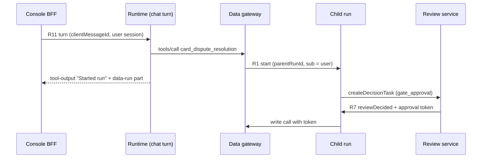

# 14 Runtime service

Status: draft for review. Binding inputs: ADR-0001 (Temporal interpreter), ADR-0002 (Python; two
machine-readable contracts), ADR-0003 (workflow definition), ADR-0004 (deployment, tenancy,
promotion), ADR-0005 (identity and entitlement), ADR-0006 (stores and evidence), ADR-0008 (AI
gateway), ADR-0009 (chat) and ADR-0012 (assurance), all in `docs/architecture/decisions/`; the
architecture overview (`docs/architecture/overview.md`) and service map
(`docs/architecture/service-map.md`); specs `01`, `03`, `04`, `07`, `09` and `10`. Grounded in the console
mock's `apps/console/src/lib/api/contract.ts` (`agents`, `workflows`, `deployments`),
`cases-contract.ts`, `chat-contract.ts`, `connect-contract.ts` and the types in
`apps/console/src/lib/types/domain.ts`, `cases.ts`, `chat.ts` and `connect.ts`. The task named
`types/workflows.ts`, `agents.ts` and `deployments.ts`; those files do not exist, and the same
types live in `domain.ts`.

## Summary

The Runtime is the one independently deployable service family that executes things: workflow runs,
agent runs and chat sessions, all on one Temporal interpreter. It owns run state (the run index, the
step journal, chat sessions and turns) and nothing else. Every definition it runs comes from the
registry by digest, every system call goes through the data gateway, every model call through the AI
gateway, every human decision arrives as a Temporal Update from the case or review service, and every
byte larger than a reference goes through the files service. This spec fixes the service boundary,
the Runtime API the console BFF and the channels call, and the contract the Runtime needs from each
common API around it. The backend overview's `services/interpreter/` folder becomes
`services/runtime/`, and run start plus the run journal move to it from `control_plane.runs`
(backend overview section 4); see open question 1.

## 1 What the Runtime is and is not

**What it is.** The Runtime is the process family that runs the one Temporal interpreter workflow
type (ADR-0001), the activities that workflow calls, the agent-block host that runs agents inside
activities (ADR-0003), and chat turns (ADR-0009, `07` CD-1). It starts runs at the version a release
pointer names, pins that version for the run's life, waits for people at no compute cost, resumes on
decisions, streams progress, and records every step in a journal that outlives Temporal's history
retention (ADR-0006). It owns run state: which runs exist, what each is pinned to, which step it is
on, who it waits for, what each step consumed and produced (by reference), and the chat sessions and
turns that are runs. It holds no keys, no system credentials and no definition it could edit.

**What it is not.** It does not hold definitions, versions, pointers or deployments; those are the
registry in the control plane (`01` 4.1–4.2, `04` 4.7). It is not either gateway: tool, knowledge,
mailbox and MCP calls are the data gateway (`03` 4–5), model calls are the AI gateway's
key-and-budget service in front of Portkey (ADR-0008). It is not the console BFF, which stays in
TypeScript inside `apps/console/` and owns session cookies and the AI SDK transport (ADR-0002,
ADR-0009). It does not own cases, queues, SLAs, decision tasks or approval tokens; those are the case
and review modules of the control plane (`01` 4.7–4.8). It is not the eval harness: datasets, graders,
judges, baselines and evidence sealing are the eval runner (`04`, backend overview service map); the
Runtime only executes the runs the eval runner asks for. It does not own chat threads, titles, pins,
sharing or feedback (`07` entities `Thread`, `Share`, `Feedback`), which stay with the control plane's
chat module; see open question 2.

## 2 Runs of three kinds on one engine

All three kinds are executions of the same interpreter workflow type against a compiled execution
plan addressed by digest. The kind changes what starts the run and how it ends, never which code runs.

| Kind | What starts it | What it pins at start | How it ends | Where the console sees it |
|---|---|---|---|---|
| Workflow run | A trigger: mailbox intake (new mail), schedule, API channel call, MCP deployment call, a workflow tool called by an agent (`03` 4.1a), the eval runner, a sample-mail test | `workflowId`, `versionNumber`, `definitionDigest`, `planDigest` from the release pointer of its environment; interpreter build through Worker Versioning (ADR-0004); `sub` and `act` (ADR-0005) | Plan reaches an end node; fails past its retry budget into the human step, then ends when the case closes; cancelled by an operator | Cases page run list (`cases.runs`, `RunRow`), the run sheet (`cases.run`), the workflow's Runs tab (`workflows.runs`), the case page when it opened a case |
| Agent run | A call on any channel of an agent's wrapper workflow (`01` 4.1 `wrapsAgentId`, 5.9.9): API, MCP, intranet widget, agent Test sheet | Same as a workflow run; the wrapper's version pins exactly one published agent version (`01` 4.5) | Reply produced (one turn), or paused at a gate review and then ended by the decision | Runs tab of the wrapper workflow, labelled "Agent · name" (`Deployment.agentName`); Cases when a gate pauses it |
| Chat session | First message in a console chat thread with no open session (`07` CD-1) | Same as a workflow run, for the agent's wrapper at the `production` pointer; transcript so far by reference | Idle 30 minutes, release pointer moved, thread archived or hidden, or an error (`07` session states) | Console chat thread; each turn's tool cards show child runs; gate reviews show in Reviews |

A **child run** is a workflow run whose trigger is a workflow tool call from an agent run or a chat
turn. It is an ordinary run of the called workflow at that workflow's live pointer, with its own
identity, gate policies and tier queue (`03` 4.1a.2). The Runtime records the link
(`parentRunId`, `parentStepId`) so the calling turn's trace and the mock's
`AgentTestTurn.startedRuns` can show it. The parent does not wait for the child to finish, because a
child may pause for a person for days while a chat session closes after 30 minutes.

## 3 Service boundary

### 3.1 Deployable units

| Unit | Runs | Needs to run | Scaling unit | State it holds |
|---|---|---|---|---|
| Runtime API | FastAPI app: start, query, list, signal, cancel, chat sessions and turns, SSE relay reads | PostgreSQL schema `runtime`, Temporal frontend (client), registry and identity APIs, stream relay | Replicas behind the bank's ingress, per environment | None in process; everything in `runtime` and Temporal |
| Interpreter workers | Workflow tasks of the interpreter type only; no I/O | Temporal frontend; task queue `interp-<tier>` | One Kubernetes deployment per risk tier per Worker Deployment Version (ADR-0004) | Workflow state in Temporal history; plan cached by digest in memory |
| Activity workers | Tool, knowledge, case, files, journal and child-start activities | Temporal, data gateway, case service, files service, identity (run context mint), `runtime` schema for journal writes | One deployment per tier, queue `act-<tier>` | None |
| Agent-block host | Agent activities: configured agents (instructions, tools, knowledge) and packaged agents from `AgentPackage` (`01` 4.5) | Temporal, AI gateway, data gateway, identity; the package artefacts by digest | One deployment per tier, queue `agent-<tier>`; packaged agents with heavy dependencies may get their own queue within the tier | None; package artefacts cached by digest |
| Chat turn worker | The streaming turn activity of chat sessions and agent Test sheet turns | Same as the agent-block host, plus the stream relay | One deployment per tier, queue `chat-<tier>` | None; parts go to the relay |
| Stream relay | Holds stream parts keyed `runId:turnId` for 10 minutes after finish (`07` Streaming) | A store chosen in open question 3 | Replicas per environment | Cache only. If it is lost, live streaming stops and stored messages are unaffected |

Phase 1 runs `low` and `medium` pools only (ADR-0004). The agent-block host and the chat turn worker
are separate deployments because their memory and dependency profile differs from tool activities and
because a slow model call must not starve case and journal activities on the same queue.

### 3.2 What each unit must never hold

| Never held | Why | Enforced by |
|---|---|---|
| Model provider keys | Every key lives in the key-and-budget service (ADR-0008, `03` 5.8.5) | Default-deny egress: workers reach only Temporal, the two gateways and the files service (ADR-0004, backend overview section 7) |
| System credentials or secret-store access | Credentials resolve only in the data gateway (`03` 4.4) | Same egress rule; no secret-store route from runtime namespaces |
| A user's long-lived token | A run can wait days; a stored user token would outlive the session that granted it | Section 5.5: the Runtime keeps the start record only and asks identity for a short-lived run context per activity |
| Trust facts in model-visible text | Identity, team, subject, tier and approval state come from the run context, never from message or email text (design lessons rank 1, `03` 5.3.4) | Agent-block host composes prompts from the plan and the case context; bound fields travel in the run context token, not in the prompt |
| Plaintext payloads in Temporal history | The Temporal server and its database never see customer data (ADR-0004 payload protection) | Payload codec on every client and worker; payloads above 64 KB (proposed) go to the files service and only a `fileId` enters history |
| Definitions it can change | A run executes what was approved, byte for byte (ADR-0004 promotion) | Plans fetched by digest and verified against it; the Runtime has read-only registry access |

## 4 Runtime API

Language-neutral HTTP under `/v1`, OpenAPI 3.1 generated from Pydantic models in CI (ADR-0002), with
the `{ success, data }` envelope and RFC 9457 errors of `01` 6. Lists use the mock's `ListParams` and
return `ListResult` with server-computed `viewCounts`. Callers are the console BFF (forwarding the
user's session), the control plane, mailbox intake, the data gateway, the eval runner and the API
channel; each authenticates with its workload identity (mTLS or SPIFFE, ADR-0005), and the BFF adds
the user's session token.

### 4.1 Operations

| # | Operation | Method and path | Request | Response | Idempotency | Auth principal |
|---|---|---|---|---|---|---|
| R1 | Start run | `POST /v1/runs` | `workflowId`, `environment`, `trigger{kind, channel, deploymentId?, key}`, `inputRef` (fileId or inline ≤ 64 KB), `subject{kind: user \| process, principalId}`, `parentRunId?`, `parentStepId?`, `mode` (`live` \| `test`) | `{runId, versionNumber, definitionDigest, status}`; 201, or 200 with the existing run for a repeated key | `runId` = hash of `(environment, workflowId, trigger.key)`; Temporal refuses a second workflow with the same id (overview end-to-end flow) | Mailbox intake, data gateway (workflow tools, MCP deployments), API channel adapter, eval runner, control plane (schedules). Never a browser |
| R2 | List runs (Cases page) | `GET /v1/runs` | `view` (`needs_person`, `open`, `past_sla`, `done_today`), filters `workflowId`, `state`, `queue`, `environment`; list params | `ListResult<RunRow> & {viewCounts: RunViewCounts}` | Read | BFF with user session; rows limited to the user's teams |
| R3 | Get run | `GET /v1/runs/{runId}` | | `RunRow` with `steps[]`, `children[]`, `parentRunId?`, `definitionDigest`, `environment`, `costUsd` | Read | BFF with user session |
| R4 | List a workflow's runs | `GET /v1/workflows/{workflowId}/runs` | filters `status`, `version`; list params | `ListResult<WorkflowRun>` | Read | BFF with user session |
| R5 | Step history | `GET /v1/runs/{runId}/steps` | `include` (`calls`, `payloads`) | `RunStep[]` extended with `stepId`, `attempts`, `startedAt`, `gatewayCallIds[]`, `modelCallIds[]`, `inputRef`, `outputRef`, `traceId` | Read | BFF with user session; payloads only for roles allowed to read them (`03` G4 rule) |
| R6 | Run events | `GET /v1/runs/{runId}/events` | `Last-Event-ID` | SSE: `step.started`, `step.finished`, `run.waiting{on}`, `run.resumed`, `child.started`, `run.finished` | Replay from `Last-Event-ID` | BFF with user session |
| R7 | Deliver an update | `POST /v1/runs/{runId}/updates` | `name` (`actionDecided`, `reviewDecided`, `customerReplied`, `manualComplete`), `payload`, `approvalToken?` | `{accepted, stepId}` | `updateId` from the caller's outbox row; Temporal Update ids de-duplicate | Case service and review service only (`01` 6.5 run-side operations); refuses user sessions |
| R8 | Cancel run | `POST /v1/runs/{runId}:cancel` | `reason` | `RunRow` with status `cancelled` | Per run; second call returns the same row | User session with the workflow's publisher or operator role (`01` 8.1); logged with reason |
| R9 | Route remaining steps to people | `POST /v1/runs:route-to-people` | `workflowId`, `versionNumber`, `reason` | `BulkResult` | Per run | Publisher role; used after a bad version is rolled back (overview failure modes). Later |
| R10 | Open chat session | `POST /v1/chat/sessions` | `threadId`, `workflowId` (the agent's wrapper), `kbIds[]` (narrowing only, `07` CD-8), `transcriptRef?` | `{sessionId, runId, versionNumber, state: open}` | One open session per thread; a second call returns it | BFF with user session; the BFF calls it implicitly on the first send |
| R11 | Send turn | `POST /v1/chat/sessions/{sessionId}/turns` | `clientMessageId`, `content`, `attachments[{fileId}]`, `regenerate?`, `edit?` | SSE, AI SDK UI message stream v1 (`07` CD-11), first part `start` with `turnId` | `clientMessageId`: a repeat returns the existing turn's stream | BFF with user session; 409 while a turn is active |
| R12 | Resume turn stream | `GET /v1/chat/sessions/{sessionId}/stream` | | SSE replay and continue, or 204 | Read | BFF with user session |
| R13 | Stop turn | `POST /v1/chat/sessions/{sessionId}/turns/{turnId}:cancel` | | `{status: stopped}` | Per turn | BFF with user session; owner only |
| R14 | Chat session update | `POST /v1/chat/sessions/{sessionId}/updates` | `name` (`reviewDecided`, `confirmationDecided`, `appToolResult`), `payload`, `approvalToken?` | `{accepted}` | `updateId` | Review service for decisions; BFF for `appToolResult` after the data gateway answered the app's call (`07` App tool call) |
| R15 | Close chat session | `POST /v1/chat/sessions/{sessionId}:close` | `reason` (`archived`, `hidden`, `pointer_moved`) | `{state: closed}` | Per session | Control plane chat module, registry (pointer move) |
| R16 | Test run | `POST /v1/test-runs` | `workflowId`, `planDigest` (compiled by the control plane from a draft revision or unsaved agent changes), `input` (sample mail fileIds, or one message), `runAsId?`, `seed?` | `TestRunResult`: the run's steps, drafted actions with payloads, citations, `wouldPause`, `startedRuns`, `costUsd`, `runJournalRef` (serves `SampleMailResult` and `AgentTestTurn`) | `Idempotency-Key` | Control plane on behalf of the user; environment `dev`; writes stubbed at the data gateway (`03` 5.3.8) |
| R17 | Channel call (API) | `POST /v1/channels/api/{deploymentId}/runs` | `input`, `callbackUrl?`, `wait` (seconds, max 30) | Run result when it finishes within `wait`; else 202 with `runId` | `Idempotency-Key` required | Deployment API key with scope `runs:write` (`09` 4.8), checked against the registry; bank systems only (ADR-0003). Later |
| R18 | Deployment serving stats | `GET /v1/deployments/stats` | `deploymentIds[]`, `range` | per deployment `traffic24h`, `errors24h`, `activeRuns`, `servedVersion` | Read | Control plane, which joins it into `deployments.list` server-side |
| R19 | Workflow run stats | `GET /v1/workflows/stats` | `workflowIds[]` | `runs24h`, `reviewed24h`, `openReviews`, `costPerRun30d` | Read | Control plane, for `Workflow` list fields |

Approve, reject and resume by a person never call the Runtime directly. A person decides in the case
or in Reviews; that service signs the approval token and sends R7 or R14 through its outbox (`01`
5.7.7, 5.7.11). This keeps one decision path and one place where tokens are signed.

### 4.2 How the mock maps onto the Runtime API

| Mock operation | Served by | Note |
|---|---|---|
| `cases.runs(params & {view})` | R2 | `RunRow.waitingOn`, `queue`, `slaDueAt`, `slaMinutes`, `actionsApproved`, `actionsPending`, `caseId` are projected into the run index by the activities that open cases and wait (section 7), so no client or BFF join is needed |
| `cases.run(id)` | R3 | |
| `cases.assignRuns(ids, assignee)` | Case service (`01` operation 42) | Assignment is a case field; the Runtime reads it into the run index from the case event |
| `workflows.runs(id, params)` | R4 | `RunFilters` has `status` only; R4 adds `version` |
| `agents.test(id, message, runAsId)` | Control plane compiles, then R16 | `AgentTestTurn.startedRuns` comes from R16's child links |
| `cases.testSampleMail(config, input)` | Control plane compiles, then R16 | See contract change 2 |
| `chat.send(threadId, input, signal)` | BFF maps thread to session, then R10 and R11 | See contract change 3 |
| `chat.widgetAction` (approve, reject) | Review service decision, then R14 | The widget never decides inside the Runtime (`07` CD-3) |
| `deployments.list` fields `traffic24h`, `errors24h` | R18 joined by the control plane | |
| `Workflow.runs24h`, `reviewed24h`, `openReviews` | R19 joined by the control plane | |
| `connect.setExposed` | Registry | Creates the MCP deployment or workflow tool; the Runtime only serves the runs those start |

### 4.3 Contract changes

| # | Mock shape | Why the Runtime cannot serve it as is | Change |
|---|---|---|---|
| 1 | `Deployment.version`, `DeploymentPatch.version`, `bulkUpdate({toLatest})`, `deployments.promote`, `DeployEnvironment = 'staging' \| 'production'` | A run reads the workflow's release pointer at start; a deployment does not pin a version (`01` 5.9.2, ADR-0004). `staging` is `test` | `version` becomes read-only `servedVersion` from the pointer; version moves are `04` operations 23 and 24; `staging` renamed `test` |
| 2 | `cases.testSampleMail(config: EmailWorkflowConfig, input)` | The interpreter runs compiled plans by digest only; a client-supplied configuration has no digest, no server check and no pins | Becomes `POST /workflows/{id}/draft/sample-mail` (`01` operation 10): the server compiles the saved draft and calls R16 |
| 3 | `chat.send(threadId, input, signal)` returning `AsyncIterable<ChatStreamEvent>` with no turn id, no idempotency key, abort as the only stop | A turn is a Temporal Update; it needs a client key to de-duplicate, a `turnId` to cancel and resume, and aborting HTTP does not stop the activity | `SendInput.clientMessageId`; `start` carries `turnId`; `cancel(threadId, turnId)` and `resume(threadId)` (`07` API) |
| 4 | `WorkflowRun` has no `parentRunId`, `environment`, `definitionDigest`; `RunStatus` has no `cancelled`; `RunStep.kind` lacks `case`, `knowledge`, `child_run` | Additive: needed for child runs, R8 and the run sheet | Add the fields; `RunStatus` gains `cancelled`; `RunStep.kind` gains the three kinds |
| 5 | `ToolCall.server` in chat | Tools are module operations with a version (`03` 4.1) | `module`, `moduleVersion` (`07` contract changes) |

## 5 Dependencies on common APIs

Each subsection lists what the Runtime calls, the contract, what Protobox has today in the files
opened for this spec, what must be built, and what the Runtime does when the dependency fails.
"Protobox" means the sibling platform repository, cited as `protobox/`; no `@temporalio` dependency was found in any
`package.json` under its `services/` or `packages/`, so Protobox has no durable runtime to reuse.

### 5.1 Registry and control plane

| Operation the Runtime calls | Who authenticates | What is pinned |
|---|---|---|
| `resolveTrigger(channel, deploymentId \| mailboxFolder \| workflowId, environment)` → `{workflowId, versionNumber, definitionDigest, planDigest, riskTier, identityId, deploymentStatus}` | Runtime workload identity | The pointer value at that instant; written into the run's start record |
| `getPlan(planDigest)` → execution plan JSON | Runtime workload identity | Immutable by digest; the Runtime verifies the digest on receipt and caches it |
| `getVersion(workflowId, versionNumber)` → pins, gate policies, human-step policies | Runtime workload identity | Immutable once sealed (`01` 4.2) |
| `compileDraft(...)` | Not called by the Runtime; the control plane compiles and passes `planDigest` to R16 | Draft plans are stored by digest like any plan, flagged `draft` |
| Pointer-move event → R15 for open chat sessions | Registry workload identity | |

Protobox today: `services/agent-service/src/agents/agents.controller.ts` has agent CRUD and
`POST /agents/:id/publish` and `/unpublish`, which flip a status; there are no immutable versions,
digests, release pointers or compiled plans. `services/agent-service/src/automations/automations.controller.ts`
has automations with `GET /automations/:id/runs` and a schedule `tick`; it is an in-process scheduler
with no durable run store. **Must be built:** the registry, compiler, pointer table and the three
internal read operations above (`01`, `04`).

Failure: if `resolveTrigger` or `getPlan` fails, R1 returns 503 and the caller keeps its input (mail
stays in the mailbox and is backfilled by delta, overview failure modes). A run that already started
never calls the registry again for its own plan.

### 5.2 Data gateway (tools and MCP modules)

| Operation | Who authenticates | What is pinned |
|---|---|---|
| `tools/list` and `tools/call` over MCP at `/mcp` (`03` G1, G2), with the run context token, and for writes the approval token header | Activity worker or agent-block host workload identity plus run context token (`03` 5.3.1) | Module versions from the run's version pins; the gateway resolves them from the definition (`03` 5.3.2) |
| Workflow tool call (`03` 4.1a): the gateway authorises the agent's grant, logs the call, then calls R1 with `parentRunId` | Data gateway workload identity on R1 | The called workflow's live pointer at call time |

The OPA decision, subject binding, approval-token check against the input hash and idempotency key
`runId:actionId` all happen in the gateway (`03` 5.3, ADR-0005). The Runtime's part is to send the
exact payload the approver saw, byte for byte, with the token the case service signed, and to treat
`gated` as "create a drafted action" (`07` rule 28).

Protobox today: `services/agent-service/src/tools/tools.controller.ts` has `POST /tools/:id/execute`,
an execution log (`GET /tools/executions`, `GET /tools/executions/:executionId/trace`) and OpenAPI
import; `services/agent-service/src/mcp/mcp-servers/mcp-servers.controller.ts` registers MCP servers
with keys (`POST /mcp/servers/:slug/resolve`, `/keys`); `service-contracts.md` lists the MCP server at
`/mcp/:workspaceId`. The route files opened show no OPA decision, no approval record with expiry and
no approval token bound to an input hash; whether the executor enforces anything similar was not
checked (**unverified**). **Must be built:** the data gateway of `03`; Protobox's tool execution and
MCP server registry are candidate reuse for module adapters only.

Failure: the gateway fails closed with `gateway_degraded` (`03` 5.3.7). The activity retries with
backoff; past the retry budget the interpreter routes the case to its manual-handling path and the SLA
timer keeps running. A `deny` is never retried.

### 5.3 Knowledge retrieval (Knowledge bases and Wiki)

The Data Hub is Wiki (content), Knowledge bases (retrieval), Connections and Tools. The Runtime uses
the first two through the data gateway, which serves knowledge modules (`03` 3, ADR-0006).

| Operation | Who authenticates | What is pinned |
|---|---|---|
| Knowledge search with citations: query, `kbIds` (the version's pinned knowledge modules ∩ the thread's narrowing), returns passages with `Citation` (section, page, version, precedence) or `noAnswer` (`07` Phase 1 work that chat reuses) | Run context token; in chat, `sub` = the user, so retrieval is pre-filtered by the user's entitlements (`07` CD-8) | Knowledge module versions from the version pins |
| Wiki page read: page index and page by id, used by agents that read procedure pages | Same | Wiki pages are content, versioned per page revision; the citation records the revision read. Whether a workflow pins wiki revisions or reads the latest is open question 6 |

Protobox today: `services/kb-service/src/knowledge/knowledge.controller.ts` has
`POST /knowledge/search` (hybrid, vector or text), and for wiki pages `GET /knowledge/pages/index`
(folder tree plus page rows) and `GET /knowledge/:id` (read a page). These exist, with workspace
auth, not run-context auth. **Must be built:** the knowledge module interface in the data gateway with
department scope as a filter inside the query, citation with version, and `noAnswer` below threshold
(`02`). Protobox's search and page routes are candidate backends behind it.

Failure: as 5.2. A retrieval that returns `noAnswer` is a normal result; the agent says it has no
answer and the turn completes.

### 5.4 AI gateway

| Operation | Who authenticates | What is pinned |
|---|---|---|
| `POST /v1/chat/completions`, `POST /v1/embeddings` at the key-and-budget service (`03` M1), `model` = alias, header `x-opsai-sensitivity` | Agent-block host or chat turn worker workload identity plus run context token; for test runs and evals, the eval or playground purpose token (`03` 8.1) | `alias@version` from the version's model binding (`03` 4.8); the caller names the alias only |

The service attaches the workflow's key, checks the per-run and monthly budget, and logs workflow,
version, run and step from the run context (`03` 5.8.7). The Runtime records the returned
`modelCallId` on the step so the run sheet joins cost without a second query. The agent-block host
composes stable instructions first and case context after them so prompt caching works (overview,
design lessons).

Protobox today: `services/agent-service/src/chat/chat.controller.ts` has `POST /agents/completion`;
no key-and-budget service, alias registry or per-workflow budget appeared in the files opened.
**Must be built:** the key-and-budget service and Portkey configuration (ADR-0008).

Failure: `budget_exceeded` and `sensitivity_not_cleared` are denials and are not retried; the step
fails into the human step and the owner is alerted. Provider errors are retried by the gateway (at
most 2, `03` 5.8.8) and then by the activity; past the budget the case opens unclassified in a triage
queue (overview failure modes). A chat turn fails with partial text kept (`07` turn states).

### 5.5 Identity

| Operation | Who authenticates | What is carried |
|---|---|---|
| Verify the human session the BFF forwards | BFF workload identity plus the user's token from the AuthProvider adapter (`mock`, `oidc`, `firebase`; `apps/console/src/lib/auth/provider.ts`) | `SessionUser.id`, `teamIds`, `role` |
| Delegation at run start: exchange the user's token for a delegation grant (`sub` = user, `act` = workflow identity), RFC 8693 where the IdP supports it (ADR-0005) | Runtime API workload identity | The grant is recorded in the run's start record with its subject and expiry; the user token itself is discarded |
| Run context mint per activity call (`03` 4.3): `workflowId`, `version`, `digest`, `environment`, `riskTier`, `runId`, `stepId`, `caseId`, `actionId`, `sub`, `act`, `bindings`, `mode`; lifetime ≤ 5 minutes | Activity worker workload identity; the identity service checks that the run exists and is at that step | Facts from the start record and the case service, never from the worker's request body |
| Process principal for mailbox and scheduled runs | Set by the trigger from the deployment's mailbox (`01` 5.9.3) | `sub` = the owning team's process principal |
| Child runs | Data gateway on R1 | `sub` = the parent's subject; `act` = the child workflow, with the parent workflow as a nested actor (open question 5) |

The human session and the delegation chain are separate. The AuthProvider seam (another team is
building it now) decides how a person signs in to the console; the Runtime only needs a verifiable
token per request and the user id in it. The `firebase` adapter's tokens are not issued by the bank's
IdP, so RFC 8693 exchange is not available there; in that case the identity service mints the internal
delegation grant itself after verifying the session, which is the fallback ADR-0005 names and needs
Security's sign-off. Entitlements are evaluated by the data gateway at call time against the
subject's current entitlements, so a person removed from a team on day 2 stops a run's day-3 write.

Protobox today: `packages/platform-server/src/api-keys/actor-tokens.controller.ts` mints a short-lived
(30–900 s) actor-bound gateway token with read verbs only (`tools:read`, `connectors:read`,
`actor:<id>`), signed with the workspace gateway secret. It is the closest existing piece; it is
read-only, not RFC 8693 and carries no workflow actor. **Must be built:** the run context mint, the
delegation grant record and process principals (ADR-0005 phase 1 line).

Failure: if the mint is unavailable, the activity cannot call either gateway and retries; past the
budget the run falls into its human step. R1 for a user-started run returns 503 if delegation cannot
be recorded.

### 5.6 Cases and reviews

| Operation the Runtime calls | Who authenticates | Contract |
|---|---|---|
| `openCase(runId, fields, intent, route)` → `{caseId, queue, slaDueAt, warnAt}` | Activity worker plus run context | Case service owns the row; the interpreter starts the Temporal timers from `warnAt` and `slaDueAt` (`01` 5.8.1) |
| `attachActions(caseId, actions[{actionId, tool, payload, citations, approvalRuleId}])` | Same | Payload stored verbatim with its hash (`01` 4.8) |
| `createDecisionTask(kind: gate_approval, subjectRef{runId, stepId}, payload)` for agent and chat gates | Same | Review service applies tier properties (`04` 5.12) |
| `slaTimerFired(caseId, kind)` → `onTimeout` outcome | Same | Never an auto-approval (`01` 5.8.3) |
| Receives `actionDecided`, `reviewDecided`, `customerReplied`, `manualComplete` on R7 or R14 | Case or review service workload identity | Delivered from an outbox committed with the decision (`01` 5.7.11) |

An approval token is signed by the case service, bound to `caseId`, `actionId` and the payload hash,
lives 24 hours, and an expired one returns the action to `drafted` (`01` 5.7.7). The interpreter holds
the token only long enough to pass it to the data gateway. Waits are Update handlers plus durable
timers, so a run waiting days holds no worker.

Protobox today: no case, queue, SLA or review routes appear in the controllers listed under
`services/` and `packages/platform-server/` (interactions-service has threads and follow-ups, not
opened). **Must be built:** `01` 4.7–4.8 and the four internal operations above.

Failure: if the case service is down, `openCase` retries; past the budget the run waits on a
`case_unavailable` timer and retries hourly, because a drafted write must not execute without a case
to approve it. Decisions made while Temporal is down wait in the case outbox.

### 5.7 Audit and evidence

| Write | Store | Contract |
|---|---|---|
| Step journal row per step (start, finish, attempts, refs, gateway and model call ids, trace id) | `runtime.run_step`, written by the activity in the same activity execution as its side effect record | The durable record of what each step did (ADR-0006) |
| Run lifecycle audit events: `run.started`, `run.cancelled`, `run.routed_to_people`, `chat.session.opened`, `chat.turn.completed` | Control plane audit log (append-only, hash chain, SIEM export, `09` 4.3) through an internal ingest operation | `actor` is `workflow` for runs, `person` for cancels |
| Payloads: email bodies, drafted payloads, model outputs, transcripts | Files service, retention class of the workflow; WORM class where the retention owner says so | Only `fileId`s enter history and the journal |

Trace ids: every run gets a W3C trace id at start; each step is a span with `runId`, `workflowId`,
`version` and `stepId` as attributes (backend overview section 6), and the trace context is propagated
to both gateways so their call logs join on `traceId` as well as `runId`.

Protobox today: tool executions are logged (`GET /tools/executions`, `/executions/:id/trace` in
`tools.controller.ts`); no hash-chained audit or WORM store appeared in the files opened. **Must be
built:** the control plane audit ingest and the files service WORM class (`10`).

Failure: a journal write is part of the step; if PostgreSQL is down the activity retries and the step
does not complete. Audit ingest failures go to a Runtime outbox and are retried; the run does not
block on audit delivery, and an outbox older than 15 minutes (proposed) alerts the platform team.

### 5.8 Files and object storage

| Operation | Who authenticates | Contract |
|---|---|---|
| Server-side write of a produced payload (`10` F19) → `FileRecord` | Activity worker workload identity | Retention class from the workflow; bytes never pass through the API |
| Add and remove a reference (`10` F18) from the run or step | Same | A referenced file cannot be deleted or expire under retention (`10` F11) |
| Read a mail archive or attachment by `fileId` for the agent | Same, through the files service | Only files whose scan passed (`10`, backend overview section 7) |

Protobox today: `packages/platform-server/src/uploads/uploads.controller.ts` has `POST /uploads/image`
and `/uploads/avatar` only. **Must be built:** the files service of `10`.

Failure: payload writes retry; a step whose payload cannot be stored does not complete.

### 5.9 Channels

| Channel | Adapter (who adapts) | What reaches the Runtime |
|---|---|---|
| Mailbox | Mailbox intake service (`03` 5.6): polls, scans, archives, binds the sender | R1 with `trigger.key` = message id, `inputRef` = archived message, `subject` = process principal; a reply on an open thread becomes `customerReplied` on R7 (`01` 5.8.4) |
| API | Runtime channel endpoint R17 (later) | Deployment key verified with the registry; R1 internally |
| Intranet widget | BFF on the intranet origin behind staff SSO (ADR-0009) | R10–R13 with the user's session, against the wrapper's chat deployment |
| MCP | Data gateway's MCP export of the deployment (ADR-0003 export, `01` 5.9.8) | R1 with the calling assistant's delegated user as subject |
| Console chat | BFF (`07` API) | R10–R14; threads stay in the control plane |
| Workflow tool | Data gateway (5.2) | R1 with `parentRunId` |

Protobox today: `service-contracts.md` lists `/agents/widget/*` in agent-service and the MCP server at
`/mcp/:workspaceId`; `chat.controller.ts` serves `POST /agents/:id/chats/:chatId?stream=true` over SSE
by iterating the AI SDK `fullStream` (comment at the handler). Those chat sessions are records in
agent-service with no durable execution behind them. No Microsoft 365 mailbox intake appeared in the files opened. **Must be built:**
mailbox intake (`03`), the API channel and the chat session path above. Protobox's streaming handler
is useful prior art for the UI message stream encoding.

Failure: each adapter keeps its own input until R1 accepts it; R1 is idempotent on the trigger key, so
a retry after a timeout never starts a second run.

### 5.10 Assurance

The eval runner owns datasets, graders, judges, baselines and sealing (ADR-0012, `04`). The Runtime's
part:

| Need (`04` 5.2) | Runtime behaviour |
|---|---|
| Runs on the production path | Eval runs are R1 with `mode: test` in environment `test`, against the candidate's `planDigest`; same interpreter, same activities |
| Candidate against live | The eval runner starts two runs per case with the same seed, dataset version and alias map snapshot; the Runtime records `evalRunId` and `caseId` on both |
| Seeded identity and case state | R1 accepts `seed{subject, bindings, caseFields}` only from the eval runner's identity; the identity service mints run context from the seed in `test` only |
| Human steps resolved by graders | In `mode: test` a human step records who would approve, then continues as approved (`04` 5.2.3) |
| Multi-turn simulation | A conversation case opens a chat session (R10) and sends persona turns (R11) under the eval identity (`04` 5.14) |
| Trace graders | The step journal is the trace: tools called, order, arguments by reference, step count, cost (`04` 4.2) |

Failure: an errored eval case is retried once by the eval runner, then the run is `incomplete`
(`04` 5.2.5). The Runtime does not retry eval runs on its own beyond activity retries.

## 6 Sequences

(a) Email arrives, the run drafts, a person approves, the tool call carries the token.

```mermaid
sequenceDiagram
  participant MI as Mailbox intake
  participant RT as Runtime (API + interpreter)
  participant AI as AI gateway
  participant CS as Case service
  participant P as Reviewer
  participant DG as Data gateway
  MI->>RT: R1 start (key = messageId, process principal)
  RT->>AI: classify, extract, draft (workflow key)
  RT->>CS: openCase, attachActions; run waits on Update + SLA timers
  P->>CS: approve action
  CS->>RT: R7 actionDecided + approval token (outbox)
  RT->>DG: tools/call payload + token + runId:actionId
```

(b) Console chat turn that calls a workflow tool and hits a gate review.



(c) Deploy a published agent, then a bank system calls it over the API channel.

```mermaid
sequenceDiagram
  participant O as Owner
  participant REG as Registry
  participant API as Bank system
  participant RT as Runtime
  participant AI as AI gateway
  O->>REG: agent_publish approved; API deployment on wrapper
  REG->>REG: wrapper publish request, pointer moves
  API->>RT: R17 call (deployment key, Idempotency-Key)
  RT->>REG: resolveTrigger → version, digest
  RT->>AI: agent turn (wrapper's key)
  RT-->>API: reply, or 202 + runId if paused
```

## 7 Data owned by the Runtime

PostgreSQL schema `runtime` in the main instance (ADR-0006). No other service reads these tables; they
read through R2–R6, R18 and R19 (backend overview section 6, "each service owns its tables").

| Table | Key fields | Evidence or cache | Retention |
|---|---|---|---|
| `run` | `run_id`, `temporal_workflow_id`, `environment`, `kind` (`workflow`, `agent`, `chat_session`, `test`, `eval`), `workflow_id`, `version_number`, `definition_digest`, `plan_digest`, `build_id`, `trigger`, `deployment_id`, `subject`, `actor`, `delegation_grant_id`, `parent_run_id`, `parent_step_id`, `eval_run_id`, `status`, `state`, `waiting_on`, `case_id`, `queue`, `assignee`, `sla_due_at`, `actions_approved`, `actions_pending`, `cost_usd`, `started_at`, `ended_at`, `trace_id` | Evidence (who started what, at which version) | Retention class of the workflow (overview open question 4) |
| `run_step` | `run_id`, `step_id`, `node_id`, `kind`, `status`, `attempts`, `started_at`, `finished_at`, `input_ref`, `output_ref`, `gateway_call_ids[]`, `model_call_ids[]`, `cost_usd`, `error`, `span_id` | Evidence: the run journal, read by trace graders and Audit | Same as `run` |
| `chat_session` | `session_id`, `thread_id`, `run_id`, `workflow_version`, `definition_digest`, `state`, `opened_at`, `closed_at`, `close_reason` | Evidence | Retention class of the chat workflow (`07` rule 49) |
| `chat_turn` | `turn_id`, `session_id`, `client_message_id`, `status`, `user_message_ref`, `assistant_message_ref`, `tool_call_ids[]`, `started_at`, `finished_at` | Evidence; the control plane's chat module stores the message rows from the `chat.turn.completed` event | Same as `chat_session` |
| `outbox` | `id`, `kind`, `payload`, `created_at`, `delivered_at` | Neither; delivery state | 7 days after delivery |
| Run-index projections (`waiting_on`, `queue`, `assignee`, `sla_due_at`) | Updated from case events | Cache of case-service facts; the case row is the record | Rebuilt from case events |
| Stream relay | Parts keyed `runId:turnId` | Cache | 10 minutes after the turn finishes |

Temporal history is operational and retention-bound: the namespace retention (proposed 30 days after
close) keeps replay and debugging possible; the journal is the long-term record (ADR-0006). Histories
hold references and encrypted small values only (ADR-0004). If the retention owner requires history
itself as evidence, the Runtime exports each closed run's history to the files service's WORM class
(ADR-0006, "what would change this decision").

## 8 Non-functional

| Concern | Target or rule |
|---|---|
| Durability | A crash at any point resumes from the last completed activity; side effects carry `runId:actionId` so a retry cannot double-post (overview failure modes) |
| Replay | Every interpreter release runs replay tests against a corpus of recorded histories from `test` and sampled `production` runs before it can poll production queues |
| Versioning of running instances | Interpreter runs are Pinned to their Worker Deployment Version; new builds ramp by percentage; the Worker Controller retires a build when its runs drain (ADR-0004). Definition versions never change a running run |
| Long waits | Human waits are Update handlers and durable timers, so they hold no worker. Runs open past 30 days (proposed, overview open question 7) continue-as-new after a human decision onto the current build, guarded by patching |
| Chat sessions | Close after 30 minutes idle, so session histories stay far below the 51,200-event limit and old builds drain (`07` CD-1) |
| Isolation per tier | Separate task queues, Kubernetes namespaces and workload identities per tier (ADR-0004); a `low` worker cannot poll a `medium` queue because the Temporal authoriser checks the worker's identity claim |
| Start latency | R1 p95 under 1 s from request to Temporal acceptance (overview criterion "fit for event-driven, per-item runs") |
| Chat | First stream part p95 under 500 ms; turn cap 120 s (`07` Non-functional) |
| Availability | Runtime API and workers at least the availability of the most demanding workflow, proposed 99.9% during bank business hours; when Temporal is down, R1 returns 503 and triggers buffer, and decisions wait in the case outbox (overview failure modes) |
| Throughput | Load-tested in phase 1 against the bank's peak intake, because Python interpreter throughput under the Temporal sandbox is an open risk (ADR-0002) |
| Observability | One OpenTelemetry trace per run, one span per step and per activity attempt, attributes `runId`, `workflowId`, `version`, `stepId`, `tier`; structured JSON logs with the same fields; metrics per queue: backlog, schedule-to-start latency, failures, pollers per build |

## 9 Phase 1 scope

| Phase 1 (first email workflow with human approval) | Later |
|---|---|
| Interpreter with the phase-1 node types (ADR-0001), pools `low` and `medium`, Worker Versioning Pinned from the first release | `high` and `critical` pools; continue-as-new upgrade for long cases |
| R1 for mailbox intake and the eval runner; R2–R5, R7, R8, R16, R18, R19 | R6 run events stream (the console polls R3 in phase 1); R9; R17 API channel |
| Run context mint and process principals; no user delegation | User delegation for chat and user-started runs (ADR-0005 later line) |
| Case operations, approval tokens, SLA timers, outbox delivery | Agent and chat `gate_approval` decision tasks |
| Step journal, payloads through the files service, audit ingest, traces | History export to WORM if the retention owner requires it |
| Agent-block host for configured agents and one packaged agent; agent Test sheet turns on the chat turn worker (`07` CD-12) | Chat sessions R10–R15, stream relay resume, widget channel (phase 2a) |
| Workflow tools as child runs, started by the data gateway, shown in `AgentTestTurn.startedRuns` | MCP deployment channel; A2A export |

## 10 Open questions for the owner

1. Should run start and the run journal move from the control plane (`control_plane.runs`, backend overview section 4) into the Runtime, with `services/interpreter/` renamed `services/runtime/`? Recommended default: yes, so run state has one owner.
2. Should chat threads, messages and feedback stay in the control plane's chat module while sessions and turns live in the Runtime? Recommended default: yes, with messages written from the `chat.turn.completed` event. Amended 2026-10-10: the service map proposal (`docs/architecture/service-map.md`) and the three-graph prototype put chat sessions, threads and messages in the Runtime; the control plane keeps no chat module. Still an option until confirmed.
3. Which store backs the stream relay? Recommended default: Redis Streams with a 10-minute expiry, holding no record and running no job queue, so the stale-worker lesson does not apply.
4. Should the API channel (R17) be served by the Runtime or by a separate edge service? Recommended default: the Runtime API, behind the bank's API gateway for rate limits.
5. How does a child run carry its parent's actor? Recommended default: `sub` = the parent's subject, `act` = the child workflow, with the parent workflow nested inside `act` as RFC 8693 allows.
6. Do workflow versions pin Wiki page revisions or read the latest revision at run time? Recommended default: read the latest verified revision and record the revision in the citation, because wiki edits are free-class content.
7. Does a day-3 write in a user-started run act under a delegation the user granted on day 1? Recommended default: yes, with entitlements checked at call time and the grant expiring with the run's case, subject to Security's sign-off.
8. With the `firebase` sign-in adapter, may the identity service mint internal delegation grants? Recommended default: allow it in `dev` and `test` only, and require the `oidc` adapter for `production`.
9. Is 99.9% during business hours the right availability target for the Runtime? Recommended default: yes until a workflow owner names a stricter one.
10. Should the console get R6 (run event stream) in phase 1, or poll R3? Recommended default: poll every 5 seconds in phase 1 and add R6 with chat.

## 11 Sources

Files opened for this spec.

- `docs/architecture/overview.md`
- `docs/architecture/decisions/durable-execution-runtime.md`
- `docs/architecture/decisions/implementation-language.md`
- `docs/architecture/decisions/workflow-definition-format.md`
- `docs/architecture/decisions/deployment-tenancy-and-promotion.md`
- `docs/architecture/decisions/identity-and-entitlement.md`
- `docs/architecture/decisions/data-stores-and-evidence.md`
- `docs/architecture/decisions/ai-gateway.md`
- `docs/architecture/decisions/chat-experience.md`
- `docs/architecture/decisions/assurance.md`
- `docs/architecture/service-map.md`
- `docs/specs/agent-builder.md` (4.1–4.8, 5.7–5.9, 6)
- `docs/specs/data-and-ai-gateways.md` (summary to 3, 4.1a–4.8, 5.3, 5.7, 5.8, 6.3–6.5)
- `docs/specs/evals-and-release.md` (4.3, 4.7, 5.2, 5.14, 6.2–6.4)
- `docs/specs/agent-chat.md` (decisions, scope, domain model, tool calls, retention, streaming, API, non-functional)
- `docs/specs/governance-and-admin.md` (4.3–4.9, 5.6, 5.7)
- `docs/specs/files.md` (API table F1–F20)
- `apps/console/src/lib/api/contract.ts`
- `apps/console/src/lib/api/cases-contract.ts`
- `apps/console/src/lib/api/chat-contract.ts`
- `apps/console/src/lib/api/connect-contract.ts`
- `apps/console/src/lib/api/wiki-contract.ts` (operation list)
- `apps/console/src/lib/api/knowledge-contract.ts` (query and retrieve)
- `apps/console/src/lib/types/domain.ts` (Workflow, WorkflowRun, RunStep, AgentTestTurn, Deployment)
- `apps/console/src/lib/types/cases.ts` (CaseAction, CaseRow, RunRow)
- `apps/console/src/lib/types/chat.ts` (ChatAgent, ToolCall, SendInput, ChatStreamEvent)
- `apps/console/src/lib/types/connect.ts` (ConnectTool)
- `apps/console/src/lib/types/query.ts` (RunFilters, DeploymentFilters)
- `apps/console/src/lib/auth/provider.ts`
- `<orchestration repo>/docs/architecture/service-contracts.md` (quick reference, agent-service, kb-service)
- `<orchestration repo>/CLAUDE.md` ("Services Overview")
- `protobox/services/agent-service/src/agents/agents.controller.ts`
- `protobox/services/agent-service/src/chat/chat.controller.ts`
- `protobox/services/agent-service/src/tools/tools.controller.ts`
- `protobox/services/agent-service/src/mcp/mcp-servers/mcp-servers.controller.ts`
- `protobox/services/agent-service/src/automations/automations.controller.ts`
- `protobox/services/kb-service/src/knowledge/knowledge.controller.ts` (search, pages index)
- `protobox/packages/platform-server/src/api-keys/actor-tokens.controller.ts`
- `protobox/packages/platform-server/src/uploads/uploads.controller.ts`
