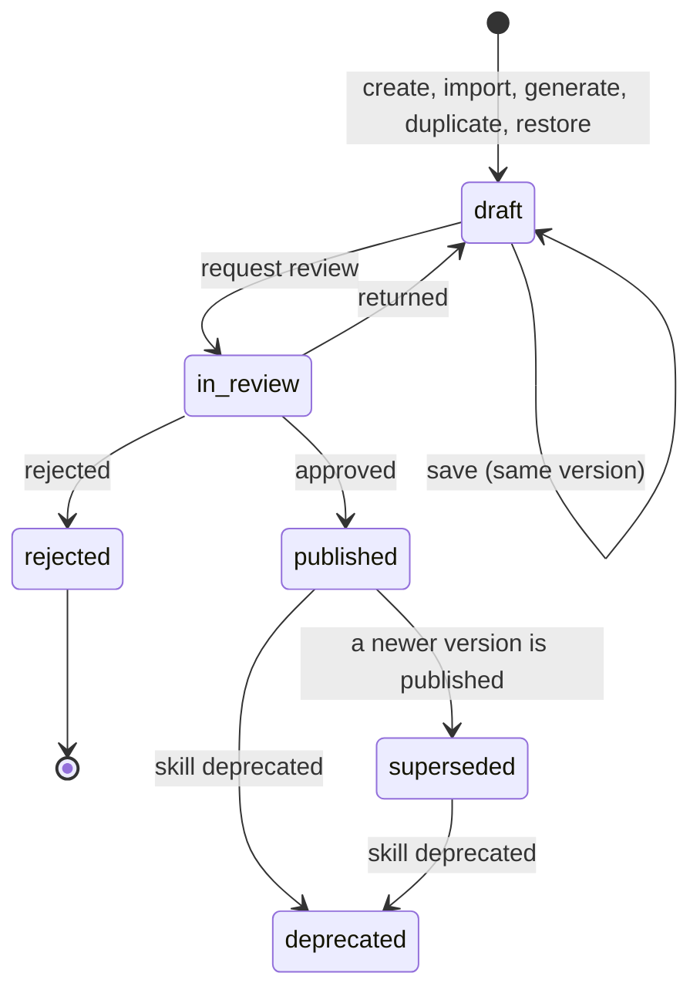

# 11 Skills

Status: draft for review.

Builds on ADR-0001 to ADR-0010 in `../architecture/decisions/` and the requirements in
`../background/problem-statement.md`. Agents, agent versions and pins are defined in
`agent-builder.md`; tool modules and the AI gateway in `data-and-ai-gateways.md`; evals and the
release gate in `evals-and-release.md`; files in `files.md`. The mock is the reference for UI
and API shape: `apps/console/src/lib/types/skills.ts`, `apps/console/src/lib/api/skills-contract.ts`,
`apps/console/src/lib/api/skills-http.ts`, `apps/console/src/lib/api/mock/skills/`,
`apps/console/src/hooks/skill-queries.ts`, `apps/console/src/app/skills/**`.

## 1. Summary

A skill is a versioned, reusable procedure an agent loads when a task matches it: a name, a "use when"
line the model reads to decide whether to load it, markdown instructions (steps, rules, examples,
output format), optional resources (files and text templates), the tool operations and knowledge
bases its steps use, guardrails it adds while loaded, test cases, an owner team and a version history.
A department writes "how we triage a hardship request" once, tests it, has it approved, and attaches
it to any agent that already holds the tools and knowledge it needs. A skill never grants access: an
agent that lacks a tool or knowledge base the skill names cannot attach it. Skills are portable in the
open Agent Skills format (a folder with `SKILL.md` frontmatter `name` and `description`, a markdown
body and resources), so they import and export. A skill can be drafted by a model through the AI
gateway from a description, a document, past cases or a template; the result is always a draft that
goes through the same tests and maker-checker review as a hand-written one.

## 2. Scope

| In | Phase |
|---|---|
| Skill registry with owner team, status, versions, use-when, instructions, tools, knowledge bases, guardrails | 2 |
| Edit classes on skill fields; drafts on top of the published version | 2 |
| Test cases with the agent eval checks; test runs per version | 2 |
| Publish through the Reviews queue as `skill_publish`, maker-checker, four-eyes for re-approval edits | 2 |
| Attach, move and detach pins per agent version; runtime index, load caps and journal records | 2 |
| Resources stored through the Files API (`skill_resource`) and text templates | 2 |
| Import and export as `SKILL.md` folders | 2 |
| Generation from description, document, past work or template through the AI gateway | 2 |
| Activity: loads per day by agent, success rate, sample traces | 2 |
| Deprecate, duplicate, restore a version into a draft | 2 |
| Sharing published skills across teams | Later (Q1) |
| Scripts inside skills (executable resources) | Later; out until a sandbox is decided (Q4) |
| Automatic upgrade of agent pins | Out: pins move only by an agent save |

| Out | Spec |
|---|---|
| Agent versions, workflow pins and publish | `01` |
| Tool module scopes and approvals | `03` |
| AI gateway aliases, keys and budgets | `03` 4.8, ADR-0008 |
| Agent eval suites and the release gate | `04` |
| File storage, scanning and retention | `10` |

The skills first release is recommended for phase 2 (implementation plan, phase 2). Workflow 1 runs
one department's procedures inside one or two agents, so instructions on the agent version cover it.
Skills pay off when a second department reuses a procedure, which is when the marginal effort of
workflow N is measured.

## 3. Traceability

| Problem statement item | How this spec serves it | Section |
|---|---|---|
| Reason 1: each agent written from scratch | Procedures are written once, tested once and attached to any agent that holds the tools | 1, 5.4 |
| Reason 4: risk review is a demo | Each skill version carries its test run and review decision as evidence | 5.2, 8.3 |
| Reason 5: testing is a person typing | Every skill version has stored test cases, run before review | 5.2 |
| Component 1: Agent Builder | Skills are registry entries with owner, version and pins, like agents | 4, 5.4 |
| Component 3: evals and testing | Skill tests reuse the agent eval checks; results are evidence on the version | 4.4, 5.2 |
| Component 4: AI gateway | Generation and rewrites call the gateway with a platform purpose key | 5.6 |
| Edit classes | Each skill field carries a class; the class sets the approvals a publish needs | 5.1 |
| Governance 3: tool calls constrained by scope, not prompt | A skill cannot grant a tool or knowledge base; attach is refused when the agent lacks one | 5.4, 8.1 |
| Governance 5: entitlement is an intersection | A loaded skill runs with the agent's grants only | 5.3 |
| Knowledge requirement 5: citations logged | Generated drafts cite their source documents and cases | 5.6 |

## 4. Domain model

### 4.1 Skill and version

| Field | Type | Rules |
|---|---|---|
| `id` | string | Stable |
| `name` | string | Display name, e.g. "Hardship request triage" |
| `slug` | string | Kebab-case, at most 64 characters, unique in the team. Becomes `name` in `SKILL.md` |
| `useWhen` | string | At most 1,024 characters. What the model reads to decide to load the skill. Becomes `description` in `SKILL.md`. Required for `on_match`; may be empty for `always` |
| `loading` | `on_match`, `always` | `on_match`: loaded when a message matches the use-when line (5.3). `always`: added to every turn of every agent that pins it, after the agent's own instructions; not counted against the per-turn load cap. Example: the Platform skill "Bank disclosure" (`always`) holds the footer every customer-facing draft carries, so the wording lives in one place and each agent pins the version it reads |
| `instructions` | markdown | Sections Steps, Rules, Examples, Output format |
| `tools` | `SkillToolRef[]` (`toolId`, `name`, `module`, `system`, `access`) | Tool module operations the steps call |
| `knowledgeBases` | string[] | Knowledge bases the steps cite |
| `guardrails` | string[] | Rules added to the turn while the skill is loaded; restrictions only |
| `resources` | `SkillResource[]` | `file` (a `fileId`, Files purpose `skill_resource`) or `template` (text on the version) |
| `ownerTeam` | owner group | Scoping follows it (`09`) |
| `status` | `draft`, `in_review`, `published`, `deprecated` | Derived from the versions (4.2) |
| `origin` | `blank`, `generated`, `imported`, `duplicated` | With `provenance.detail` and `citations` |

Shared instruction text (disclosures, tone guides, policy rules, reply formats) is an always-on skill,
not a separate entity (decided 2026-10-08; supersedes the prompt blocks of ADR-0011). The agent's own
instructions keep its role and main prompt and never reference other text. Always-on skills are usually
owned by Platform so every team can pin them; the team that writes the wording is named in provenance.

| Version field | Rules |
|---|---|
| `version` | Increments by one per new draft |
| `state` | 4.2 |
| `editClass` | Highest class among the changes from the published version (5.1) |
| `note`, `changes[]`, `savedBy`, `savedAt` | Recorded per save |
| `content` | Snapshot of every field in the table above |
| `tokens` | Tokens the body adds to a turn when loaded, computed by the server |
| `testRun` | Latest run on this exact version |
| `reviewId`, `publishedAt`, `publishedBy` | Set by review and publish |

### 4.2 Version states

| Skill status | When |
|---|---|
| `draft` | No version has been published and none is in review |
| `in_review` | The newest version is in review |
| `published` | A published version exists and the skill is not deprecated |
| `deprecated` | Deprecated with a reason; terminal |

### 4.3 Pins

| Entity | Fields | Rules |
|---|---|---|
| `SkillPin` | `agentId`, `agentVersion`, `skillId`, `skillVersion`, `attachedBy`, `attachedAt` | Part of the agent version (`01` 4.5 `skillPins[]`). Only published versions are pinned |
| `AgentSkills` (read model) | `pins[]` with loads, share of turns and upgrade state; `available[]` with `attachable` and `missing[]`; `limits` | 5.3, 5.4 |

### 4.4 Tests

| Entity | Fields | Rules |
|---|---|---|
| `SkillTestCase` | `name`, `input`, `checks[]` (graders from `04` 4.2, the single grader vocabulary for every asset; skill cases use the outcome and trace graders that apply to a message, including `skill_loaded`), `source` (`generated`, `manual`, `case`, `document`, `imported`), `sourceRef`, `lastOutcome` | Owned by the skill, not by a version |
| `SkillTestRun` | `version`, `ranAt`, `ranBy`, `passed`, `total`, `results[]` (`status`, `checks`, `failure`, `reply`, `skillLoaded`, `toolsCalled`, `latencyMs`) | `skillLoaded` false means the use-when line did not select the skill for that input |

### 4.5 Activity

| Field | Rules |
|---|---|
| `loadsPerDay` | 14 days, per agent, from the run journal |
| `loads30d`, `successRate` | Loaded turns that completed without a hand-off or failure |
| `samples[]` | Recent traces: agent, version, input (redacted), outcome, tool calls, duration |

## 5. Behaviour

### 5.1 Edit classes and drafts

| Class | Fields | What a publish needs |
|---|---|---|
| Free | Version note, owner team | Applies at once; logged; no new version |
| Re-test | Name, use-when, instructions | A test run on the version, and one approver from the owning team who is not the requester |
| Re-approval | Tools, knowledge bases, guardrails, resources | As re-test, plus a second approver where the tier requires one: `high` and `critical`, the second from the second line (`04` 5.12.2) |

1. Saving an edit on a published skill opens draft version N+1; saving on a draft updates it in place.
2. A save carries `baseVersion`; a stale base returns 409 naming the newer version.
3. The server computes the edit class against the published version and returns it on the version.
4. Restoring a version copies it into a new draft; nothing is published.

### 5.2 Tests and the publish request

1. Request review is refused with 422 and the blockers when the newest version is not a draft, the skill has no test cases, or no test run exists on that exact version.
2. Failing cases are advisory at `low` only: the request goes through, the review lists them, and approving needs a written reason, which goes into the evidence. At `medium` and above a failing case blocks approval (422 listing each), as for agents (`04` 5.10.6 AG5, gate step S16; ADR-0012). The tier is the highest effective tier among the live workflows that pin the skill through an agent, else the tier its tools imply (`04` 5.12.2).
3. The review kind is `skill_publish` in the shared Reviews queue, with the edit class, changes, test summary, tools and knowledge bases added, guardrails and the agents pinning it.
4. The requester cannot approve (409). A re-approval review at `high` or `critical` stays `in_review` after one approval and publishes on the second, from a different person in the second line (`04` 5.12.2); at `low` and `medium` one approval publishes it.
5. Approving publishes: the version becomes `published` and the previous published version `superseded`. Pins do not move.
6. Returning puts the version back to `draft`; rejecting marks it `rejected` and the next save opens a new draft.

### 5.3 Runtime selection and loading

1. Each attached `on_match` skill contributes its name and use-when line to the agent's system prompt (the index). Each `always` skill's pinned body is added in full to every turn after the agent's instructions, in pin order, and is recorded in the run journal as loaded with the reason "Always on".
2. The model loads a body with the platform `load_skill` tool when the task matches; the body comes from the pinned version.
3. At most 2 `on_match` skills load per turn, and loaded bodies share a budget of 6,000 tokens per turn after always-on bodies are counted; a load past either cap is refused and the turn continues without it.
4. An agent may hold at most 12 skills.
5. While loaded, the skill's guardrails are added to the turn; they never remove an agent guardrail.
6. Tool calls from a skill's steps go through the data gateway with the agent's grants and the run context; the skill adds no scope.
7. Each load is recorded in the run journal with skill id, version and the matched reason. The agent test panel shows "Loaded skill X v3" on that turn.
8. A resource whose file is quarantined or unscanned is skipped and shown blocked; the skill loads without it.

### 5.4 Attach, move, detach

1. Attaching, moving or detaching a pin saves a new draft agent version, which publishes through its `agent_publish` review; workflows adopt it on their next publish (`01` 4.5, 5.5).
2. Attach and move are refused (422) when the agent lacks any tool or knowledge base the target version names, naming the missing ones.
3. Only published versions can be pinned. A deprecated skill cannot be attached; existing pins keep working and show an upgrade or replace prompt.
4. A pin to an older version shows "upgrade available"; when the newer version needs a tool the agent lacks, the prompt shows why it is blocked.

### 5.5 Deprecate and delete

1. Deprecate needs a reason and stops new attaches.
2. Delete is refused while any live agent pins the skill; bulk delete skips those with the reason.

### 5.6 Generation

1. The generate dialog has five steps: start from (describe, document, past work, template), scope (target agents, team, tool operations, knowledge bases, risk notes), draft, tests, review.
2. Documents are knowledge documents or an SOP uploaded through the Files API; past work is resolved cases, completed runs or chats; templates are Email reply, Data extraction, Policy Q&A, Case triage and Approval memo.
3. Model calls go through the AI gateway with the platform purpose key `skill-authoring` (`03` 4.8, alongside `eval`) on the drafting alias `ops-drafting`. Inputs carry their sensitivity, and the gateway refuses an alias not cleared for it.
4. Customer identifiers in past-work inputs are redacted before the call.
5. The draft streams field by field and section by section. Stop ends the call; the partial text stays visible but the dialog cannot continue until Regenerate drafts it in full. "Rewrite with instruction" redrafts one section and can be undone.
6. A draft that names a tool or knowledge base outside the chosen scope, or one a target agent lacks, shows a warning on that item.
7. Each generated section cites the documents, cases or template it came from.
8. Test cases are drafted from the sources and are editable; "Run tests now" runs them against the unsaved draft and stores nothing.
9. The review step shows per target agent the skills before and after, tools and knowledge bases held and missing, guardrails added and token cost.
10. Saving creates version 1 as a draft (or requests review at once) with `origin: generated` and the gateway call id as provenance. A generated skill cannot skip review.

### 5.7 Import and export

1. Import accepts a `SKILL.md` file or a folder zip uploaded through the Files API (purpose `skill_resource`).
2. The preview parses frontmatter `name`, `description` and `allowed-tools`, the body and the resources.
3. Missing `name` or `description`, a `name` that is not kebab-case or exceeds 64 characters, or a `description` over 1,024 characters refuses the import.
4. Each `allowed-tools` entry is matched to a bank tool operation; unmatched entries are warnings and are dropped. An import never grants a tool.
5. Import creates a draft with `origin: imported`.
6. Export writes one zip of `SKILL.md` folders through the Files API (purpose `export`). Frontmatter carries `name` and `description`; bank fields (version, owner team, tools, knowledge bases, guardrails) go under `metadata:`. Each export is audited.

## 6. API

Conventions of `01` section 6. Paths follow `skills-http.ts` under `/v1`.

| # | Operation | Request | Response | Errors | Phase |
|---|---|---|---|---|---|
| SK-1 | `GET /v1/skills` | list params, `view` (`all`, `published`, `drafts`, `in_review`, `deprecated`, `unused`), filters `status`, `ownerTeam`, `tools`, `knowledgeBases`, `origin` | `ListResult<Skill> & { viewCounts }` with facets | | 2 |
| SK-2 | `GET /v1/skills/{id}` | | `SkillDetail` (versions, tests, runs, usage, activity, provenance, `publishCheck`) | 404; 403 other team | 2 |
| SK-3 | `POST /v1/skills` | `SkillCreateInput` | `Skill` (version 1 draft, or in review when `requestReview`) | 400 field rules; 409 slug taken | 2 |
| SK-4 | `PUT /v1/skills/{id}/draft` | `SkillDraftPatch` with `baseVersion` | `SkillDetail` | 409 stale base; 409 deprecated | 2 |
| SK-5 | `POST /v1/skills/{id}/versions/{n}/restore` | | `SkillDetail` with a new draft | 404 | 2 |
| SK-6 | `POST /v1/skills/{id}/duplicate` | | `Skill` (draft, `origin: duplicated`) | | 2 |
| SK-7 | `POST /v1/skills/{id}/publish-requests` | `note` | `SkillDetail` with `pendingReview` | 422 blockers (5.2.1) | 2 |
| SK-8 | `POST /v1/reviews/{id}/decision` for `kind: skill_publish` | `decision`, `reason` | `Review` with `skillPublish` | 409 own request or already decided; 400 no reason with failing tests or to reject | 2 (`01` operation 35, extended) |
| SK-9 | `POST /v1/skills/{id}/deprecate` | `reason` | `SkillDetail` | 400 no reason | 2 |
| SK-10 | `DELETE /v1/skills/{id}` | | 204 | 409 pinned by a live agent | 2 |
| SK-11 | `POST /v1/skills/bulk-deprecate`, `/bulk-delete` | `ids[]`, `reason` | `BulkResult` | | 2 |
| SK-12 | `POST /v1/skills/export` | `ids[]`, `version?` | `FileRecord` (`10`) | | 2 |
| SK-13 | `POST`, `PUT`, `DELETE /v1/skills/{id}/tests[/{caseId}]` | `SkillTestCaseInput` | `SkillTestCase` | 400 no checks | 2 |
| SK-14 | `POST /v1/skills/{id}/test-runs` | | `SkillTestRun` on the newest version | 422 no cases | 2 |
| SK-15 | `POST`, `DELETE /v1/skills/{id}/resources[/{resourceId}]` | `fileIds[]` or `template {name, body}` | `SkillDetail` | 409 file scanning or quarantined; 400 wrong purpose | 2 |
| SK-16 | `POST /v1/skills/generate` (SSE) | `SkillGenerateInput` | stream of `SkillGenerateEvent` ending in `done` with `GeneratedSkill` | 429 budget; 403 sensitivity not cleared | 2 |
| SK-17 | `POST /v1/skills/rewrite-section` | `SkillRewriteInput` | `{ text, gatewayCallId }` | 400 no instruction | 2 |
| SK-18 | `POST /v1/skills/suggest-tests` | `{ input, skill }` | `SkillTestCaseInput[]` | | 2 |
| SK-19 | `POST /v1/skills/dry-run` | `{ draft, tests }` | `SkillTestRun` (not stored) | | 2 |
| SK-20 | `POST /v1/skills/impact` | `{ draft, agentIds }` | `SkillImpact[]` | | 2 |
| SK-21 | `GET /v1/skills/generate-options`, `GET /v1/skills/options` | | `SkillGenerateOptions`, `SkillOptions` | | 2 |
| SK-22 | `POST /v1/skills/import/preview`, `POST /v1/skills/import` | `fileId`; `fileId`, `ownerTeam` | `SkillImportPreview`; `Skill` | 422 preview errors | 2 |
| SK-23 | `GET /v1/agents/{id}/skills` | | `AgentSkills` | | 2 |
| SK-24 | `PUT /v1/agents/{id}/skills/{skillId}` | `version` | `AgentSkills` (new agent version saved) | 422 agent lacks tool or knowledge base; 422 not published or deprecated; 422 over 12 skills | 2 |
| SK-25 | `DELETE /v1/agents/{id}/skills/{skillId}` | | `AgentSkills` | 404 not attached | 2 |
| SK-26 | Cross-team sharing of published skills | | | | Later |

**Skills first release: 25 operations** (SK-1 to SK-25), with `AgentTestTurn.skills[]` added to `01`
operation 29.

## 7. UI mapping

| Route or dialog | API | Gaps between mock and spec |
|---|---|---|
| `/skills` list: views, facets, bulk deprecate, delete, export | SK-1, SK-11, SK-12 | None |
| Generate skill dialog (Stepper, five steps) | SK-21, SK-16, SK-17, SK-18, SK-19, SK-20, SK-3 | The mock streams a canned draft per start type; the server drafts through the gateway |
| New blank skill dialog | SK-3 | None |
| Import dialog (`FileUpload`, preview) | `10` uploads, SK-22 | The mock reads text files only; zip contents are parsed server-side |
| `/skills/[id]` rail and tabs Instructions, Resources, Tests, Used by, Versions, Activity | SK-2, SK-4, SK-5, SK-13, SK-14, SK-15 | None |
| Request review, Deprecate, Export, Duplicate | SK-7, SK-9, SK-12, SK-6 | None |
| `/reviews` skill publish body and decision | SK-8 | None |
| Agent page Skills section, Attach skill dialog | SK-23, SK-24, SK-25 | None |
| Agent Test sheet "Loaded skill" | `01` 29 | The mock matches use-when words; the runtime lets the model choose (5.3) |
| ⌘K skills group, "Generate skill" and "New skill" actions | `09` search | None |

## 8. Security, audit and evidence

### 8.1 Who may do what

| Action | Who |
|---|---|
| Create, edit, generate, import, run tests, request review | Members of the owning team with the builder role |
| Approve a `skill_publish` | Another member of the owning team with the publisher role; a second one for re-approval |
| Attach, move, detach | Anyone who may save the agent (`01` 8.1) |
| Deprecate, delete | Owning team publishers and Platform admins |

Skills grant nothing: attach and move check the agent's tools and knowledge bases (5.4.2), runtime
calls use the agent's grants (5.3.6), and guardrails only add restrictions (5.3.5).

### 8.2 Audit

| Event | Action and target |
|---|---|
| Create, import, duplicate, generate | `created` on `skill`, summary names the origin; generate records the gateway call id |
| Draft saved, restore | `edited` with the field diff and edit class |
| Review requested | `edited`, review id |
| Approved, rejected, returned | `approved` or `rejected` with the reason |
| Published | `published` with the version |
| Deprecated, deleted | `edited` with the reason; `deleted` |
| Attached, detached, pin moved | `edited` on the `agent`, with skill and versions |
| Exported | `created` on the export file (`10`) |

### 8.3 Evidence

A published skill version carries its content snapshot, its test run, the review decision with
reasons, and for generated skills the gateway call id and citations. An agent version's evidence
bundle (`04` 8.3) lists its skill pins and each pinned version's test summary.

## 9. Non-functional

| Item | Target |
|---|---|
| Index cost per turn | At most 12 × (name + 1,024 characters) |
| Load overhead | Body from cache in p95 ≤ 50 ms |
| Generation | First streamed field in p95 ≤ 3 s; whole draft ≤ 60 s |
| Scale | 500 skills per team, 12 per agent |
| Retention | Versions kept for the life of the skill; test runs 2 years; journal loads follow run retention |

## 10. Acceptance tests

| # | Test | Fails if |
|---|---|---|
| SK1 | Request review on a draft with no test cases | Anything other than 422 naming the missing tests |
| SK2 | Edit the instructions, then request review without running tests | The request succeeds |
| SK3 | Approve your own skill publish request | Anything other than 409 |
| SK4 | Change a skill's tools and approve the review once | The version publishes after one approval |
| SK5 | Approve a request whose run has a failing case, without a reason | The approval succeeds |
| SK6 | Publish v3 of a skill that agent A pins at v2 | A's pin moves, or the Used by tab does not show the upgrade |
| SK7 | Attach a skill naming `get_loan_account` to an agent without that tool | Anything other than 422 naming the tool |
| SK8 | Move a pin to a version that adds a knowledge base the agent lacks | The pin moves |
| SK9 | Attach a skill to an agent | No new agent version, or no audit entry |
| SK10 | Send a test message matching the use-when line of an attached skill | The turn does not show "Loaded skill" with the pinned version |
| SK11 | Attach three skills and send a message matching all three | More than two load |
| SK12 | Delete a skill a live agent pins; bulk delete it with an unused one | The delete succeeds, or the bulk result does not skip it with a reason |
| SK13 | Attach a deprecated skill | The attach succeeds |
| SK14 | Save an edit with a stale `baseVersion` | Anything other than 409 |
| SK15 | Import a `SKILL.md` whose `name` is "Hardship Triage" | The import succeeds |
| SK16 | Import a `SKILL.md` whose `allowed-tools` names an unknown tool | The import fails, or the tool is granted |
| SK17 | Generate a skill with a scope that excludes a tool the draft names | No warning on that tool |
| SK18 | Generate and save a skill | It is published, or has no gateway call id in its provenance |
| SK19 | Add a resource file that is still being scanned | The resource is added |
| SK20 | Export two skills and open the zip | Either folder lacks a `SKILL.md` with `name` and `description` frontmatter |

## 11. Open questions

| # | Question | Blocks |
|---|---|---|
| Q1 | May a team attach another team's published skill, and who approves that use: the skill's owner, the agent's owner, or both? Phase 2 allows the same team and Platform only | Cross-team reuse |
| Q2 | Must customer identifiers be redacted from past-work inputs before generation, or is the gateway's sensitivity clearance enough? | Generation from past work |
| Q3 | Should a skill's failing tests block publish at `medium` and above, as agent evals do (`04` 5.10)? Answered: yes. They are advisory with a reason at `low` and block at `medium` and above (5.2.2, `04` 5.10.6 AG5, ADR-0012) | None |
| Q4 | Are executable scripts in skills ever allowed, and in which sandbox? | Script resources |
| Q5 | Should loading a skill raise the agent's effective risk tier when its steps call write tools? | `01` 5.2 tier computation |
| Q6 | Is the model's choice to load a skill acceptable to Model Risk, or must selection be a deterministic rule for `high` tier agents? | `high` tier use |
