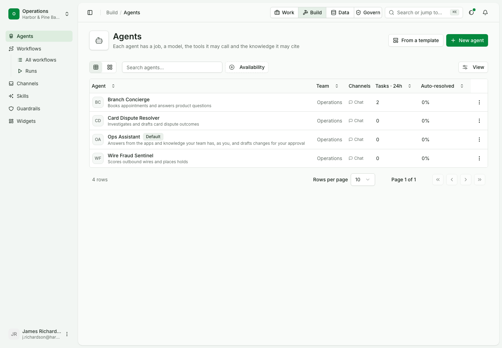
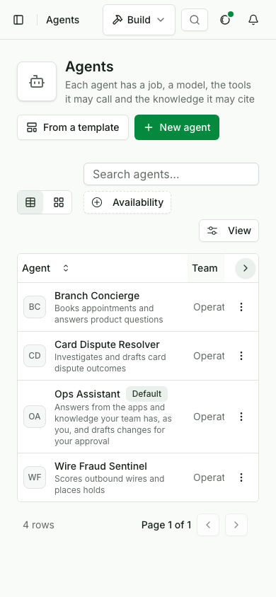

# An agent with three tools

Status: current. Layers: ui passes; sdk and cli have open gaps below.

| Use case | |
|---|---|
| Id | `uc-086` |
| Area | Agents |
| Runs | Python, TypeScript, CLI; console steps in their own script |
| Run it | `make usecase-test UC=uc-086` |


The import-to-call path in one run, as the seeded people, in the console: the bank's keys stored as secrets, its OpenAPI
document imported, reviewed and published, a second version published, the reads tried and granted to an agent, a
chat write held until a second person approves it, and the call log naming who asked, who approved and how each call
ended. The design is [tool lifecycle](../../architecture/tool-lifecycle.md). It replaces uc-055 as the card's gate;
uc-055's last step belongs to the agent page.

## Stories

| # | Story | Layer | Steps | Proved by |
|---|---|---|---|---|
| S1 | A builder takes a bank API to an agent that reads at once | ui | 1-8 | 6 |
| S2 | A write is held until a second person approves, then runs once | ui | 9-10 | 10 |
| S3 | The call log names the agent, the approver and the outcome | ui | 11-12 | 11 |

## Who is in it

| Person | Role | Signs in as |
|---|---|---|
| James Richardson, who builds the agent | Builder | the `builder` profile |
| Maya Okafor, who approves the write | Approver | the `approver` profile |
| Sam Adeyemi, Security admin | Security admin | the `security` profile |

## Before you start

```python tab="Python" tab-group="language"
from ops_ai import OpsAI

security = OpsAI(profile="security")
builder = OpsAI(profile="builder")
approver = OpsAI(profile="approver")
```

```ts tab="TypeScript"
import { OpsAI } from '@chanl-ai/ops-ai';

const security = new OpsAI({ profile: 'security' });
const builder = new OpsAI({ profile: 'builder' });
const approver = new OpsAI({ profile: 'approver' });
```

```bash tab="CLI"
set -euo pipefail
export OPS_PROFILE=builder
```

## Steps

### 1. Allow the bank's host and range

```python tab="Python" tab-group="language"
security.raw.tools.egress_add_host({"value": "api.bank.test", "note": "core banking"})
security.raw.tools.egress_add_range({"value": "127.0.0.0/8", "note": "core banking"})
```

```ts tab="TypeScript"
await security.raw.tools.egress_add_host({ body: { value: 'api.bank.test', note: 'core banking' } });
await security.raw.tools.egress_add_range({ body: { value: '127.0.0.0/8', note: 'core banking' } });
```

Expected: both accepted. The CLI has no word for this step (see Gaps).

### 2. Store the bank's two keys as secrets

Expected: 201 each; no response shows the value. No word exists in the SDK or CLI (see Gaps).

### 3. Import the OpenAPI document, tick `place_hold`, untick `get_statement`, save the draft

Expected: reads are Read, `place_hold` is Write. No word exists in the SDK or CLI (see Gaps).

### 4. Request a security review; the Security approver publishes the module

Expected: the module is published. No word exists in the SDK or CLI (see Gaps).

### 5. Import `get_statement` and publish a second version

Expected: the version is listed; `get_statement` has no `api_key` input. No word exists in the SDK or CLI (see Gaps).

### 6. Run `get_account` and `get_statement` from the test panel

Expected: both reach the bank. The SDK's `tools.run` takes an app, not a module (see Gaps).

### 7. Grant the three tools to Branch Concierge and publish it

Expected: the agent holds all three. No word grants a module's tools to an agent (see Gaps).

### 8. Ask the agent for an account

```python tab="Python" tab-group="language"
agent = next(a for a in builder.agents.list() if a["name"] == "Branch Concierge")
reply = builder.agents.chat(agent["id"], 'call get_account {"account_id": "CHQ-2219"}')
assert reply["text"] == "Here is what I found."
assert [call["name"] for call in reply["toolCalls"]] == ["get_account"]
```

```ts tab="TypeScript"
const agents = await builder.agents.list();
const agent = agents.find((a: { name: string }) => a.name === 'Branch Concierge');
const reply = await builder.agents.chat(agent.id, 'call get_account {"account_id": "CHQ-2219"}');
assert.equal(reply.text, 'Here is what I found.');
assert.deepEqual(reply.toolCalls.map((call: { name: string }) => call.name), ['get_account']);
```

```bash tab="CLI"
AGENT=$(opsai agents --json list | jq -r '.[] | select(.name == "Branch Concierge") | .id')
opsai agents --json chat "$AGENT" --message 'call get_account {"account_id": "CHQ-2219"}' \
  | jq -e '.text == "Here is what I found." and ([.toolCalls[].name] == ["get_account"])'
```

Expected: "Here is what I found."; one call by the agent in the log.

### 9. Ask for a write: it is held

Expected: an approval card; no call logged and no new hold at the bank. A chat write held for approval has no SDK or CLI word to read it (see Gaps).

### 10. The approver approves it

Expected: one call runs and the bank holds exactly one new hold of 25. No word answers a held chat write (see Gaps).

### 11. The call log names the write

```python tab="Python" tab-group="language"
calls = approver.usage.list(tool="place_hold")
assert len(calls) == 1 and calls[0]["outcome"] == "ok"
```

```ts tab="TypeScript"
const calls = await approver.usage.list({ tool: 'place_hold' });
assert.equal(calls.length, 1);
assert.equal(calls[0].outcome, 'ok');
```

```bash tab="CLI"
opsai tools --profile approver --json calls --tool place_hold | jq -e 'length == 1 and .[0].outcome == "ok"'
```

Expected: one row naming the agent, the approver and the outcome.

### 12. No key on any page

Expected: the console script checks it; there is no SDK or CLI step.

## Gaps

This page does not pass while a row here is open. Each open gap is a product change tracked on the board; no test helper stands in for it.

| Product fix | Step | Tab | What is missing | Where |
|---|---|---|---|---|
| Egress words | 1 | CLI | no `opsai` verb allows a host or a range | `sdk/python/src/ops_ai/_cli/tools.py` |
| Secrets words | 2 | All | the SDK and CLI cannot store a team secret; only `raw` calls reach it | no word yet in `sdk/python/src/ops_ai/_words.py` |
| OpenAPI import words | 3, 5 | All | no word imports an OpenAPI document or ticks operations | no word yet in `sdk/python/src/ops_ai/_words.py` |
| Publish review words | 4 | All | no word requests or answers a module's security review | no word yet in `sdk/python/src/ops_ai/_words.py` |
| Module test run | 6 | All | `tools.run` takes an app; a module that is not an app cannot be run from the SDK | `sdk/python/src/ops_ai/_words.py:306` |
| Granting tools | 7 | All | no word grants a module's tools to an agent | no word yet in `sdk/python/src/ops_ai/_words.py` |
| Held writes | 9, 10 | All | no word lists or answers a chat write held for approval | no word yet in `sdk/python/src/ops_ai/_words.py` |
| A bank on the page stack | All | All | `page_stack.py` starts no core-banking fake, so no step can reach the bank | `docs/usecases/lib/page_stack.py:259-302` |

## What proves it

> [!IMPORTANT]
> Step 6's statement call answers 401 from the bank unless `{{STATEMENTS_API_KEY}}` in the query is resolved, and its
> `requestedUrl` carries the key unless the gateway scrubs it. Step 10 counts holds at the bank itself, so a write that
> ran twice or not at all fails it.

## In the console


`OPS_USECASE_MEDIA=1 make usecase-test UC=uc-086 LAYER=ui` writes the pictures and the clip beside this page (`media/`); the
script checks that the clip is under 15 s and 2 MB.





### Steps and results in the console

| # | Step | Expected |
|---|---|---|
| 1 | Sam (Security admin) allows the bank's host and range | 201 |
| 2 | James adds `BANK_API_KEY` and `STATEMENTS_API_KEY` in Settings > Secrets, as Operations' secrets: a secret belongs to the team that uses it | 201 each; no response or page shows the value |
| 3 | James imports `https://api.bank.test/openapi.json`, ticks `place_hold`, unticks `get_statement`, saves the draft | 201; reads are Read, `place_hold` is Write |
| 4 | James requests a security review; Nadia approves it on the module's Approval tab | the module is published |
| 5 | James imports `get_statement` into the module and publishes a version | the version is listed on the Versions tab; `get_statement` has no `api_key` input |
| 6 | James runs `get_account` and `get_statement` from the test panel against the test environment | both reach the bank (a missing or wrong key answers 401); the URL the statement route repeats shows `api_key=[secret]` |
| 7 | James grants `get_account`, `get_statement` and `place_hold` to Branch Concierge and publishes it | the agent holds the three |
| 8 | James asks `call get_account {"account_id": "CHQ-2219"}` | "Here is what I found."; one call by the agent in the log |
| 9 | James asks `call place_hold {...25...}` | an approval card; no call logged and no new hold at the bank |
| 10 | Maya approves it in Reviews | one call runs and the bank holds exactly one new hold of 25 |
| 11 | James opens the module's Activity tab | the write's row names the agent that made it, Maya (by her sign-in email) as approver and the outcome, and links to the chat thread. The person who asked is not shown yet: the caller is the agents service until the runner signs a run context naming the user (planned, data-and-ai-gateways 4.3) |
| 12 | Every page | no page error, and the key never appears |

## Details

| | |
|---|---|
| Services the run starts | platform, agents and tools services on the scripted model, with a core-banking fake |
| Console script | `docs/usecases/console/scripts/test-uc-086-ui.mjs` |

### Preconditions


| Needs | How |
|---|---|
| PostgreSQL :5477 | `make db-up` |
| platform-service's dev seed | James Richardson (builder) and Maya Okafor (approver) on Operations, Nadia Petrov (approver) on Security, Priya Shah (admin), Sam Adeyemi (admin on Security, the only one who changes egress); password `northfield-demo` |
| The core-banking fake on https | the ui harness's `tools: { bank: 'core' }` (`services/tools-service/scripts/fake_bank`): an `X-Api-Key` header on most routes, an `api_key` query key on `get_statement`, holds that later reads return; key `dev-bank-key` |
| Agents granted from tools-service | the ui harness's `tools: { gateway: true }` |
| No model calls | the scripted model; a chat message `call <tool> <json>` calls that tool |
