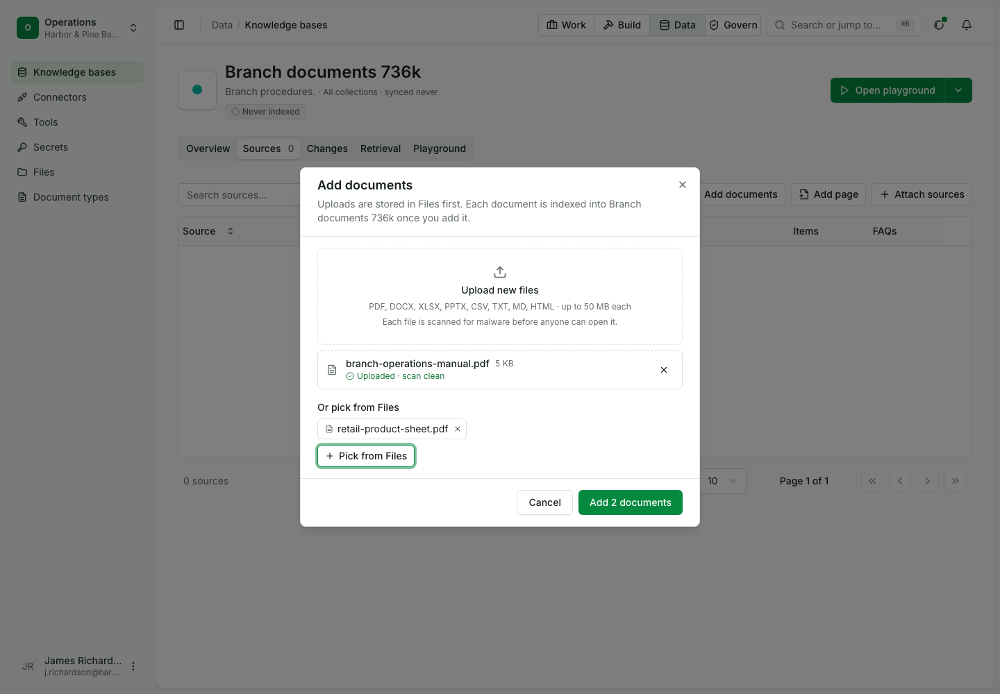
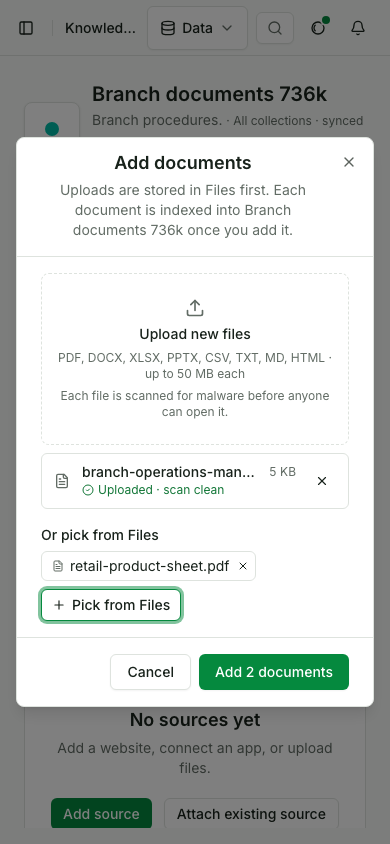

# Add files from Files to a knowledge base

Status: draft for review.

In this example we will add a file that is already in Files and a file we have just uploaded to a branch-procedures knowledge base in one call, so both are read, indexed and kept. It assumes a signed-in builder in the team and a knowledge base with no documents in it.

| Use case | |
|---|---|
| Id | `uc-129` |
| Area | Knowledge |
| Runs | Python, TypeScript; the CLI cannot add a file already in Files (see Gaps); console steps in their own script |
| Run it | `make usecase-test UC=uc-129` |

## Who is in it

| Person | Role | Signs in as |
|---|---|---|
| The branch operations owner | Builder | the `builder` profile |

## Before you start

```python tab="Python" tab-group="language"
from ops_ai import OpsAI

ops = OpsAI(profile="builder")
```

```ts tab="TypeScript"
import assert from 'node:assert/strict';
import { OpsAI } from '@chanl-ai/ops-ai';

const ops = new OpsAI({ profile: 'builder' });
const text = (s: string) => new TextEncoder().encode(s) as Uint8Array<ArrayBuffer>;
```

## Steps

### 1. Put a file in Files

The team already has a product sheet in Files, uploaded for knowledge.

```python tab="Python" tab-group="language"
sheet = ops.upload(
    "retail-product-sheet.md", b"# Retail product sheet\n\nThe everyday account has no monthly fee.", mime="text/markdown", purpose="knowledge_source"
)
sheet_id = sheet.get("id") or sheet.get("fileId")
assert sheet_id
```

```ts tab="TypeScript"
const sheet = (await ops.files.upload('retail-product-sheet.md', text('# Retail product sheet\n\nThe everyday account has no monthly fee.'), {
  mime: 'text/markdown',
  purpose: 'knowledge_source',
})) as Record<string, any>;
const sheetId: string = sheet.id ?? sheet.fileId;
assert.ok(sheetId);
```

Expected: a file in Files with an id.

### 2. Add it and a new upload in one call

The owner makes a base, uploads a second file and adds both by their file ids.

```python tab="Python" tab-group="language"
branch = ops.knowledge.add_base("Branch documents", owner="branch.ops@harborpine.example")
manual = ops.upload(
    "branch-operations-manual.md", b"# Branch operations\n\nTwo tellers open every night deposit bag.", mime="text/markdown", purpose="knowledge_source"
)
manual_id = manual.get("id") or manual.get("fileId")

added = ops.raw.kb.knowledge_bases_add_documents(branch["id"], {"fileIds": [sheet_id, manual_id]})
assert added["run"]["counts"]["upserted"] == 2
```

```ts tab="TypeScript"
const branch = await ops.knowledge.addBase('Branch documents', { owner: 'branch.ops@harborpine.example' });
const manual = (await ops.files.upload('branch-operations-manual.md', text('# Branch operations\n\nTwo tellers open every night deposit bag.'), {
  mime: 'text/markdown',
  purpose: 'knowledge_source',
})) as Record<string, any>;
const manualId: string = manual.id ?? manual.fileId;

const added = (await ops.raw.kb.knowledge_bases_add_documents({
  path: { kb_id: branch.id },
  body: { fileIds: [sheetId, manualId] } as never,
})) as any;
assert.equal(added.run.counts.upserted, 2);
```

Expected: one call; two documents indexed.

### 3. The base keeps a documents source with both

```python tab="Python" tab-group="language"
source = ops.raw.kb.sources_get_source(added["sourceId"])
assert source["status"] == "active" and source["itemsIndexed"] == 2 and source["itemCount"] == 2
```

```ts tab="TypeScript"
const source = (await ops.raw.kb.sources_get_source({ path: { source_id: added.sourceId } })) as any;
assert.ok(source.status === 'active' && source.itemsIndexed === 2 && source.itemCount === 2);
```

Expected: an active source counting two items, not their pieces.

### 4. Files keeps both files

```python tab="Python" tab-group="language"
for file_id in (sheet_id, manual_id):
    refs = ops.raw.files.files_get_file(file_id).get("references", [])
    assert any(r["type"] == "source" and r["id"] == added["sourceId"] for r in refs)
```

```ts tab="TypeScript"
for (const fileId of [sheetId, manualId]) {
  const file = (await ops.raw.files.files_get_file({ path: { file_id: fileId } })) as any;
  assert.ok((file.references ?? []).some((r: any) => r.type === 'source' && r.id === added.sourceId));
}
```

Expected: each file is referenced by the source, so Files will not delete it from under the base.

## Gaps

| Product fix | Step | The page expects | The product does |
|---|---|---|---|
| Add a file already in Files from the command line | 2 | `opsai kb` adds files by their ids, as Pick from Files does | `opsai kb add-file` takes paths on disk and uploads each (`sdk/python/src/ops_ai/_cli/kb.py:117`); no flag takes a file id |

## What proves it

> [!IMPORTANT]
> Step 2 fails if the console's upload does not reach the files service first: no file id comes back to add. It was seen
> failing that way before the fix, when uploads went to the in-browser API.

## In the console

The console steps run in their own script, since a browser cannot run the code above.

| # | Step | Expected |
|---|---|---|
| 1 | Knowledge, New knowledge base | No Documents tab; Sources offers Add documents |
| 2 | Add documents: upload a PDF, Pick from Files, choose the PDF already there, Add 2 documents | One call with both file ids; both indexed |
| 3 | Reload the base | The documents source is active with two indexed items |





`OPS_USECASE_MEDIA=1 make usecase-test UC=uc-129 LAYER=ui` writes the pictures and the clip here. The script checks that the
clip is under 15 s and 2 MB.

## Details

| | |
|---|---|
| Services the run starts | knowledge, files and documents services; no model is called |
| Console script | `docs/usecases/kb-service/scripts/test-uc-129-ui.mjs` |
