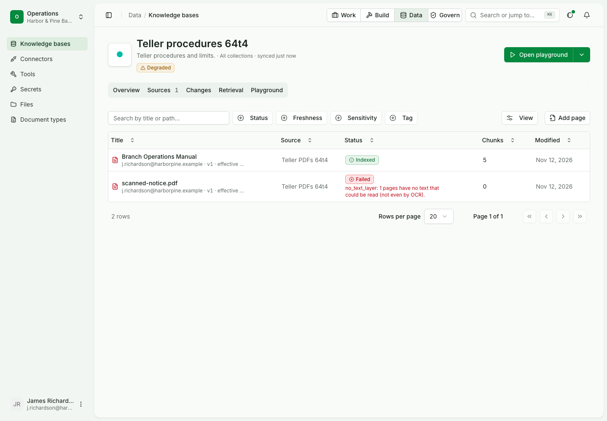
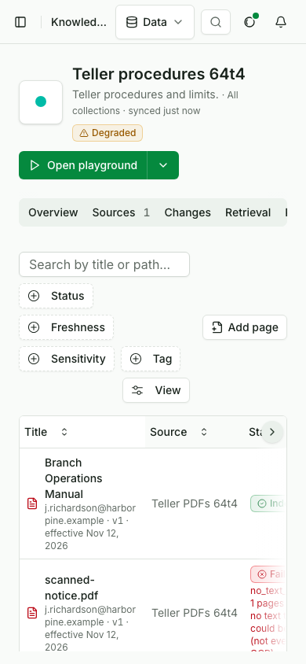
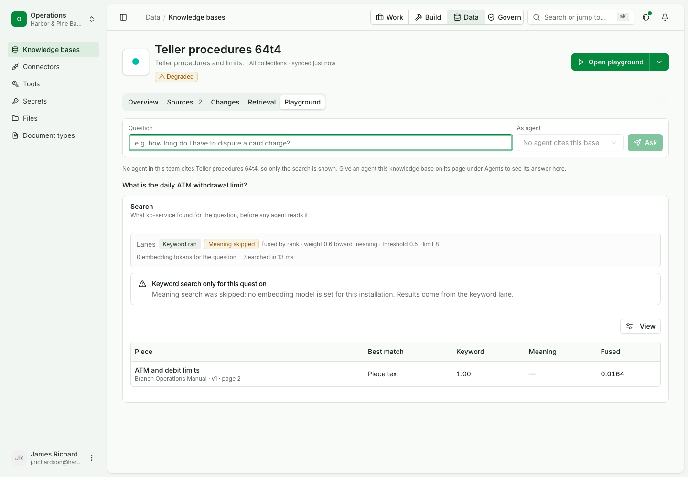
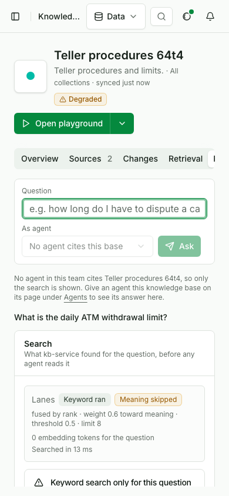

# Make, fill, ask and retire a knowledge base

Status: draft for review.

In this example we will make a knowledge base for branch procedures, add a file and a written page, ask it a question, and retire it, with nobody from engineering involved. It assumes a signed-in builder in the team and nothing else: the team has no knowledge bases yet.

| Use case | |
|---|---|
| Id | `uc-096` |
| Area | Knowledge |
| Runs | Python, TypeScript; console steps in their own script |
| Run it | `make usecase-test UC=uc-096` |

## Who is in it

| Person | Role | Signs in as |
|---|---|---|
| The branch operations owner | Builder | the `builder` profile |

## Before you start

```python tab="Python" tab-group="language"
from ops_ai import OpsAI
from ops_ai.errors import NotFound
import pytest

ops = OpsAI(profile="builder")
```

```ts tab="TypeScript"
import assert from 'node:assert/strict';
import { OpsAI } from '@chanl-ai/ops-ai';

const ops = new OpsAI({ profile: 'builder' });
```

## Steps

### 1. Make the base

```python tab="Python" tab-group="language"
branch = ops.knowledge.add_base("Branch procedures", owner="branch.ops@harborpine.example")
assert branch["name"] == "Branch procedures"
```

```ts tab="TypeScript"
const branch = await ops.knowledge.addBase('Branch procedures', { owner: 'branch.ops@harborpine.example' });
assert.equal(branch.name, 'Branch procedures');
```

Expected: a base with no documents.

### 2. Add a file and read that it indexed

```python tab="Python" tab-group="language"
manual = ops.upload(
    "branch-operations-manual.md",
    b"# Branch operations\n\n## ATM limits\n\nThe daily ATM withdrawal limit is 500 dollars.",
    mime="text/markdown",
    purpose="knowledge_source",
)
ops.raw.kb.knowledge_bases_add_documents(branch["id"], {"fileIds": [manual.get("id") or manual.get("fileId")]})

documents = ops.raw.kb.knowledge_bases_list_documents(branch["id"], page_size=50)["data"]
assert [(d["title"], d["status"]) for d in documents] == [(documents[0]["title"], "indexed")]
```

```ts tab="TypeScript"
const manual = (await ops.files.upload(
  'branch-operations-manual.md',
  new TextEncoder().encode('# Branch operations\n\n## ATM limits\n\nThe daily ATM withdrawal limit is 500 dollars.') as Uint8Array<ArrayBuffer>,
  { mime: 'text/markdown', purpose: 'knowledge_source' },
)) as Record<string, any>;
await ops.raw.kb.knowledge_bases_add_documents({ path: { kb_id: branch.id }, body: { fileIds: [manual.id ?? manual.fileId] } as never });

const listed = (await ops.raw.kb.knowledge_bases_list_documents({ path: { kb_id: branch.id }, query: { pageSize: 50 } })) as any;
assert.deepEqual(listed.data.map((d: any) => d.status), ['indexed']);
```

Expected: one document, indexed.

### 3. Write a page

```python tab="Python" tab-group="language"
page = ops.knowledge.add_page(branch["id"], "Night deposit", "A night deposit bag is opened by two tellers before 9 am.")
assert page["status"] == "indexed"
```

```ts tab="TypeScript"
const page = await ops.knowledge.addPage(branch.id, 'Night deposit', 'A night deposit bag is opened by two tellers before 9 am.');
assert.equal(page.status, 'indexed');
```

Expected: the page is indexed at once.

### 4. Ask a question

```python tab="Python" tab-group="language"
found = ops.knowledge.search({"kbIds": [branch["id"]], "question": "What is the daily ATM withdrawal limit?"})
assert "500 dollars" in found["passages"][0]["text"]
```

```ts tab="TypeScript"
const found = (await ops.knowledge.search({ kbIds: [branch.id], question: 'What is the daily ATM withdrawal limit?' })) as any;
assert.match(found.passages[0].text, /500 dollars/);
```

Expected: the first passage is from the manual and quotes the limit.

### 5. Retire the base

```python tab="Python" tab-group="language"
ops.raw.kb.knowledge_bases_remove_knowledge_base(branch["id"])
with pytest.raises(NotFound):
    ops.raw.kb.knowledge_bases_get_knowledge_base(branch["id"])
```

```ts tab="TypeScript"
await ops.raw.kb.knowledge_bases_remove_knowledge_base({ path: { kb_id: branch.id } });
await assert.rejects(ops.raw.kb.knowledge_bases_get_knowledge_base({ path: { kb_id: branch.id } }));
```

Expected: the base is gone.

## Gaps

| Product fix | Step | The page expects | The product does |
|---|---|---|---|
| Knowledge on the command line, end to end | 2, 5 | `opsai kb` adds a file already in Files and retires a base | `opsai kb` has no verb that deletes a base (`sdk/python/src/ops_ai/_cli/kb.py:20`) and none that adds a file by id |

## What stays outside this page

A file with no text layer failing with its reason, a base shown as Degraded, and the retire dialog that names the agent
citing the base and keeps Delete off until the name is typed, need the agents service and a scanned file. They stay in the
console script.

## What proves it

> [!IMPORTANT]
> Step 4 fails if the file's text is not what the search answers from: the first passage would be the written page or
> empty.

## In the console

The console steps run in their own script, since a browser cannot run the code above.

| # | Step | Expected |
|---|---|---|
| 1 | Knowledge, New knowledge base: name, owner, description, Create | The person lands on the base's page |
| 2 | Sources, Add source, Files: upload the manual and a scanned PDF; Create and sync | One file indexes and one fails |
| 3 | Documents tab, then the list | The manual is Indexed; the scan says "no text layer"; the list shows 1 document and the base Degraded |
| 4 | Documents, Add page | The page shows as Indexed |
| 5 | Playground: "What is the daily ATM withdrawal limit?" | A passage of the manual with its section, version and page |
| 6 | Delete a base an agent cites | The dialog names the agent and keeps Delete off until the name is typed; the base leaves the list |







`OPS_USECASE_MEDIA=1 make usecase-test UC=uc-096 LAYER=ui` writes the pictures and the clip here. The script checks that the
clip is under 15 s and 2 MB.

## Details

| | |
|---|---|
| Services the run starts | knowledge, files and documents services; no model is called |
| Console script | `docs/usecases/console/scripts/test-uc-096-ui.mjs` |
