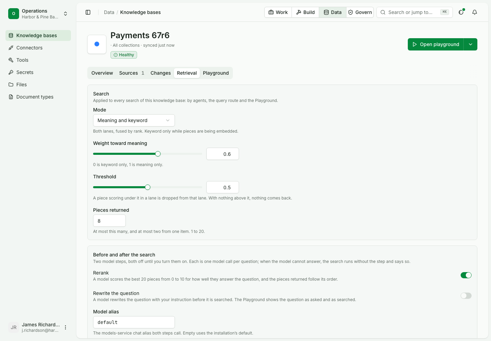
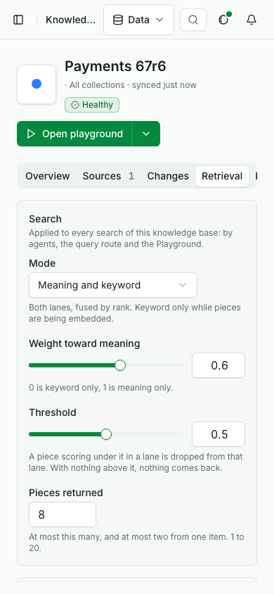
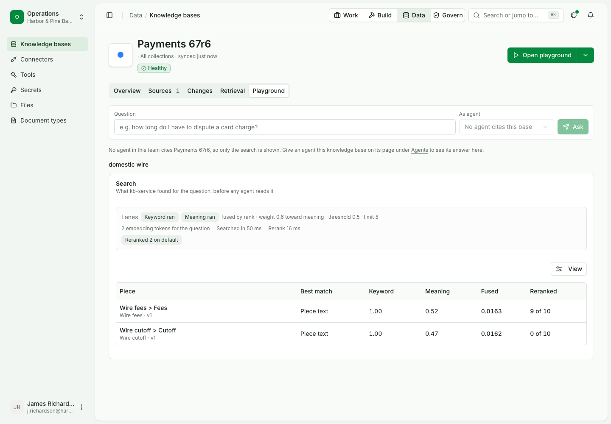
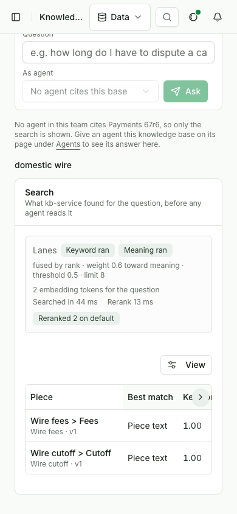

# Turn on rerank and query rewrite

Status: draft for review.

In this example we will turn on rerank for a payments knowledge base, then query rewrite, so a hard question finds the right passage and every search says what was done to it. It assumes a signed-in builder who owns the base and a base with two pages in it.

| Use case | |
|---|---|
| Id | `uc-677` |
| Area | Knowledge |
| Runs | Python, TypeScript; the CLI cannot set retrieval yet (see Gaps); console steps in their own script |
| Run it | `make usecase-test UC=uc-677` |

## Who is in it

| Person | Role | Signs in as |
|---|---|---|
| The payments knowledge owner | Builder | the `builder` profile |

The run gives each person a profile on a stack it starts for itself. Rerank and rewrite call a chat model; the run answers
their prompts from a scripted model, so no provider is called.

## Before you start

```python tab="Python" tab-group="language"
from ops_ai import OpsAI
from ops_ai.errors import BadRequest
import pytest

ops = OpsAI(profile="builder")
```

```ts tab="TypeScript"
import assert from 'node:assert/strict';
import { OpsAI } from '@chanl-ai/ops-ai';

const ops = new OpsAI({ profile: 'builder' });
```

```bash tab="CLI"
set -euo pipefail
export OPS_PROFILE=builder
```

## Steps

### 1. Search a base with both steps off

The owner writes two pages. A search for "domestic wire" returns passages and names neither step.

```python tab="Python" tab-group="language"
payments = ops.knowledge.add_base("Payments", owner="maya@harborpine.example")
ops.knowledge.add_page(payments["id"], "Wire cutoff", "## Cutoff\n\nA domestic wire sent after 5 pm goes out the next business day.")
ops.knowledge.add_page(payments["id"], "Wire fees", "## Fees\n\nAn outgoing domestic wire costs 25 dollars.")

plain = ops.knowledge.search({"kbIds": [payments["id"]], "question": "domestic wire"})
assert plain["passages"]
assert "rerank" not in plain and "rewrite" not in plain
```

```ts tab="TypeScript"
const payments = await ops.knowledge.addBase('Payments', { owner: 'maya@harborpine.example' });
await ops.knowledge.addPage(payments.id, 'Wire cutoff', '## Cutoff\n\nA domestic wire sent after 5 pm goes out the next business day.');
await ops.knowledge.addPage(payments.id, 'Wire fees', '## Fees\n\nAn outgoing domestic wire costs 25 dollars.');

const plain = (await ops.knowledge.search({ kbIds: [payments.id], question: 'domestic wire' })) as Record<string, any>;
assert.ok(plain.passages.length);
assert.ok(!('rerank' in plain) && !('rewrite' in plain));
```

```bash tab="CLI"
PAYMENTS=$(opsai kb create Payments --owner maya@harborpine.example --json | jq -r .id)
opsai kb add-text "$PAYMENTS" --title "Wire cutoff" --text $'## Cutoff\n\nA domestic wire sent after 5 pm goes out the next business day.' --json > /dev/null
opsai kb add-text "$PAYMENTS" --title "Wire fees" --text $'## Fees\n\nAn outgoing domestic wire costs 25 dollars.' --json > /dev/null
opsai kb search "$PAYMENTS" "domestic wire" --json | jq -e '(.passages | length) > 0 and (has("rerank") | not) and (has("rewrite") | not)'
```

Expected: passages, and no `rerank` or `rewrite` in the answer.

### 2. Turn rerank on

The owner turns rerank on with the model alias `default`. The same search now follows the model's 0 to 10 scores and says it reranked.

```python tab="Python" tab-group="language"
ops.raw.kb.knowledge_bases_update_knowledge_base(payments["id"], {"retrieval": {"rerank": True, "queryModel": "default"}})

ranked = ops.knowledge.search({"kbIds": [payments["id"]], "question": "domestic wire"})
assert ranked["rerank"]["ran"] is True
assert ranked["passages"][0]["title"] == "Wire fees" and ranked["passages"][0]["reranked"] == 9
assert ranked["passages"][-1]["reranked"] == 0
```

```ts tab="TypeScript"
await ops.raw.kb.knowledge_bases_update_knowledge_base({
  path: { kb_id: payments.id },
  body: { retrieval: { rerank: true, queryModel: 'default' } } as never,
});

const ranked = (await ops.knowledge.search({ kbIds: [payments.id], question: 'domestic wire' })) as Record<string, any>;
assert.equal(ranked.rerank.ran, true);
assert.deepEqual([ranked.passages[0].title, ranked.passages[0].reranked], ['Wire fees', 9]);
assert.equal(ranked.passages.at(-1).reranked, 0);
```

Expected: `rerank.ran`; Wire fees first, scored 9; the other page scored 0.

### 3. Turn rewrite on

The owner turns rerank off and rewrite on, with an instruction. A loosely worded question is rewritten before it searches, and the answer shows both forms.

```python tab="Python" tab-group="language"
ops.raw.kb.knowledge_bases_update_knowledge_base(
    payments["id"],
    {"retrieval": {"rerank": False, "rewrite": "rewrite", "rewriteInstructions": "Use the bank's payment terms."}},
)

asked = ops.raw.kb.knowledge_bases_query_knowledge_base(payments["id"], {"question": "how late can money leave"})
assert asked["rewrite"]["asked"] == "how late can money leave"
assert asked["rewrite"]["rewritten"] == "domestic wire cutoff"
assert asked["passages"][0]["title"] == "Wire cutoff"
```

```ts tab="TypeScript"
await ops.raw.kb.knowledge_bases_update_knowledge_base({
  path: { kb_id: payments.id },
  body: { retrieval: { rerank: false, rewrite: 'rewrite', rewriteInstructions: "Use the bank's payment terms." } } as never,
});

const asked = (await ops.raw.kb.knowledge_bases_query_knowledge_base({
  path: { kb_id: payments.id },
  body: { question: 'how late can money leave' } as never,
})) as Record<string, any>;
assert.equal(asked.rewrite.asked, 'how late can money leave');
assert.equal(asked.rewrite.rewritten, 'domestic wire cutoff');
assert.equal(asked.passages[0].title, 'Wire cutoff');
```

Expected: the question as asked and as searched, and the cutoff page first.

### 4. A rewrite mode that is not built is refused

```python tab="Python" tab-group="language"
with pytest.raises(BadRequest) as refused:
    ops.raw.kb.knowledge_bases_update_knowledge_base(payments["id"], {"retrieval": {"rewrite": "expand"}})
assert refused.value.code == "invalid_retrieval"
```

```ts tab="TypeScript"
await assert.rejects(
  ops.raw.kb.knowledge_bases_update_knowledge_base({ path: { kb_id: payments.id }, body: { retrieval: { rewrite: 'expand' } } as never }),
  { code: 'invalid_retrieval' },
);
```

Expected: refused with `invalid_retrieval`.

## Gaps

| Product fix | Step | The page expects | The product does |
|---|---|---|---|
| A retrieval setting on the command line | 2, 3, 4 | `opsai kb` turns rerank and rewrite on, as the Retrieval tab does | `opsai kb` has no verb that changes a base's retrieval settings (`sdk/python/src/ops_ai/_cli/kb.py:19`); the SDKs reach it only through `ops.raw.kb` |

## What proves it

> [!IMPORTANT]
> Step 2 fails if the agents' search ignores the model's scores: the first passage stays the fused order and
> `reranked` is missing. It was seen failing that way (`assert [2, 9] == [9, 2]`) with the reranked sort replaced by
> the fused order.

## In the console

The console steps run in their own script, since a browser cannot run the code above.

| # | Step | Expected |
|---|---|---|
| 1 | Knowledge, Payments, Retrieval tab: turn Rerank on, name alias `default`, save | One PATCH with `rerank: true` |
| 2 | Playground: ask "domestic wire" | The trace says Reranked 2 on default and shows a Reranked column with 9 of 10 first |







`OPS_USECASE_MEDIA=1 make usecase-test UC=uc-677 LAYER=ui` writes the pictures and the clip here. The script checks that the
clip is under 15 s and 2 MB.

## Details

| | |
|---|---|
| Services the run starts | knowledge, files and documents services, and a scripted chat model (models service on the fake OpenAI from `services/kb-service/tests/fixtures/rerank-and-rewrite-fake-openai`) |
| Console script | `docs/usecases/kb-service/scripts/test-uc-677-ui.mjs` |
| Replaces | `test-uc-677-sdk.py`, deleted; `test-uc-677-api.py` keeps the api layer |
