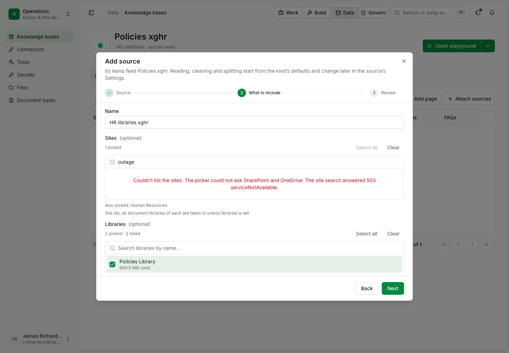
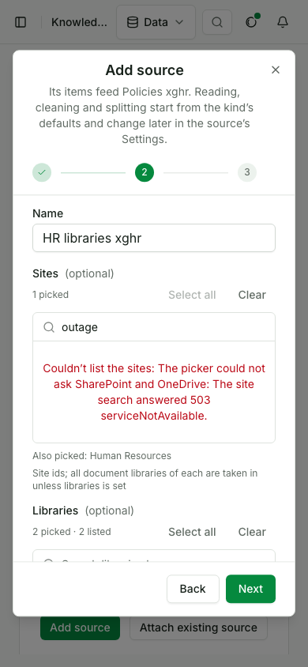
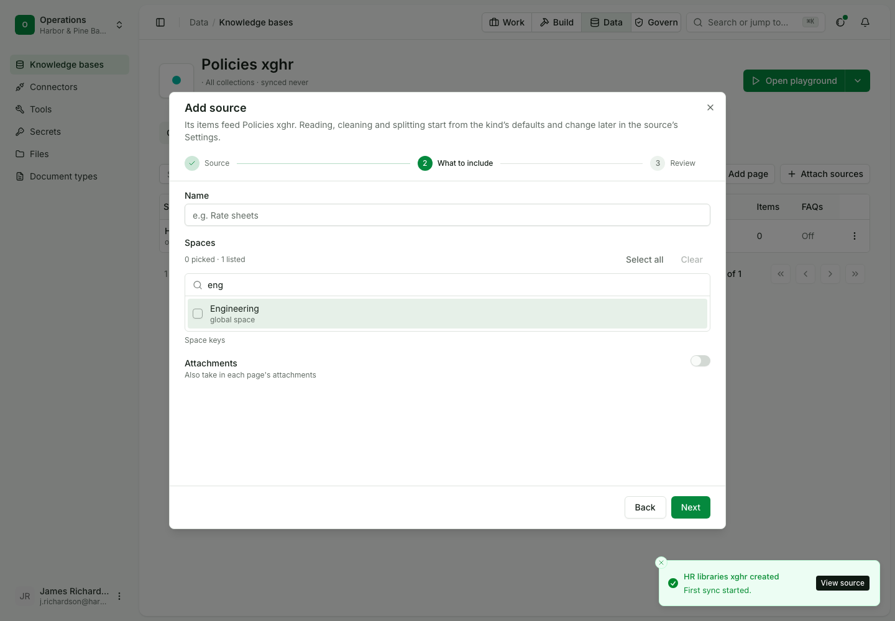
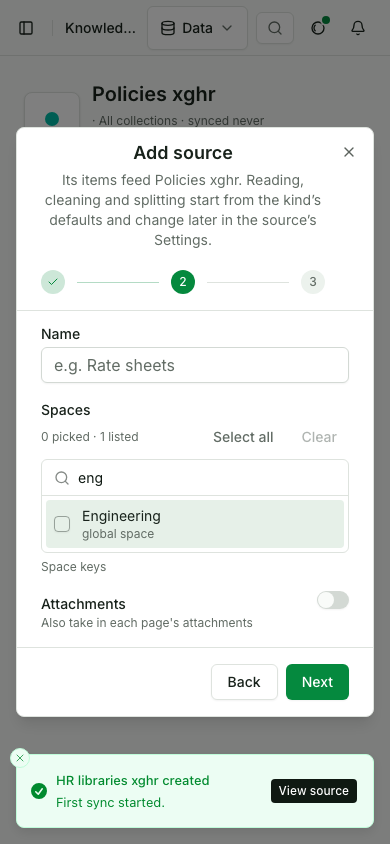

# Take in SharePoint libraries and Confluence spaces

Status: draft for review.

In this example we will pick a SharePoint site and its libraries and a Confluence space by searching for them, take their pages into a knowledge base, and search it, so every passage cites the file or page it came from. It assumes a signed-in builder and a team whose admin has already signed SharePoint and Confluence in under Apps.

| Use case | |
|---|---|
| Id | `uc-678` |
| Area | Knowledge |
| Runs | Python, TypeScript, CLI; console steps in their own script |
| Run it | `make usecase-test UC=uc-678` |

## Who is in it

| Person | Role | Signs in as |
|---|---|---|
| The HR knowledge owner | Builder | the `builder` profile |

The run starts the team's two outside systems as fakes, signs both apps in the way the team admin does, and gives the
builder a profile. No model is called.

## Before you start

```python tab="Python" tab-group="language"
from ops_ai import OpsAI
from ops_ai.errors import OpsError
import pytest

ops = OpsAI(profile="builder")
SHAREPOINT = {"plugin": "opsai.sharepoint", "source": "files"}
CONFLUENCE = {"plugin": "opsai.confluence", "source": "spaces"}
```

```ts tab="TypeScript"
import assert from 'node:assert/strict';
import { OpsAI } from '@chanl-ai/ops-ai';

const ops = new OpsAI({ profile: 'builder' });
const SHAREPOINT = { plugin: 'opsai.sharepoint', source: 'files' };
const CONFLUENCE = { plugin: 'opsai.confluence', source: 'spaces' };
```

```bash tab="CLI"
set -euo pipefail
export OPS_PROFILE=builder
SHAREPOINT=(--plugin opsai.sharepoint --source files)
CONFLUENCE=(--plugin opsai.confluence --source spaces)
```

## Steps

### 1. Search for a site, then list its libraries

The owner types "human" into the sites picker and gets the Human Resources site. Picking it lists its two libraries.

```python tab="Python" tab-group="language"
sites = ops.raw.kb.sources_source_scopes({**SHAREPOINT, "query": "human"})
assert [s["title"] for s in sites["scopes"]] == ["Human Resources"]
site = sites["scopes"][0]["id"]

libraries = ops.raw.kb.sources_source_scopes({**SHAREPOINT, "parent": site})
assert len(libraries["scopes"]) == 2
assert all(s["kind"] == "library" and s["parent"] == site for s in libraries["scopes"])
```

```ts tab="TypeScript"
const sites = (await ops.raw.kb.sources_source_scopes({ body: { ...SHAREPOINT, query: 'human' } as never })) as any;
assert.deepEqual(sites.scopes.map((s: any) => s.title), ['Human Resources']);
const site: string = sites.scopes[0].id;

const libraries = (await ops.raw.kb.sources_source_scopes({ body: { ...SHAREPOINT, parent: site } as never })) as any;
assert.equal(libraries.scopes.length, 2);
assert.ok(libraries.scopes.every((s: any) => s.kind === 'library' && s.parent === site));
```

```bash tab="CLI"
SITE=$(opsai kb scopes "${SHAREPOINT[@]}" --query human --json | jq -er 'if map(.title) == ["Human Resources"] then .[0].id else error("sites") end')
LIBRARIES=$(opsai kb scopes "${SHAREPOINT[@]}" --parent "$SITE" --json)
echo "$LIBRARIES" | jq -e --arg site "$SITE" 'length == 2 and all(.[]; .kind == "library" and .parent == $site)'
```

Expected: one site, then its two libraries, each under the site.

### 2. A search that finds nothing, and one SharePoint refuses

A search nothing matches answers an empty list. When SharePoint is unavailable the answer is an error that says so.

```python tab="Python" tab-group="language"
assert ops.raw.kb.sources_source_scopes({**SHAREPOINT, "query": "zebra"})["scopes"] == []

with pytest.raises(OpsError) as down:
    ops.raw.kb.sources_source_scopes({**SHAREPOINT, "query": "outage"})
assert down.value.code == "scopes_failed" and "503" in str(down.value)
```

```ts tab="TypeScript"
const none = (await ops.raw.kb.sources_source_scopes({ body: { ...SHAREPOINT, query: 'zebra' } as never })) as any;
assert.deepEqual(none.scopes, []);

await assert.rejects(ops.raw.kb.sources_source_scopes({ body: { ...SHAREPOINT, query: 'outage' } as never }), (e: any) => {
  assert.equal(e.code, 'scopes_failed');
  assert.match(String(e.message), /503/);
  return true;
});
```

```bash tab="CLI"
opsai kb scopes "${SHAREPOINT[@]}" --query zebra --json | jq -e '. == []'
if opsai kb scopes "${SHAREPOINT[@]}" --query outage --json 2> down.txt; then exit 1; fi
grep -q scopes_failed down.txt && grep -q 503 down.txt
```

Expected: an empty list; then `scopes_failed` naming SharePoint's 503.

### 3. Take in the picked libraries and search them

The owner makes a source on the site and both libraries and syncs it. The text files are indexed, and a search cites the file by its address in the library.

```python tab="Python" tab-group="language"
policies = ops.knowledge.add_base("Policies and runbooks", owner="maya@harborpine.example")
files = ops.knowledge.add_source(
    "HR libraries",
    [policies["id"]],
    type="tool",
    config={**{"plugin": "opsai.sharepoint", "source": "files"}, "values": {"sites": [site], "libraries": [s["id"] for s in libraries["scopes"]]}},
)
assert ops.raw.kb.sources_sync_source(files["id"], {"full": False})["status"] == "success"

taken = {i["title"]: i["status"] for i in ops.raw.kb.sources_list_items(files["id"], page_size=100)["data"]}
assert taken["leave.md"] == "indexed" and taken["expenses.txt"] == "indexed"

found = ops.knowledge.search({"kbIds": [policies["id"]], "question": "leave days a year"})
assert any("Twenty days" in p["text"] and "leave.md" in str(p.get("url") or p.get("title")) for p in found["passages"])
```

```ts tab="TypeScript"
const policies = await ops.knowledge.addBase('Policies and runbooks', { owner: 'maya@harborpine.example' });
const files = await ops.knowledge.addSource('HR libraries', [policies.id], {
  type: 'tool',
  config: { ...SHAREPOINT, values: { sites: [site], libraries: libraries.scopes.map((s: any) => s.id) } },
} as never);
assert.equal(((await ops.raw.kb.sources_sync_source({ path: { source_id: files.id }, body: { full: false } as never })) as any).status, 'success');

const rows = ((await ops.raw.kb.sources_list_items({ path: { source_id: files.id }, query: { pageSize: 100 } })) as any).data;
const taken = Object.fromEntries(rows.map((r: any) => [r.title, r.status]));
assert.equal(taken['leave.md'], 'indexed');
assert.equal(taken['expenses.txt'], 'indexed');

const found = (await ops.knowledge.search({ kbIds: [policies.id], question: 'leave days a year' })) as any;
assert.ok(found.passages.some((p: any) => p.text.includes('Twenty days') && String(p.url ?? p.title).includes('leave.md')));
```

```bash tab="CLI"
POLICIES=$(opsai kb create "Policies and runbooks" --owner maya@harborpine.example --json | jq -r .id)
PICKED=$(echo "$LIBRARIES" | jq -r 'map(.id) | join(",")')
FILES=$(opsai kb add-source "HR libraries" --kb "$POLICIES" "${SHAREPOINT[@]}" --value "sites=$SITE" --value "libraries=$PICKED" --json | jq -r .id)
opsai kb sync "$FILES" --json | jq -e '.status == "success"'

opsai kb items "$FILES" --json | jq -e 'map({(.title): .status}) | add | .["leave.md"] == "indexed" and .["expenses.txt"] == "indexed"'
opsai kb search "$POLICIES" "leave days a year" --json \
  | jq -e 'any(.passages[]; (.text | contains("Twenty days")) and ((.url // .title) | contains("leave.md")))'
```

Expected: the sync succeeds; `leave.md` and `expenses.txt` are indexed; the passage quotes the file and cites its address.

### 4. Pick a Confluence space and search its pages

```python tab="Python" tab-group="language"
spaces = ops.raw.kb.sources_source_scopes({**CONFLUENCE, "query": "eng"})
assert [(s["id"], s["title"]) for s in spaces["scopes"]] == [("ENG", "Engineering")]

wiki = ops.knowledge.add_source("Engineering space", [policies["id"]], type="tool", config={**CONFLUENCE, "values": {"spaces": ["ENG"]}})
assert ops.raw.kb.sources_sync_source(wiki["id"], {"full": False})["status"] == "success"

deploy = ops.knowledge.search({"kbIds": [policies["id"]], "question": "deploy pipeline"})
assert any("pipeline" in p["text"] and p["title"] for p in deploy["passages"])
```

```ts tab="TypeScript"
const spaces = (await ops.raw.kb.sources_source_scopes({ body: { ...CONFLUENCE, query: 'eng' } as never })) as any;
assert.deepEqual(spaces.scopes.map((s: any) => [s.id, s.title]), [['ENG', 'Engineering']]);

const wiki = await ops.knowledge.addSource('Engineering space', [policies.id], { type: 'tool', config: { ...CONFLUENCE, values: { spaces: ['ENG'] } } } as never);
assert.equal(((await ops.raw.kb.sources_sync_source({ path: { source_id: wiki.id }, body: { full: false } as never })) as any).status, 'success');

const deploy = (await ops.knowledge.search({ kbIds: [policies.id], question: 'deploy pipeline' })) as any;
assert.ok(deploy.passages.some((p: any) => p.text.includes('pipeline') && p.title));
```

```bash tab="CLI"
opsai kb scopes "${CONFLUENCE[@]}" --query eng --json | jq -e 'map([.id, .title]) == [["ENG", "Engineering"]]'
WIKI=$(opsai kb add-source "Engineering space" --kb "$POLICIES" "${CONFLUENCE[@]}" --value spaces=ENG --json | jq -r .id)
opsai kb sync "$WIKI" --json | jq -e '.status == "success"'
opsai kb search "$POLICIES" "deploy pipeline" --json | jq -e 'any(.passages[]; (.text | contains("pipeline")) and .title)'
```

Expected: Engineering alone is offered; its pages are indexed; the passage names its page.

## What stays outside this page

Changing a file at SharePoint and a page at Confluence, and what a delta sync then fetches, is the outside system's side
and cannot be done from a developer's profile. Those checks (only the changed file is downloaded again, a deleted file
leaves search, who may read each file is stored, PDF and Word files are read, an agent cites both) stay in
`docs/usecases/kb-service/scripts/test-uc-678-api.py`, which keeps the api layer.

## What proves it

> [!IMPORTANT]
> Step 3 fails if the first sync does not index the picked libraries' files, or if search stops citing the file by its
> address. The api script's second-sync check fails when a second file is edited, listing both downloads.

## In the console

The console steps run in their own script, since a browser cannot run the code above.

| # | Step | Expected |
|---|---|---|
| 1 | Knowledge, a new base, Add source, SharePoint and OneDrive; type "human" in the sites picker | Human Resources alone is listed |
| 2 | Select all on sites, then on libraries | The site is picked; the libraries picker lists Policies Library and Handbook and both are picked |
| 3 | A search nothing matches, then one SharePoint refuses | "No site called ..."; "Couldn't list the sites: ..." with the reason |
| 4 | Create and sync | The source is made on the site and both libraries and indexes the text files |
| 5 | Add source, Confluence; type "eng" in the spaces picker | Engineering alone is listed |







`OPS_USECASE_MEDIA=1 make usecase-test UC=uc-678 LAYER=ui` writes the pictures and the clip here. The script checks that the
clip is under 15 s and 2 MB.

## Details

| | |
|---|---|
| Services the run starts | knowledge, files and documents services, tools service with the SharePoint and Confluence plugins (`OPS_PLUGINS_REPO`, else `ops-ai-plugins` beside this checkout) against the fakes in `docs/usecases/lib/fake_sharepoint_confluence.py`; no model is called |
| Console script | `docs/usecases/kb-service/scripts/test-uc-678-ui.mjs` |
| Replaces | `test-uc-678-sdk.py`, deleted; `test-uc-678-api.py` keeps the api layer |
