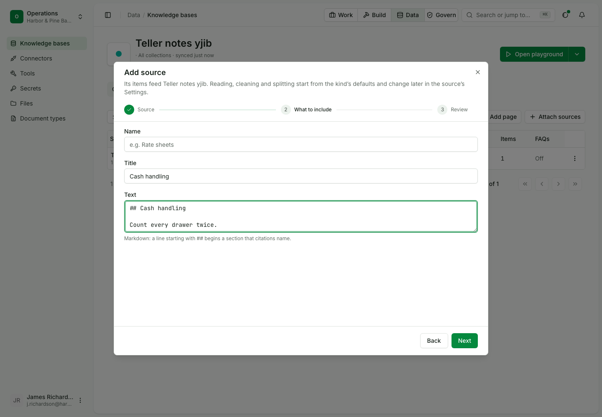
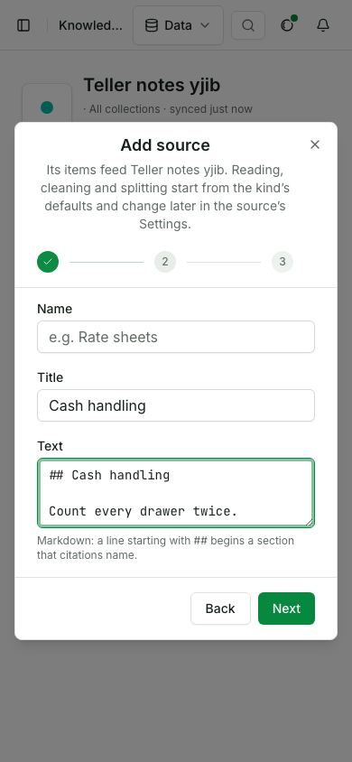
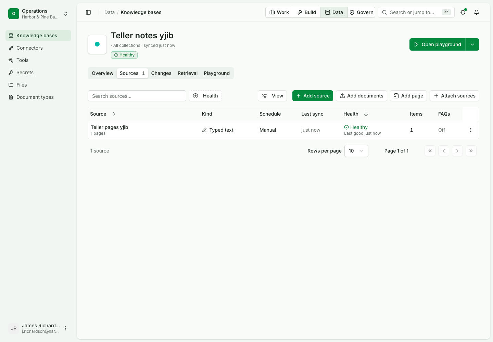
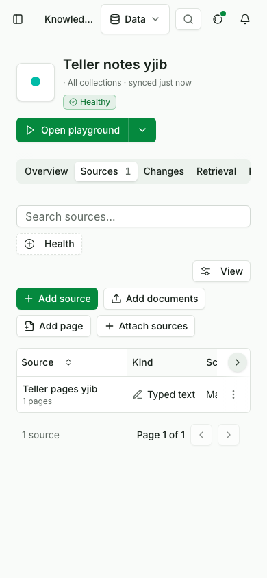

# Push knowledge from another system

Status: draft for review.

In this example we will make a knowledge base for an insurer's claims handbook, write a page into it, have the policy system push its product sheets into it, and search it, so every passage names the page and version it came from. It assumes a signed-in builder in the team and nothing else: the knowledge base starts empty.

| Use case | |
|---|---|
| Id | `uc-676` |
| Area | Knowledge |
| Runs | Python, TypeScript, CLI; console steps in their own script |
| Run it | `make usecase-test UC=uc-676` |

## Who is in it

| Person | Role | Signs in as |
|---|---|---|
| The claims knowledge owner | Builder | the `builder` profile |

The run gives each person a profile on a stack it starts for itself, so the code below is the code you run against
your own deployment once your profile points at it.

## Before you start

```python tab="Python" tab-group="language"
from ops_ai import OpsAI
from ops_ai.errors import BadRequest
import pytest

ops = OpsAI(profile="builder")
```

```ts tab="TypeScript"
import assert from 'node:assert/strict';
import { OpsAI } from '@chanl-ai/ops-ai';

const ops = new OpsAI({ profile: 'builder' });
```

```bash tab="CLI"
set -euo pipefail
export OPS_PROFILE=builder
```

## Steps

### 1. Create a knowledge base

The knowledge owner makes an empty base for the handbook.

```python tab="Python" tab-group="language"
handbook = ops.knowledge.add_base("Claims handbook")
assert handbook["name"] == "Claims handbook"
```

```ts tab="TypeScript"
const handbook = await ops.knowledge.addBase('Claims handbook');
assert.equal(handbook.name, 'Claims handbook');
```

```bash tab="CLI"
HANDBOOK=$(opsai kb create "Claims handbook" --json | jq -r .id)
```

Expected: a knowledge base with no sources and no pages.

### 2. Write a page and find it by meaning

The owner writes the water damage rule as a page. A search that does not use the page's words still finds it.

```python tab="Python" tab-group="language"
page = ops.knowledge.add_page(handbook["id"], "Water damage", "Report a burst pipe within 14 days.")
assert page["outcome"] == "created"

found = ops.knowledge.search({"kbIds": [handbook["id"]], "question": "How long do I have to claim for a leak?"})
assert found["passages"][0]["title"] == "Water damage"
assert found["passages"][0]["version"] == 1
```

```ts tab="TypeScript"
const page = await ops.knowledge.addPage(handbook.id, 'Water damage', 'Report a burst pipe within 14 days.');
assert.equal(page.outcome, 'created');

const found = await ops.knowledge.search({ kbIds: [handbook.id], question: 'How long do I have to claim for a leak?' });
assert.equal(found.passages[0].title, 'Water damage');
assert.equal(found.passages[0].version, 1);
```

```bash tab="CLI"
opsai kb add-text "$HANDBOOK" --title "Water damage" --text "Report a burst pipe within 14 days." --json \
  | jq -e '.outcome == "created"'
opsai kb search "$HANDBOOK" "How long do I have to claim for a leak?" --json \
  | jq -e '.passages[0].title == "Water damage" and .passages[0].version == 1'
```

Expected: the page is created and indexed at once; the first passage is the page, at version 1.

### 3. The policy system pushes the same item twice

A push source takes items by name. Sending an item it already holds changes nothing, so the other system can resend
on every run without making duplicates.

```python tab="Python" tab-group="language"
feed = ops.knowledge.add_source("Policy system", [handbook["id"]])
sheet = {"title": "Home cover", "text": "Home cover pays for sudden leaks, not gradual seepage."}

assert ops.knowledge.push(feed["id"], "home-cover.md", **sheet)["outcome"] == "created"
assert ops.knowledge.push(feed["id"], "home-cover.md", **sheet)["outcome"] == "unchanged"
```

```ts tab="TypeScript"
const feed = await ops.knowledge.addSource('Policy system', [handbook.id]);
const sheet = { title: 'Home cover', text: 'Home cover pays for sudden leaks, not gradual seepage.' };

assert.equal((await ops.knowledge.push(feed.id, 'home-cover.md', sheet)).outcome, 'created');
assert.equal((await ops.knowledge.push(feed.id, 'home-cover.md', sheet)).outcome, 'unchanged');
```

```bash tab="CLI"
FEED=$(opsai kb add-source "Policy system" --kb "$HANDBOOK" --json | jq -r .id)
SHEET="Home cover pays for sudden leaks, not gradual seepage."

opsai kb push "$FEED" --name home-cover.md --title "Home cover" --text "$SHEET" --json | jq -e '.outcome == "created"'
opsai kb push "$FEED" --name home-cover.md --title "Home cover" --text "$SHEET" --json | jq -e '.outcome == "unchanged"'
```

Expected: `created`, then `unchanged`; no second sync runs.

### 4. New content under the same name is the next version

```python tab="Python" tab-group="language"
sheet["text"] = "Home cover pays for sudden leaks and for tracing the leak."
assert ops.knowledge.push(feed["id"], "home-cover.md", **sheet)["outcome"] == "updated"

found = ops.knowledge.search({"kbIds": [handbook["id"]], "question": "Does home cover pay to trace a leak?"})
assert "tracing the leak" in found["passages"][0]["text"]
assert found["passages"][0]["version"] == 2
```

```ts tab="TypeScript"
sheet.text = 'Home cover pays for sudden leaks and for tracing the leak.';
assert.equal((await ops.knowledge.push(feed.id, 'home-cover.md', sheet)).outcome, 'updated');

const again = await ops.knowledge.search({ kbIds: [handbook.id], question: 'Does home cover pay to trace a leak?' });
assert.match(again.passages[0].text, /tracing the leak/);
assert.equal(again.passages[0].version, 2);
```

```bash tab="CLI"
SHEET="Home cover pays for sudden leaks and for tracing the leak."
opsai kb push "$FEED" --name home-cover.md --title "Home cover" --text "$SHEET" --json | jq -e '.outcome == "updated"'
opsai kb search "$HANDBOOK" "Does home cover pay to trace a leak?" --json \
  | jq -e '(.passages[0].text | contains("tracing the leak")) and .passages[0].version == 2'
```

Expected: `updated`; the passage quotes the new text, at version 2, and the old text is no longer returned.

### 5. A source fed from Files refuses a pushed item

A file source is filled by uploads, so a pushed item is refused instead of mixing two ways in.

```python tab="Python" tab-group="language"
uploads = ops.knowledge.add_source("Uploads", [handbook["id"]], type="file")

with pytest.raises(BadRequest) as refused:
    ops.knowledge.push(uploads["id"], "stray.md", title="Stray", text="Should not land.")
assert refused.value.code == "source_not_written"
```

```ts tab="TypeScript"
const uploads = await ops.knowledge.addSource('Uploads', [handbook.id], { type: 'file' });

await assert.rejects(ops.knowledge.push(uploads.id, 'stray.md', { title: 'Stray', text: 'Should not land.' }), {
  code: 'source_not_written',
});
```

```bash tab="CLI"
UPLOADS=$(opsai kb add-source Uploads --kb "$HANDBOOK" --type file --json | jq -r .id)

if refused=$(opsai kb push "$UPLOADS" --name stray.md --title Stray --text "Should not land." 2>&1); then exit 1; fi
grep -q '^source_not_written:' <<<"$refused"
```

Expected: refused with `source_not_written`; the base still holds two items.

## Gaps

No product gap is open for this page's steps: the named knowledge calls, `opsai kb create`, `add-source` and `push`, and the
TypeScript SDK's saved profile are in the SDKs. What still blocks the page as the test is the runner: nothing yet
extracts these tabs and runs them (`make usecase-extract`), so the registry keeps running the scripts named under Details.

## What proves it

> [!IMPORTANT]
> Step 3 fails if pushing an item the base already holds starts a sync: the second push answers `updated` and the
> run count moves. It was seen failing that way with the unchanged check removed from the route.

## In the console

The console steps run in their own script, since a browser cannot run the code above.

| # | Step | Expected |
|---|---|---|
| 1 | Knowledge, Claims handbook, Add source, Typed text | Step 2 shows a title and a text field; Review shows no schedule |
| 2 | Create and sync | The source is created and the page is written into it, indexed |
| 3 | Sources tab | The typed source is listed with one item |
| 4 | Search the base for the typed text | The passage holds it |







The pictures and the clip are made by the console script: `OPS_USECASE_MEDIA=1 make usecase-test UC=uc-676 LAYER=ui`
writes them here, and a normal run keeps them in the evidence folder. The script checks that the clip is under 15 s
and 2 MB.

## Details

| | |
|---|---|
| Services the run starts | knowledge, files and documents services; no model is called (search uses the scripted embedding) |
| Console script | `docs/usecases/kb-service/scripts/test-uc-676-ui.mjs`; it moves to `docs/usecases/knowledge/scripts/` when this page converts |
| Replaces | `test-uc-676-api.py` and `test-uc-676-sdk.py`, deleted when this page passes |
